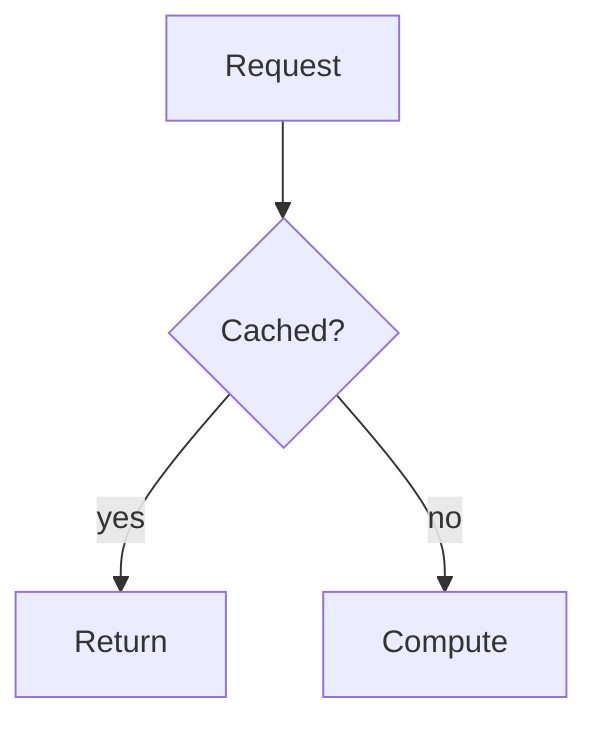

# DSA & System Design

A pattern-driven reference for Data Structures & Algorithms, System
Design, and AI/ML Systems. Every DSA problem is taught from brute-force
reasoning to the optimal C++ solution, with the complexity analysis that
explains why. System Design is split into Fundamentals, Low-Level Design,
High-Level Design, and AI/ML Systems, with a C++ Toolkit reference for the
language features the solutions use.

Live: <https://dsa.anindyadey.com>

## Stack

- Next.js 16 (App Router, Turbopack) + React 19 + TypeScript
- Tailwind CSS v4
- MDX via `next-mdx-remote`, highlighted with Shiki
- Mermaid diagrams rendered client-side from fenced `mermaid` code blocks
- pnpm as the package manager

## Getting started

Requires Node 24+ and pnpm.

```bash
pnpm install
pnpm dev
```

Open <http://localhost:3000>.

## Scripts

| Script | Purpose |
| --- | --- |
| `pnpm dev` | Start the dev server |
| `pnpm build` | Production build |
| `pnpm start` | Serve the production build |
| `pnpm lint` | ESLint |
| `pnpm typecheck` | TypeScript, no emit |
| `pnpm check:content` | Validate the catalog ↔ content mapping |
| `pnpm validate` | lint + typecheck + content check + build |

## Project structure

```
app/                    Routes (App Router)
  dsa/                  DSA roadmap, patterns, problems, cheat sheet
  system-design/        Roadmap + [track]/[slug] topic pages
  cpp/                  C++ Toolkit reference
  opengraph-image.tsx   Generated social preview image
  sitemap.ts            Sitemap (published content only)
components/             Presentational components
content/                MDX content (the source of truth for pages)
  dsa/patterns/<slug>/index.mdx
  dsa/patterns/<slug>/problems/<problem>.mdx
  system-design/<track>/<slug>/index.mdx
  cpp/<slug>.mdx
lib/
  catalog/              Typed catalog: every pattern/topic/entry + roadmap metadata
  content/              Filesystem-backed content loaders
  mdx.tsx               MDX compilation pipeline
  search.ts             Static search-index builder
docs/                   Requirements and planning docs
```

## The roadmaps

### DSA — four phases (29 patterns, 108 problems)

1. **Core Mechanics & Complexity Foundations** — complexity analysis, linear
   and hash-based structures, recursion, sorting, bit manipulation.
2. **Fundamental Algorithmic Patterns** — two pointers, sliding window,
   monotonic structures, binary search, divide & conquer, prefix sums,
   intervals, matrices, stacks, linked-list surgery.
3. **Trees, Heaps, and Graphs** — binary trees and BSTs, heaps/priority
   queues, tries, BFS/DFS, topological sort, DSU, shortest paths, MSTs, SCCs.
4. **Advanced Algorithms & Specialized Structures** — backtracking,
   dynamic programming, greedy, string algorithms, range-query structures,
   number theory, design-from-scratch data structures.

### System Design — four tracks

- **Fundamentals** (36 topics) — grouped into Scalability & Performance,
  Data & Storage, Communication & APIs, Distributed Systems, Reliability &
  Operations, and Security.
- **Low-Level Design** (21 topics) — classic OOP modeling problems:
  parking lot, elevator, chess, caches, schedulers, ledgers, undo/redo.
- **High-Level Design** (33 topics) — split into Infrastructure Components
  (load balancers, CDNs, message queues, storage) and Product Case Studies
  (URL shortener, chat, feeds, payments, maps, exchanges).
- **AI/ML Systems** (68 topics) — the systems side of ML (engineering, not
  theory): the learning problem, data, serving state, evaluation and
  operations, serving and inference, GenAI/LLM systems, MLOps and platform,
  case studies, and code-level designs.

### C++ Toolkit (14 entries)

Reference pages for the containers, algorithms, and idioms the DSA solutions
use (`std::vector`, `priority_queue`, `unordered_map`, `lower_bound`,
iterator invalidation, and more): what each does, what it costs, and the
gotchas. Linked from the pattern overviews via "Related C++ tools" sections.

The catalog is calibrated to carry a candidate from junior through
lead-level interviews, with enough depth (consensus, multi-region,
reliability engineering, concurrency, migrations, multi-tenancy) for
principal-level breadth, and the AI/ML track for the GenAI era.

## Authoring content

The catalog in `lib/catalog/` defines the full roadmap, including topics
that have no content yet. Any catalog entry without a matching content file
renders a "coming soon" placeholder (never a 404), and those placeholders
are excluded from the sitemap and marked `noindex`.

To publish a topic, create the corresponding MDX file with frontmatter:

```mdx
---
title: "Two Pointers"
summary: "One-line summary shown in listings and metadata."
---
```

Write plainly: second person, short sentences, one idea per sentence. Lead
with a plain-language definition and a concrete example before the
mechanics. Prefer prose over bullet dumps, keep em-dashes to a minimum, and
finish with what can go wrong. The published `two-pointers` pattern and
`caching` topic are the reference exemplars for their templates.

Diagrams are authored as code and rendered automatically:

````mdx

````

Run `pnpm check:content` (or `pnpm validate`) to confirm slugs are unique,
content maps to the catalog, and frontmatter is well-formed.

## Deployment

Deployed on Vercel. The site is statically prerendered; old flat
`/system-design/<topic>` URLs 301-redirect to their track URL via
`next.config.ts`.

## Documentation

- `docs/brainstorms/` — product requirements and delivery sequencing.
