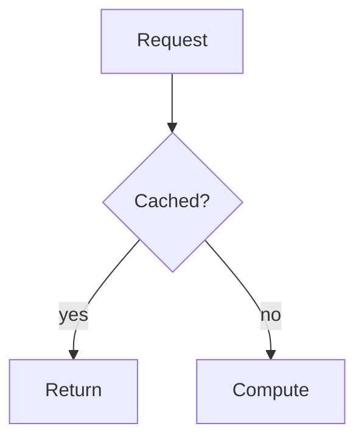

# DSA, System Design & AI/ML

A pattern-driven reference with four verticals:

- **DSA**: every problem is taught from brute-force reasoning to the optimal
  C++ solution, with the complexity analysis that explains why.
- **System Design**: Fundamentals, Low-Level Design, and High-Level Design.
- **AI/ML**: how models work (Concepts) and the engineering that ships them
  (Systems).
- **C++ Toolkit**: reference pages for the language features the solutions
  use, linked from every page that uses them.

Every topic carries a Foundational, Intermediate, or Advanced tier.

Live: <https://dsa.anindyadey.com>

## Stack

- Next.js 16 (App Router, Turbopack) + React 19 + TypeScript
- Tailwind CSS v4
- MDX via `next-mdx-remote`, highlighted with Shiki
- Mermaid diagrams rendered client-side from fenced `mermaid` code blocks
- pnpm as the package manager

## Getting started

Requires Node 24+ and pnpm.

```bash
pnpm install
pnpm dev
```

Open <http://localhost:3000>.

## Scripts

| Script | Purpose |
| --- | --- |
| `pnpm dev` | Start the dev server |
| `pnpm build` | Production build |
| `pnpm start` | Serve the production build |
| `pnpm lint` | ESLint |
| `pnpm typecheck` | TypeScript, no emit |
| `pnpm check:content` | Catalog ↔ content mapping, titles, tiers, internal links, Mermaid labels, house style |
| `pnpm check:cpp` | Compile the C++ on every DSA problem page (needs clang++ or g++; set `CXX` to choose) |
| `pnpm validate` | lint + typecheck + content check + C++ check + build |

## Project structure

```
app/                    Routes (App Router)
  dsa/                  DSA roadmap, patterns, problems, cheat sheet
  system-design/        Roadmap + [track]/[slug] topic pages
  ai-ml/                Roadmap + [track]/[slug] topic pages (concepts, systems)
  cpp/                  C++ Toolkit reference
  opengraph-image.tsx   Generated social preview image
  sitemap.ts            Sitemap (published content only)
components/             Presentational components
content/                MDX content (the source of truth for pages)
  dsa/patterns/<slug>/index.mdx
  dsa/patterns/<slug>/problems/<problem>.mdx
  system-design/<track>/<slug>/index.mdx
  ai-ml/<track>/<slug>/index.mdx
  cpp/<slug>.mdx
lib/
  catalog/              Typed catalog: every pattern/topic/entry + roadmap metadata
    tiers.ts            Foundational / Intermediate / Advanced per slug
  content/              Filesystem-backed content loaders
  mdx.tsx               MDX compilation pipeline
  search.ts             Static search-index builder
scripts/                check-content.mjs, check-cpp.mjs
docs/                   Requirements and planning docs
```

## The roadmaps

### DSA: four phases (29 patterns, 125 problems)

1. **Core Mechanics & Complexity Foundations**: complexity analysis, linear
   and hash-based structures, recursion, sorting and selection, bit
   manipulation.
2. **Fundamental Algorithmic Patterns**: two pointers, sliding window,
   monotonic structures, binary search, divide & conquer, prefix sums,
   intervals, matrices, stacks, linked-list surgery.
3. **Trees, Heaps, and Graphs**: binary trees and BSTs, heaps/priority
   queues, tries, BFS/DFS, topological sort, DSU, shortest paths, MSTs,
   bridges.
4. **Advanced Algorithms & Specialized Structures**: backtracking,
   dynamic programming, greedy, string algorithms, range-query structures,
   number theory, design-from-scratch data structures.

The [cheat sheet](https://dsa.anindyadey.com/dsa/cheat-sheet) maps problem
clues to all 29 patterns. Problems link to LeetCode where an equivalent
exists.

### System Design: three tracks (97 topics)

- **Fundamentals** (43 topics): Scalability & Performance, Data & Storage
  (including replication, partitioning, and probabilistic data
  structures), Communication & APIs, Distributed Systems, Reliability &
  Operations, Security, and Platform Engineering.
- **Low-Level Design** (21 topics): classic object-modeling problems such
  as parking lot, elevator, chess, caches, schedulers, ledgers, undo/redo.
- **High-Level Design** (33 topics): Infrastructure Components (load
  balancers, CDNs, message queues, storage) and Product Case Studies (URL
  shortener, chat, feeds, payments, maps, exchanges).

### AI/ML: two tracks (106 topics)

- **Concepts** (39 topics): how models work, in plain language and
  diagrams rather than derivations. Foundations of learning, classical
  models, neural networks, architectures (CNNs, RNNs, transformers,
  diffusion, MoE), NLP, vision, speech and multimodal, RL and safety.
- **Systems** (67 topics): the engineering side. The learning problem,
  data, serving state, evaluation and operations, serving and inference,
  GenAI/LLM systems, MLOps and platform, case studies, and code-level
  designs.

### C++ Toolkit (18 entries)

Reference pages for the containers, algorithms, and idioms the solutions
use: `std::vector`, `priority_queue`, `unordered_map`, `lower_bound`,
custom comparators, integer overflow, bit operations, smart pointers,
iterator invalidation, and more. Each covers what it does, what it costs,
and the gotchas. DSA problems, pattern overviews, and low-level designs
link to the entries they use in a "Related C++ tools" section.

The catalog is calibrated to carry a candidate from junior through
lead-level interviews, with enough depth (consensus, multi-region,
reliability engineering, concurrency, migrations, multi-tenancy) for
principal-level breadth.

## Authoring content

The catalog in `lib/catalog/` defines the full roadmap, including topics
that have no content yet. Any catalog entry without a matching content file
renders a "coming soon" placeholder (never a 404), and those placeholders
are excluded from the sitemap and marked `noindex`.

To publish a topic, create the corresponding MDX file with frontmatter:

```mdx
---
title: "Two Pointers"
summary: "One-line summary shown in listings and metadata."
---
```

Write plainly: second person, short sentences, one idea per sentence. Lead
with a plain-language definition and a concrete example before the
mechanics. Prefer prose over bullet dumps, use no em-dashes (the content
check enforces this), and finish with what can go wrong. In Mermaid, quote
any node label that contains parentheses: `A["label (note)"]`. The published `two-pointers` pattern and
`caching` topic are the reference exemplars for their templates.

Diagrams are authored as code and rendered automatically:

````mdx

````

Run `pnpm check:content` (or `pnpm validate`) to confirm slugs are unique,
content maps to the catalog, titles and tiers are in sync, every internal
link resolves, and frontmatter is well-formed. Run `pnpm check:cpp` after
editing any DSA solution.

## Deployment

Deployed on Vercel. The site is statically prerendered. `next.config.ts`
keeps old URLs working with permanent redirects: flat
`/system-design/<topic>` URLs, the former `/system-design/ai-ml/<topic>`
pages (now `/ai-ml/systems/<topic>`), and pages that moved or merged during
content reviews.

## Documentation

- `docs/brainstorms/`: product requirements and delivery sequencing.
- `docs/plans/`: per-vertical plans and the content batch log, including
  the house rules every article follows.
