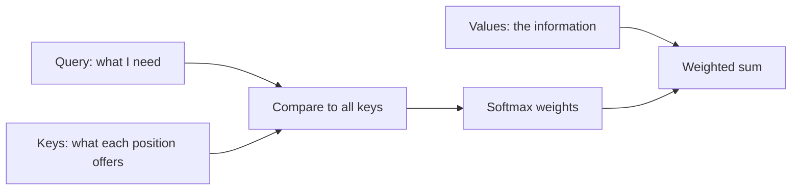

Attention is the single most important idea in modern AI. It answers a
problem that plagued
[recurrent networks](/ai-ml/concepts/recurrent-neural-networks): when
processing one part of a sequence, the model needs to *refer back* to
relevant earlier parts, but a fixed hidden state cannot hold
everything. Attention lets the model, at each step, **look at all the
other positions and weight them by relevance** — dynamically deciding
what to pay attention to. It removed the bottleneck that limited
sequence models, and it is the mechanism that
[transformers](/ai-ml/concepts/transformers) — and therefore
[large language models](/ai-ml/concepts/language-models-and-scaling) —
are built from.

## The intuition

Read the sentence "The animal did not cross the street because **it**
was too tired." To resolve what "it" refers to, you *attend* to
"animal" more than "street". Attention is exactly this: for each
position, compute a *relevance score* against every other position,
and take a weighted combination of their information. The weights are
*learned* — the model discovers, from data, what to attend to — and
they are **content-based** (depend on the actual tokens, not their
distance), which is what lets attention connect distant parts of a
sequence directly.

## The query-key-value framing

The standard formulation (which sounds more abstract than it is):

- Each position produces a **query** ("what am I looking for?"), a
  **key** ("what do I offer?"), and a **value** ("what information do
  I carry?").
- For a given query, compute its similarity (dot product) against
  every key — the **attention scores** (how relevant each position
  is).
- Normalize the scores (softmax) into weights that sum to 1.
- Take the weighted sum of the **values** — the output is a blend of
  the most relevant positions' information.

Think of it as a **soft, differentiable lookup**: instead of
retrieving one matching item, retrieve a *weighted blend* of
everything, weighted by relevance. That differentiability is the key —
it means attention is *learned* by [backpropagation](/ai-ml/concepts/backpropagation)
like any other operation, with no hard retrieval decisions.

## Why it is revolutionary

- **It connects any two positions in one step** (unlike an RNN, where
  information must propagate step by step), which solves long-range
  dependencies directly.
- **It is parallelizable** (all positions' attention can be computed
  at once, unlike the sequential RNN — this is what let models train
  on huge data and hardware).
- **It is a general mechanism** (attention works over any set of
  items — words, image patches, audio frames — which is why the same
  architecture spans text, vision, and beyond).

## Self-attention and cross-attention

- **Self-attention**: the sequence attends to *itself* — each token
  looks at the other tokens in the same sequence. This is the core of
  the transformer encoder.
- **Cross-attention**: one sequence attends to *another* (the decoder
  attending to the encoder's output — how translation works, and how
  [multimodal](/ai-ml/concepts/vision-language-models) models connect
  images to text).
- **Multi-head attention**: run several attention operations in
  parallel, each learning a different kind of relationship (syntax,
  coreference, position), and combine them — the reason transformers
  capture many patterns at once.

## Related concepts

- [Transformers](/ai-ml/concepts/transformers): the architecture built
  entirely from attention.
- [Sequence-to-Sequence Models](/ai-ml/concepts/sequence-to-sequence):
  the bottleneck attention fixed.
- [Language Models & Scaling](/ai-ml/concepts/language-models-and-scaling):
  what attention, scaled up, produces.
- [Vision-Language Models](/ai-ml/concepts/vision-language-models):
  cross-attention across modalities.
