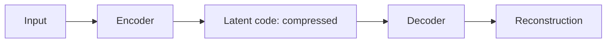

An autoencoder is a neural network trained to do something that sounds
useless: **reproduce its own input**. The trick is that it must pass
the input through a **bottleneck**, a compressed representation, on
the way. To reconstruct accurately through a narrow channel, the
network has to learn the *essential structure* of the data, discarding
noise and redundancy. That learned compressed representation is the
point, and it is the foundation of representation learning, anomaly
detection, and (in spirit) the latent spaces behind
[diffusion models](/ai-ml/concepts/diffusion-models).

## The architecture

Two halves:

- **Encoder**: compresses the input into a low-dimensional **latent
  code** (the bottleneck).
- **Decoder**: reconstructs the input from that code.

Training minimizes **reconstruction error** (how far the output is
from the input). The bottleneck forces a trade: the network cannot
memorize (the code is too small), so it must learn which features
actually matter to reconstruct the data, the *learned representation*
falls out of the compression constraint. It is
[unsupervised](/ai-ml/systems/supervised-unsupervised-rl) in the sense
that no labels are needed (the input *is* the target), which is what
makes it useful when labeled data is scarce.

## What they are used for

- **Representation learning / dimensionality reduction** (the latent
  code is a compressed, learned feature vector, a non-linear
  alternative to PCA, and useful as input to downstream models).
- **Anomaly detection** (train the autoencoder on *normal* data; at
  inference, an input it reconstructs *badly* is anomalous, the
  reconstruction error is the anomaly score. A clean, unsupervised
  approach used in [fraud and intrusion
  detection](/ai-ml/systems/anomaly-detection-system)).
- **Denoising** (train it to reconstruct the *clean* input from a
  corrupted one, the network learns to remove noise).
- **The generative bridge**: **variational autoencoders (VAEs)**
  make the latent space *smooth and probabilistic* (encode to a
  distribution, sample from it, decode), which lets you *generate* new
  data by sampling the latent space. VAEs were an early generative
  model, and their encoder/decoder + latent-space structure is the
  direct ancestor of diffusion models.

## The core idea

The autoencoder's lesson is **learning by reconstruction**: force the
data through a narrow channel and the network must discover a compact
representation that captures what matters. It is a form of
self-supervision (the target is derived from the input), and that
principle, *learn representations by predicting something about the
data itself*, is now the dominant pre-training strategy, from
[language models](/ai-ml/concepts/language-models-and-scaling)
(predict the next token) to masked-image modeling. The autoencoder is
the simplest, cleanest instance of the idea.

## Related concepts

- [Word Embeddings](/ai-ml/concepts/word-embeddings): another learned
  representation, via a different objective.
- [Diffusion Models](/ai-ml/concepts/diffusion-models): the modern
  generative descendant of the VAE.
- [Generative Adversarial Networks](/ai-ml/concepts/generative-adversarial-networks):
  the other major generative approach.
- [Design a Real-Time Anomaly Detection System](/ai-ml/systems/anomaly-detection-system):
  the reconstruction-error application.
