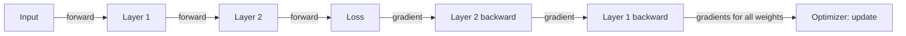

A neural network can have millions of weights, and training must
answer one question for each of them: *if I nudge this weight, how
much does the loss change?*, the
[gradient](/ai-ml/concepts/gradient-descent). Computing that for
every weight, efficiently, is the job of **backpropagation**, and it
is the algorithm that made training deep networks feasible. The idea
is the chain rule from calculus, applied cleverly to a computation
graph; the systems-relevant point is that it makes the cost of
training *proportional to the cost of a forward pass*, which is what
makes millions of weights trainable at all.

## The problem: credit assignment

A network is a chain of operations: inputs → layer 1 → layer 2 → ...
→ output → loss. The loss depends on every weight through this chain,
and a weight early in the network affects the loss through *everything
after it*. The naive way to compute each weight's gradient (perturb
it, re-run, measure) would cost *one forward pass per weight*:
millions of passes per training step, impossibly slow. Backpropagation
does it in **one backward pass**.

## The mechanism: forward then backward

- **Forward pass**: run the input through the network, layer by layer,
  computing each layer's output, and finally the loss. Along the way,
  cache the intermediate values.
- **Backward pass**: starting from the loss, walk *backwards* through
  the layers, computing how much each layer's output contributed to
  the loss (the chain rule), and *reusing* the next layer's already-
  computed gradient. Each weight's gradient falls out of its layer's
  output gradient times its input.
- **Update**: hand the gradients to the
  [optimizer](/ai-ml/concepts/optimizers), which adjusts the weights.

The efficiency comes from **reuse**: the backward pass computes each
layer's gradient *once* and passes it to the previous layer, so the
whole gradient computation is roughly as expensive as the forward
pass, one extra pass per training step, regardless of how many
weights there are. That is the algorithmic breakthrough.

## The practical consequences

- **Gradients can vanish or explode** (through many layers, the
  chained multiplications can shrink toward zero or blow up, the
  [activation-function](/ai-ml/concepts/activation-functions) and
  [normalization](/ai-ml/concepts/normalization-and-initialization)
  choices exist largely to keep gradients healthy, and
  residual connections
  give gradients a shortcut).
- **Memory is the cost** (the forward pass caches intermediates so the
  backward pass can use them: training a deep model uses *much* more
  memory than inference, because inference needs no backward pass,
a real systems consequence, and why training GPUs are memory-hungry).
- **It requires differentiable operations** (every layer must have a
  defined gradient, which shapes architecture design, the reason
  "which operations can I use" is really "which operations have a
  gradient").

## Related concepts

- [Gradient Descent](/ai-ml/concepts/gradient-descent): what uses the
  gradients.
- [Optimizers](/ai-ml/concepts/optimizers): the update step.
- [Perceptrons & Multilayer Perceptrons](/ai-ml/concepts/perceptrons-and-mlps):
  the network it trains.
- [Distributed Training](/ai-ml/systems/distributed-training): where
  gradients are averaged across a fleet.
