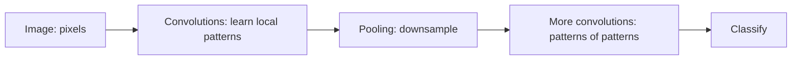

A convolutional neural network is a
[neural network](/ai-ml/concepts/perceptrons-and-mlps) with one
architectural assumption baked in: **nearby pixels are related, and
the same pattern can appear anywhere in the image.** A plain network
treats every pixel as an independent input, which wastes parameters
and ignores the structure. A CNN exploits it with **convolutions**,
and that single idea is why deep learning transformed computer vision.

## The convolution: a sliding filter

A **convolution** slides a small **filter** (a tiny grid of weights,
say 3×3) across the image, and at each position computes a weighted
sum of the pixels under it: producing a *feature map* that lights up
wherever the filter's pattern appears. A filter might detect a
horizontal edge, a corner, or a color blob; the network *learns* what
each filter detects.

The two properties that make it powerful:

- **Parameter sharing** (the *same* filter is applied everywhere in
  the image, so the network learns "a horizontal edge" once and
  detects it *anywhere*, instead of learning a separate edge
  detector per position. This is a massive reduction in parameters,
  and it encodes **translation invariance**: a cat in the corner and a
  cat in the middle activate the same filters).
- **Locality** (each output depends only on a small neighborhood of
  the input, matching the fact that meaningful image features are
  local: edges, textures, then shapes).

## The standard structure

- **Convolutional layers** (detect local patterns; the first layers
  learn edges and colors, deeper layers learn textures, then parts,
  then objects: *composition again*).
- **Pooling layers** (downsample: take the max or average over small
  regions, shrinking the feature map and adding tolerance to small
  shifts, the "summarize a region" step).
- **Fully-connected layers** (at the end: take the learned features
  and classify).
- **Depth**: stacking convolutions lets the network learn
  *hierarchically*, pixels → edges → shapes → objects, which is why
  deep CNNs work so well and shallow ones do not.

## What it means beyond vision

The CNN's core insight, **build the data's structure into the
architecture**, generalizes: use *shared, local* operations when the
data has *shared, local* patterns. It appears in audio (spectrograms
are image-like), and the same principle (structure-specific
architectures beat generic ones) is why
[RNNs](/ai-ml/concepts/recurrent-neural-networks) handle sequences and
[transformers](/ai-ml/concepts/transformers) handle everything with
attention. The modern twist: **vision transformers** (ViT) apply the
transformer architecture to images (by splitting them into patches),
and now rival or beat CNNs, but the *idea* (exploit spatial
structure) remains the point of the CNN.

## Related concepts

- [Perceptrons & Multilayer Perceptrons](/ai-ml/concepts/perceptrons-and-mlps):
  the generic network the CNN specializes.
- [Image Classification](/ai-ml/concepts/image-classification) and
  [Object Detection & Segmentation](/ai-ml/concepts/object-detection-and-segmentation):
  the tasks it powers.
- [Transformers](/ai-ml/concepts/transformers): the architecture now
  competing in vision.
- [Edge / On-Device Inference](/ai-ml/systems/edge-on-device-inference):
  where efficient CNNs run.
