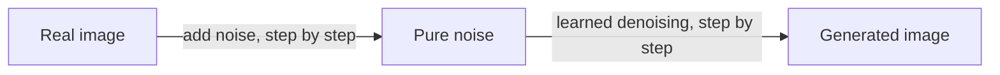

Diffusion models are the generative technology behind the current
explosion of image and video AI — Stable Diffusion, DALL·E, Midjourney,
Sora. The idea is beautiful and, once seen, obvious: **take an image,
destroy it by adding noise step by step until it is pure static, and
train a network to reverse the process.** To generate, start from
random noise and run the reverse process — the network "denoises" step
by step into a coherent image. It is the most important generative
modeling advance since the
[GAN](/ai-ml/concepts/generative-adversarial-networks), and it won by
being *stable and controllable* where GANs were fragile.

## The two processes

- **Forward (noising)**: starting from a real image, add a little
  random noise at each step, over hundreds of steps, until the image
  becomes indistinguishable from pure noise. This process is *fixed*
  (no learning) — it is just gradually destroying the image.
- **Reverse (denoising)**: train a neural network to *undo* one step
  of noising — given a noisy image and the noise level, predict the
  noise (or the clean image). Stack hundreds of these small denoising
  steps and you can go from noise all the way back to a coherent
  image.

Training is simple and stable: sample a real image, pick a random
noise level, add noise, and train the network to recover the clean
image. No adversarial game, no unstable competition — just a
[denoising](/ai-ml/concepts/autoencoders) objective (the reason
diffusion trains far more reliably than GANs). Generation is *slow* by
comparison (hundreds of network evaluations per image), which is the
main cost, and the reason for the whole sub-field of faster samplers
and distillation.

## Why it works, and why it is controllable

The insight: **modeling the reverse of a gradual corruption is easier
than generating an image in one shot.** Each denoising step is a small,
local problem (remove a little noise), and doing it repeatedly
composes into full generation — the same *composition of simple steps*
that makes deep learning work, applied to generation. The
step-by-step structure also gives **control**: the denoising network
can be *conditioned* on text (so "a cat wearing a hat" steers every
step), which is how text-to-image works — the text conditioning is
typically injected via
[cross-attention](/ai-ml/concepts/attention-mechanism) into the
denoising network. Editing, inpainting, and style control all come
from steering the denoising process.

## The latent-space twist

Modern systems run diffusion in a **compressed latent space** rather
than pixel space (an [autoencoder](/ai-ml/concepts/autoencoders)
compresses the image, diffusion runs in the small latent space, the
decoder expands back) — the "latent diffusion" that makes generation
tractable at high resolution. This is why the components stack:
*autoencoder* for compression, *transformer or U-Net* for the
denoising network, *cross-attention* for text conditioning — each
concept from this track appearing in the pipeline.

## Related concepts

- [Autoencoders](/ai-ml/concepts/autoencoders): the latent-space
  compression.
- [Generative Adversarial Networks](/ai-ml/concepts/generative-adversarial-networks):
  the predecessor it displaced.
- [The Attention Mechanism](/ai-ml/concepts/attention-mechanism):
  how text conditions the denoising.
- [Vision-Language Models](/ai-ml/concepts/vision-language-models):
  the text understanding that steers generation.
