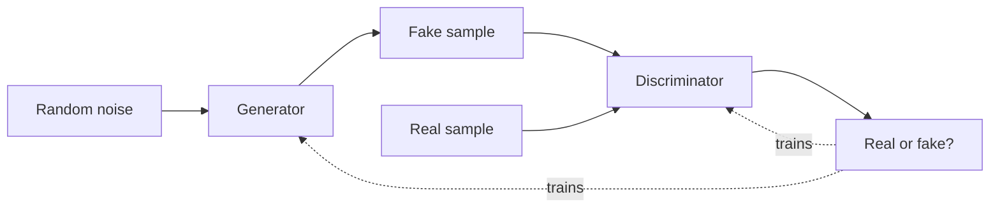

A generative adversarial network is a generative model built on a
competitive game between two networks: a **generator** that creates
fake data (images, audio, text) and a **discriminator** that tries to
tell real from fake. They train *against each other*, the generator
improves at fooling the discriminator, the discriminator improves at
catching fakes, and the competition drives the generator toward
producing samples indistinguishable from real data. It is one of the
most elegant ideas in machine learning, and it produced the first
photorealistic AI-generated faces.

## The adversarial game

- **Generator**: takes random noise and produces a sample (e.g., an
  image), trying to make it look real.
- **Discriminator**: takes a sample (real or generated) and predicts
  whether it is real.

Training alternates: update the discriminator to better separate real
from fake, then update the generator to better fool the discriminator.
At the ideal equilibrium, the generator's output is so good the
discriminator can only guess (50% accuracy). The generator never sees
the real data directly: it learns *only* from the discriminator's
feedback, which is what makes the setup so striking.

## The appeal and the difficulty

The appeal: **no explicit likelihood** is needed (unlike a VAE or
diffusion model, which model the data distribution directly), and the
adversarial signal can produce *sharp, realistic* samples: GANs
pioneered photorealistic image generation, image-to-image translation
(pix2pix, CycleGAN), and super-resolution.

The difficulty: **training is unstable**. The game can fail to
converge (the generator collapses to producing the same output:
**mode collapse**, covering only a few of the data's modes), or the
discriminator wins too easily and the generator gets no useful
gradient. GANs are notoriously finicky, a long list of tricks
(architectures, regularizers, training schedules) exists precisely to
stabilize them. That fragility is the main reason
[diffusion models](/ai-ml/concepts/diffusion-models) have largely
replaced GANs for image generation: diffusion is slower but far more
stable and controllable.

## The lasting ideas

Even as diffusion dominates generation, the GAN contributed concepts
that echo widely: **learning a signal from a learned critic** (the
adversarial objective appears in other settings), **latent-space
generation** (sample noise, decode to data), and the general template
of **two networks in a loop** (which recurs in
[RLHF](/ai-ml/concepts/rlhf), where a reward model plays the
discriminator's role of judging outputs). It is the clearest example
of *competition as a training signal*, and understanding it makes the
family of generative models, VAE, GAN, diffusion, easy to
compare.

## Related concepts

- [Autoencoders](/ai-ml/concepts/autoencoders): the other
  latent-space generative approach.
- [Diffusion Models](/ai-ml/concepts/diffusion-models): what replaced
  GANs for image generation.
- [RLHF](/ai-ml/concepts/rlhf): another "train against a learned
  critic" loop.
- [Alignment & Safety](/ai-ml/concepts/alignment-and-safety): where
  generative realism raises concerns.
