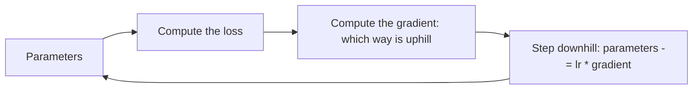

Training a model means *minimizing a loss*, and **gradient descent**
is how: picture the loss as a landscape over the model's parameters,
hills where the loss is high, valleys where it is low, and the
parameters as a point standing somewhere on it. Gradient descent
takes a small step *downhill* (the direction that decreases the loss
most), repeatedly, until it settles in a valley. That is the entire
algorithm, and it is how virtually every neural network is trained.

## The idea, without the calculus

The **gradient** is the direction of steepest *ascent*, the way
uphill. So the training step is: compute the gradient (which way is
uphill), and move the parameters the *opposite* way (downhill) by a
small amount. Repeat. The size of the step is the **learning rate**,
and it is the single most consequential hyperparameter:

- **Too small** (tiny steps): training is correct but *slow*, it
  takes forever to reach the valley.
- **Too large** (huge steps): training *overshoots*, it bounces
  across the valley, or diverges entirely.
- **Just right**: steady progress, but the right value depends on the
  problem, which is why schedules and adaptive methods exist.

## The variants

- **Batch gradient descent**: compute the gradient over the *whole*
  dataset before each step. Accurate, and slow (one step per full
  pass).
- **Stochastic gradient descent (SGD)**: compute it over *one*
  example. Noisy, and fast, the noise is a feature, helping escape
  shallow traps. The dominant modern practice is the middle:
  **mini-batch** (a small batch, e.g. 32-1024 examples, per step),
the sweet spot between accuracy and speed, and what "batch size"
  means.
- **Momentum and adaptive methods** ([Adam](/ai-ml/concepts/optimizers)):
  refinements that smooth the path and adjust the step per parameter,
  which is why modern training rarely uses plain SGD.

## What makes it hard: the landscape

The loss landscape is not a simple bowl, and the difficulties are the
concepts:

- **Local minima and saddle points** (spots that are low but not the
  lowest: the optimizer can stall. In high dimensions, saddles
  dominate, and momentum/noise help escape them).
- **Plateaus** (flat regions where the gradient is near zero: the
  step is tiny and progress stalls, the reason adaptive optimizers
  scale the step per parameter).
- **Ill-conditioning** (the valley is a narrow ravine: the gradient
  points across it, not along it, so plain descent zigzags, the
  reason momentum exists).
- **Vanishing/exploding gradients** (in deep networks, the gradient
  shrinks or grows exponentially through the layers, the
  [deep-network training problem](/ai-ml/concepts/normalization-and-initialization),
  addressed by normalization, careful initialization, and
  architectures like residual connections).

## The systems view

Two properties matter beyond the math: **it is iterative** (training
runs many steps, which is why it is a
[long-running compute job](/ai-ml/systems/distributed-training):
hours to weeks), and **it is parallelizable** (the gradient over a
mini-batch decomposes, which is exactly what
[data-parallel training](/ai-ml/systems/distributed-training) exploits:
many GPUs, each with a slice of the batch, averaging their
gradients). The algorithm is a loop; the systems are about running
that loop across a fleet.

## Related concepts

- [Loss Functions & Empirical Risk](/ai-ml/concepts/loss-functions-and-risk):
  what is being minimized.
- [Optimizers](/ai-ml/concepts/optimizers): the refinements (Adam)
  that replaced plain descent.
- [Backpropagation](/ai-ml/concepts/backpropagation): how the
  gradient is computed for a network.
- [Distributed Training](/ai-ml/systems/distributed-training): the
  fleet that runs the loop.
