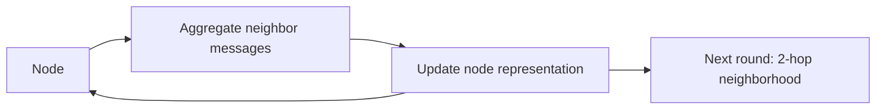

Not all data is a grid (images) or a sequence (text). Much of it is a
**graph** — nodes connected by edges: social networks, molecules,
recommendation graphs, knowledge bases, road networks. A graph neural
network learns on this structure with one idea: **each node updates
its representation by aggregating messages from its neighbors**,
repeated over several rounds. This *message passing* lets information
propagate across the graph, so a node's representation comes to encode
its neighborhood — and the whole network learns patterns that depend
on *who is connected to whom*.

## The mechanism: message passing

- Each node starts with a feature vector (e.g., a user's attributes).
- In each round, every node collects the representations of its
  neighbors, **aggregates** them (sum, mean, or attention-weighted),
  and combines that with its own representation to update.
- After several rounds, each node's vector encodes information from
  its `k`-hop neighborhood.

It is a *learned* form of the intuition that "you are known by your
neighbors", and it generalizes
[convolution](/ai-ml/concepts/convolutional-neural-networks) from
grids to arbitrary connection structures (indeed, GNNs are often
called graph convolutions). The number of rounds controls the
*receptive field*: one round sees direct neighbors, two sees
neighbors-of-neighbors, and so on.

## Where graphs appear

- **Recommendation** (users and items as nodes, interactions as edges —
  the graph structure captures "people like you liked this", a
  powerful signal beyond [collaborative
  filtering](/system-design/hld/recommendation-system)).
- **Molecules and drug discovery** (atoms as nodes, bonds as edges;
  predict properties from structure — a major application).
- **Knowledge graphs and fraud** (entities and relationships; detect
  suspicious connection patterns — fraud rings are *graph* patterns,
  which is why GNNs are strong in
  [fraud detection](/system-design/hld/fraud-detection)).
- **Traffic and logistics** (road networks, supply chains).

## The challenges

- **Scalability** (real graphs have billions of nodes; neighborhood
  aggregation over a huge graph is expensive — the reason graph
  sampling and distributed GNN training are active areas).
- **Depth** (stacking too many rounds causes *oversmoothing* — all
  nodes' representations converge, losing distinctiveness — so GNNs
  are usually shallow).
- **Dynamic graphs** (real graphs change over time — new edges, new
  nodes — which is harder than a static graph).

## Why the concept matters

The GNN is the natural architecture for **relational data**, and
relational structure is everywhere in production systems (social,
commerce, fraud, knowledge). It is also conceptually unifying: it
shows that the architecture should match the data's structure — grids
for [CNNs](/ai-ml/concepts/convolutional-neural-networks), sequences
for [RNNs](/ai-ml/concepts/recurrent-neural-networks), sets for
[transformers](/ai-ml/concepts/transformers), and *graphs* for GNNs.
Message passing is the graph's version of the same deep-learning
principle: build the data's structure into the model.

## Related concepts

- [Convolutional Neural Networks](/ai-ml/concepts/convolutional-neural-networks):
  the grid version of neighborhood aggregation.
- [Recommendation Systems](/system-design/hld/recommendation-system):
  a major GNN application.
- [Design a Fraud Detection System](/system-design/hld/fraud-detection):
  graph patterns for fraud rings.
- [Retrieval-Augmented Generation (RAG)](/ai-ml/systems/rag):
  the retrieval side of graph structure.
