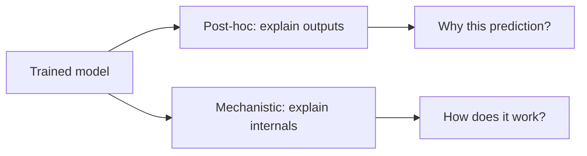

A trained model is millions (or billions) of numbers, and yet it makes
decisions that affect people: who gets a loan, what a diagnosis is,
what a chatbot tells you. **Interpretability** is the effort to
understand *what a model learned* and *why it produced a given
answer* — both to build trust and to catch problems. It splits into
two broad approaches: **explaining a model's behavior after the fact**
(post-hoc) and **understanding its internal workings** (mechanistic),
and both matter more as models grow more capable and more opaque.

## Why it matters

- **Trust and adoption** (a doctor, a judge, or a regulator will not
  act on "the model said so" — they need reasons, and
  [regulated domains](/ai-ml/systems/model-governance-compliance)
  often *require* explanations).
- **Debugging and safety** (understanding why a model fails, or
  whether it is relying on a spurious shortcut — a model that
  "detects" pneumonia from the hospital's equipment artifacts, not the
  lungs, is a real, famous failure).
- **Fairness** (checking whether the model discriminates on protected
  attributes requires seeing what it uses —
  [bias and fairness](/ai-ml/systems/bias-fairness-explainability)).
- **The alignment frontier** (as models get more capable, understanding
  *what they are actually doing internally* becomes central to
  [safety](/ai-ml/concepts/alignment-and-safety) — you cannot trust
  what you cannot inspect).

## The two families

**Post-hoc explanation** (explain a model's *outputs* without opening
it up):

- **Feature importance / attribution** (which inputs mattered most for
  this prediction. **SHAP** and **LIME** are the standard tools:
  attribute a prediction to its input features, so you can say "the
  loan was denied mostly because of these factors").
- **Saliency maps** (for images: which pixels drove the decision —
  highlight the region the model looked at).
- **Example-based explanation** (show similar cases the model saw, and
  how it treated them).

These are practical and widely used, but they are *approximations* of
the model's behavior, not ground truth — a caveat worth remembering.

**Mechanistic interpretability** (understand the model's *internals* —
the frontier, especially for LLMs):

- **Probing** (train simple classifiers on internal activations to see
  what information they encode — does this layer "know" the sentiment?).
- **Circuits and features** (find the actual internal structures that
  implement a behavior — the ambitious goal of reverse-engineering a
  network into understandable components, and the focus of modern
  work like sparse autoencoders that disentangle the many concepts a
  single neuron mixes together).

## The tension

There is a real tradeoff between **performance and interpretability**:
simple models ([linear
regression](/ai-ml/concepts/linear-and-logistic-regression), small
[decision trees](/ai-ml/concepts/decision-trees-and-ensembles)) are
transparent by construction, and the most accurate models
(deep networks, big ensembles) are the most opaque. The field's
answer is *both*: use post-hoc tools to explain black boxes in
practice, and pursue mechanistic understanding for the models where
trust really matters. Interpretability is not a nice-to-have — it is
the bridge between a model's capability and the human judgment that
has to act on it.

## Related concepts

- [Bias, Fairness & Explainability](/ai-ml/systems/bias-fairness-explainability):
  the applied side.
- [Decision Trees, Bagging & Random Forests](/ai-ml/concepts/decision-trees-and-ensembles):
  the inherently interpretable models.
- [Alignment & Safety](/ai-ml/concepts/alignment-and-safety):
  why internal understanding matters.
- [Model Governance & Compliance](/ai-ml/systems/model-governance-compliance):
  where explanations become requirements.
