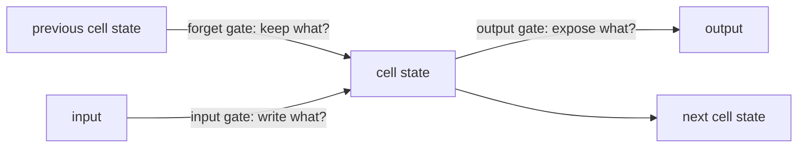

A plain [RNN](/ai-ml/concepts/recurrent-neural-networks) forgets:
its hidden state gets overwritten each step, and gradients vanish over
long sequences, so it cannot connect a word at the start of a
sentence to one at the end. **Long Short-Term Memory (LSTM)** — and
its simpler cousin the **GRU** — fix this with **gates**: small,
learned controllers that decide what the memory keeps, what it
forgets, and what it outputs. They were the sequence-modeling
standard for years, and the gate idea is worth understanding even now
that [transformers](/ai-ml/concepts/transformers) have taken over.

## The gate idea

An LSTM keeps two things: the **cell state** (a long-term memory
that flows through the sequence) and the **hidden state** (the
current output). Three gates regulate the cell state:

- **Forget gate** (what to erase from memory: "this subject is no
  longer relevant").
- **Input gate** (what to write into memory: "this new information
  matters").
- **Output gate** (what to expose as the current output).

Each gate is a small neural network whose output (between 0 and 1)
acts as a *soft switch*: 0 means "block", 1 means "let through", and
the values in between blend. Crucially, the cell state flows forward
through *additions* (not repeated multiplications), which gives the
gradient a **highway** through time — the reason LSTMs train over
hundreds of steps where plain RNNs fail.

The **GRU** simplifies: it merges the forget and input gates into one
"update" gate and drops the separate cell state. Fewer parameters,
faster, and often about as good — which is why GRUs are a common
lighter alternative.

## What they enabled, and why they were replaced

LSTMs/GRUs made sequence tasks work: machine translation, speech
recognition, text generation, time-series forecasting — the
pre-transformer NLP and speech stack was built on them. Their
limitations, which the transformer addressed:

- **Sequential processing** (each step depends on the previous, so
  training cannot parallelize over the sequence — slow on modern
  hardware, which is built for parallelism).
- **A fixed-size bottleneck** (everything must be compressed into one
  hidden state, which still struggles with very long dependencies —
  the problem [attention](/ai-ml/concepts/attention-mechanism) solves
  by letting the model *look back* at any position directly).
- **Hard to tune** (gates, many hyperparameters).

## Where they persist

Despite the transformer's dominance, gated recurrences remain useful
where **streaming, constant-memory, per-step processing** matters:
real-time time-series, some embedded/edge settings, and any place
where the sequence is processed online one element at a time (the
recurrence's constant per-step cost is an advantage there). And
**state space models** (Mamba and relatives) are the modern
descendants — recurrent in spirit, parallel-trainable, addressing
the transformer's sequence-length cost. The gate idea did not die; it
evolved.

## Related concepts

- [Recurrent Neural Networks](/ai-ml/concepts/recurrent-neural-networks):
  the base architecture and its vanishing-gradient problem.
- [Sequence-to-Sequence](/ai-ml/concepts/sequence-to-sequence): the
  encoder-decoder use they powered.
- [The Attention Mechanism](/ai-ml/concepts/attention-mechanism): the
  fix for their bottleneck.
- [Transformers](/ai-ml/concepts/transformers): what replaced them.
