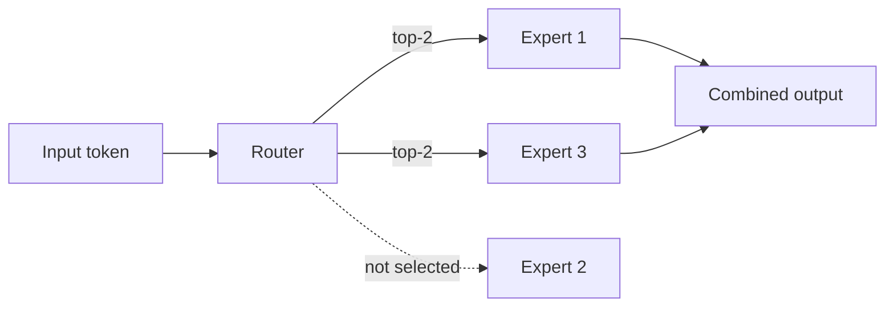

A mixture-of-experts is a way to make a model **huge without making
every prediction expensive**. Instead of one giant network, an MoE has
many **experts** (each a small network) and a **router** that, for
each input, selects only a *few* experts to run. The model's total
parameter count can be enormous, but each input only activates a
fraction of them — so capacity grows while the *compute per token*
stays roughly constant. It is the central technique behind the current
generation of frontier
[language models](/ai-ml/concepts/language-models-and-scaling), which
are almost all MoEs.

## The mechanism

- The model has many expert sub-networks (say, dozens or hundreds).
- For each input token, a **router** (a small learned network) scores
  the experts and picks the top few (often 2).
- Only those experts process the token; their outputs are combined
  (weighted by the router's scores).
- The rest of the model (attention layers, etc.) is shared.

The result is **conditional computation**: the model has the capacity
of a very large network (many experts' worth of parameters) but the
inference cost of a small one (only a couple of experts run per
token). The router learns to *specialize* the experts — different
experts come to handle different kinds of input (different languages,
topics, or syntax), so the model divides the work.

## Why it matters

Scaling laws say bigger models are better — but dense models get
*proportionally* more expensive to run. MoE **decouples capacity from
compute**: you can have a trillion-parameter model whose per-token
cost is that of a much smaller one, which is how frontier labs train
massive models affordably and serve them at reasonable cost. It is
the reason "the model has N parameters" now needs the caveat
"*active* parameters" — the number actually used per token is far
smaller than the total.

## The challenges

- **Load balancing** (the router tends to favor a few experts, leaving
  others untrained — so training adds a balancing loss to spread
  tokens evenly, and routing collapses are a real failure mode).
- **Memory** (all experts must be *stored* even though few are used
  per token, so MoE models are memory-heavy — a systems trade,
  relevant to [serving](/ai-ml/systems/model-serving-architectures) and
  [distributed training](/ai-ml/systems/distributed-training), where
  experts are sharded across devices).
- **Communication** (in distributed training, routing tokens to
  experts on different machines means lots of all-to-all
  communication — an infrastructure challenge).
- **Fine-tuning complexity** (more parameters, more moving parts).

## The concept in context

MoE is the clearest example of a broader theme: **spend compute where
it matters.** Attention spends it on relevant positions; MoE spends
it on relevant experts; both are forms of *conditional computation* —
not running the whole model for every input. As models grow, this
principle (activate only what you need) becomes central to making
scale affordable, and MoE is its most successful embodiment in modern
LLMs.

## Related concepts

- [Transformers](/ai-ml/concepts/transformers): the architecture MoE
  augments.
- [Language Models & Scaling](/ai-ml/concepts/language-models-and-scaling):
  the scaling pressure MoE addresses.
- [Distributed Training](/ai-ml/systems/distributed-training): where
  experts are sharded.
- [Model Serving Architectures](/ai-ml/systems/model-serving-architectures): the
  memory/compute trade at serving time.
