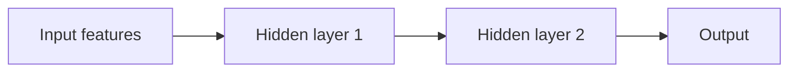

A neural network starts with the **perceptron**: a single artificial
neuron that takes inputs, multiplies each by a weight, adds them up,
and passes the sum through a non-linear function to produce an output.
That is just [logistic regression](/ai-ml/concepts/linear-and-logistic-regression)
— and on its own it can only draw a linear boundary. The leap that
creates "deep learning" is **stacking** these neurons into layers: the
output of one layer becomes the input of the next, and the *composition*
of non-linear functions can represent almost anything.

## The perceptron

The neuron: `output = activation(w₁·x₁ + ... + wₙ·xₙ + b)`. Inputs in,
weighted sum, non-linearity out. A single perceptron is a linear
classifier, and its famous limitation (it cannot learn XOR — a simple
non-linear pattern) is the reason the field stalled in the 1970s and
the reason *layers* matter.

## The multilayer perceptron (MLP)

Stack neurons into layers: an **input layer** (the features), one or
more **hidden layers** (each neuron receiving every output of the
previous layer), and an **output layer** (the prediction). Each
connection has a weight; each neuron has a bias. The whole thing is a
*big parameterized function*, and training
([gradient descent](/ai-ml/concepts/gradient-descent) +
[backpropagation](/ai-ml/concepts/backpropagation)) finds the weights
that fit the data.

The key property: **layers compose features.** The first hidden layer
learns simple patterns of the inputs; the second learns patterns *of
those patterns*; and so on. This is why depth helps — each layer
builds a more abstract representation on top of the previous, and the
network *learns* the feature engineering that a linear model needs a
human to do. It is also why MLPs are **universal approximators** (with
enough neurons, they can approximate any continuous function) — the
theoretical basis for "a big enough network can learn it", though the
*hard* part is having enough data and training it well.

## What makes them work (and fail)

- **Non-linearity is essential** (without the
  [activation function](/ai-ml/concepts/activation-functions), a stack
  of linear layers collapses into one linear layer — the whole point
  is the non-linearity between them).
- **Depth needs care to train** (deep MLPs suffer vanishing gradients
  and unstable training, addressed by
  [normalization, initialization](/ai-ml/concepts/normalization-and-initialization),
  and better [optimizers](/ai-ml/concepts/optimizers) — the
  engineering that made deep learning work).
- **They are general, not specialized** (an MLP on raw pixels ignores
  spatial structure, so [CNNs](/ai-ml/concepts/convolutional-neural-networks)
  beat it on images; an MLP on a sequence ignores order, so
  [RNNs](/ai-ml/concepts/recurrent-neural-networks) and
  [transformers](/ai-ml/concepts/transformers) beat it on text. The
  specialized architectures are MLPs with *built-in assumptions about
  the data's structure*).

## The role in the story

The MLP is the *general* neural network — the template every
specialized architecture modifies. Understanding it (layers, weights,
the forward pass, the need for non-linearity) is the prerequisite for
understanding CNNs, RNNs, and transformers, which are all "MLPs with
structure baked in".

## Related concepts

- [Activation Functions](/ai-ml/concepts/activation-functions): the
  non-linearity that makes layers useful.
- [Backpropagation](/ai-ml/concepts/backpropagation): how the weights
  are learned.
- [Convolutional Neural Networks](/ai-ml/concepts/convolutional-neural-networks),
  [Recurrent Neural Networks](/ai-ml/concepts/recurrent-neural-networks),
  [Transformers](/ai-ml/concepts/transformers): the specialized
  successors.
- [Normalization & Initialization](/ai-ml/concepts/normalization-and-initialization):
  making deep stacks trainable.
