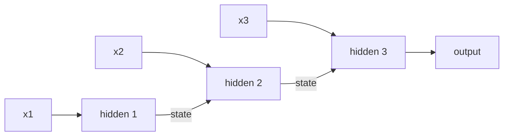

A [feedforward network](/ai-ml/concepts/perceptrons-and-mlps) sees
its input all at once, with no notion of order, but language, audio,
and time series are *sequences*, where order carries the meaning
("dog bites man" ≠ "man bites dog"). A **recurrent neural network
(RNN)** handles sequences with a simple, powerful idea: process the
input *one element at a time*, and carry a **hidden state**, a
running summary of everything seen so far, from step to step. The
same network is applied at every step, and the hidden state is its
memory.

## The recurrence

At each time step, the RNN takes the current input *and the previous
hidden state*, and produces a new hidden state (and optionally an
output):

The hidden state is the *memory*: by the end of the sequence, it has
(in principle) accumulated the meaning of everything seen. The same
weights are reused at every step (parameter sharing again, the
sequence-length independence), which is what lets an RNN handle
inputs of any length.

## The fatal flaw: vanishing gradients

RNNs are theoretically appealing and **practically hard to train**,
for one reason: training propagates gradients *backward through the
sequence* (backpropagation through time), and over many steps the
gradient shrinks (or explodes) exponentially, the same
[vanishing-gradient](/ai-ml/concepts/normalization-and-initialization)
problem as deep networks, but *worse*, because the "depth" is the
sequence length. The consequence: **plain RNNs cannot learn
long-range dependencies**, the state forgets the beginning of a long
sentence by the time it reaches the end, so the network only
"remembers" the recent past. This is why LSTMs and GRUs exist.

## The variants, and the modern verdict

- **LSTM / GRU** ([gated recurrences](/ai-ml/concepts/lstm-and-gru)):
  add *gates* that control what the memory keeps and forgets, which
  lets them learn dependencies over hundreds of steps. They were the
  sequence standard for years.
- **Bidirectional RNNs** (run the sequence forward *and* backward, so
  each step sees both past and future, for tasks where the whole
  sequence is available, like classification).
- **The transformer takeover**: [attention](/ai-ml/concepts/attention-mechanism)-based
  models process the whole sequence *in parallel* and connect any two
  positions directly, which fixes the long-range problem *and*
  trains far faster (no sequential dependency). Since the
  [transformer](/ai-ml/concepts/transformers) arrived, RNNs have been
  largely displaced for language, though they persist in some
  streaming and time-series settings where the recurrence's constant
  per-step cost matters.

## Why the concept still matters

The RNN teaches the core idea of **sequence modeling as state**,
carry a summary, update it per step, and it is the conceptual
ancestor of the architectures that replaced it. The *problem it
fails at* (long-range dependencies and parallel training) is exactly
what [attention](/ai-ml/concepts/attention-mechanism) solves, so
understanding the RNN makes the transformer's motivation obvious.

## Related concepts

- [LSTMs & GRUs](/ai-ml/concepts/lstm-and-gru): the gated fixes.
- [Sequence-to-Sequence](/ai-ml/concepts/sequence-to-sequence): the
  encoder-decoder use.
- [The Attention Mechanism](/ai-ml/concepts/attention-mechanism): the
  successor's core idea.
- [Transformers](/ai-ml/concepts/transformers): what replaced RNNs
  for language.
