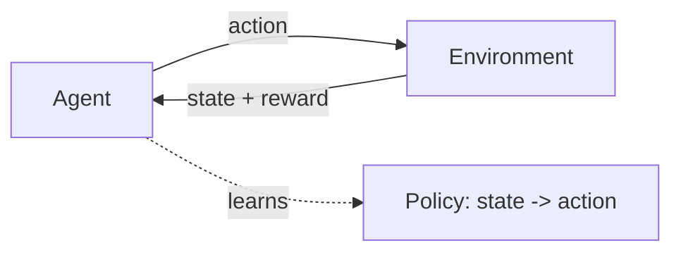

Supervised learning learns from *labeled examples*; reinforcement
learning (RL) learns from **interaction**. An **agent** takes
**actions** in an **environment**, receives **rewards**, and learns a
**policy** (what to do in each situation) that maximizes long-run
reward. There are no labels telling it the right action, only
feedback on how good the *outcome* was, often delayed. This is how you
learn to ride a bike or play a game, and it is the paradigm behind
game-playing AI, robotics, and the
[RLHF](/ai-ml/concepts/rlhf) that aligns modern language models.

## The vocabulary

- **Agent**: the decision-maker.
- **Environment**: the world it acts in (a game, a robot's
  surroundings, a conversation).
- **State**: the situation the agent is in.
- **Action**: what it can do.
- **Reward**: the feedback signal (a score, a win, a penalty).
- **Policy**: the agent's strategy, a mapping from states to actions
  (the thing being learned).

The core difficulty is **credit assignment over time**: a move in a
game might be brilliant or terrible, but the win or loss comes at the
*end*. The agent must figure out which of its many past actions
deserve credit, the RL version of the same problem
[backpropagation](/ai-ml/concepts/backpropagation) solves in
networks. RL solves it by learning a **value function** (how good is
this state, or this action in this state, in terms of future reward),
which lets delayed rewards propagate backward to the decisions that
led to them.

## The key ideas

- **Exploration vs exploitation** (the central tension: exploit what
  you know is good, or explore to find something better, too little
  exploration and you get stuck, too much and you never capitalize).
- **Value-based methods** (learn the value function, act greedily:
Q-learning and its deep version, DQN, which famously learned to play
  Atari from pixels).
- **Policy-based methods** (learn the policy directly, adjusting
  action probabilities based on the reward they lead to: better for
  continuous actions and for stochastic policies).
- **Actor-critic** (combine both: an *actor* proposes actions, a
  *critic* evaluates them, the dominant modern architecture, and what
  [RLHF](/ai-ml/concepts/rlhf) uses).
- **Reward design** (specifying the reward is the hard, human part,
a misspecified reward produces the wrong behavior, the central
  alignment problem).

## Where it applies

RL is the right tool when you cannot *label* the right action but can
*evaluate* outcomes: **games** (AlphaGo, Atari, poker), **robotics**
(control policies learned by trial and error), **recommendation and
pricing** (sequences of decisions), and, the current headline,
**aligning language models** ([RLHF](/ai-ml/concepts/rlhf): treat the
model as the agent, generated text as actions, and human preference as
the reward). The modern convergence is that the most capable AI
systems use *both*: supervised pre-training to learn from data, then
RL to optimize behavior against a goal.

## The honest caveats

RL is **sample-hungry** (it can take enormous interaction to learn:
why simulators and games are the sweet spot), **unstable** (small
changes break training), and **reward-hacking-prone** (the agent
exploits whatever you actually specified, not what you meant). These
weaknesses are exactly why [alignment](/ai-ml/concepts/alignment-and-safety)
is a serious concern: a powerful optimizer against a flawed reward is
a dangerous combination.

## Related concepts

- [RLHF](/ai-ml/concepts/rlhf): RL applied to language models.
- [Alignment & Safety](/ai-ml/concepts/alignment-and-safety): reward
  misspecification and its risks.
- [Supervised, Unsupervised & RL](/ai-ml/systems/supervised-unsupervised-rl):
  the three paradigms side by side.
- [Interpretability](/ai-ml/concepts/interpretability): understanding
  what a learned policy is doing.
