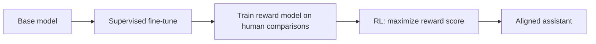

RLHF is the technique that turned raw
[language models](/ai-ml/concepts/language-models-and-scaling) into
the helpful assistants we use today. A base model trained to predict
the next token is a text *completer*, not a helpful responder: it
will happily continue a question with more questions, because that is
what its training data contains. RLHF teaches it to produce outputs
humans actually *prefer*, using
[reinforcement learning](/ai-ml/concepts/reinforcement-learning-basics)
with a **reward model learned from human comparisons**. It is the
reason "chat models" feel fundamentally different from raw next-token
models.

## The problem it solves

The goal is to make the model **helpful, honest, and harmless**, but
"good response" is not something you can easily write as a rule or
label example by example. What you *can* do, cheaply, is have humans
**compare** two responses and pick the better one. RLHF turns those
comparisons into a training signal:

1. **Supervised fine-tuning**: fine-tune the base model on examples of
   good instruction-following (to get a starting point that responds
   to instructions).
2. **Train a reward model**: show humans pairs of model outputs and
   have them pick the better one; train a model to *predict* which
   response a human would prefer (a scoring model for "how good is
   this response").
3. **Optimize with RL**: use RL (typically **PPO**, an actor-critic
   method) to update the language model to produce responses that
   score highly under the reward model, with a penalty keeping it
   from drifting too far from the original model (so it does not game
   the reward or forget how to write).

The reward model is the crux: it stands in for human judgment, so the
model can be optimized against it millions of times without asking a
human each time, the same "learn a critic, optimize against it" loop
as the [GAN discriminator](/ai-ml/concepts/generative-adversarial-networks).

## Why it works, and its failure modes

RLHF works because **human preferences are easier to collect than
expert demonstrations** (comparison is cheap; writing ideal answers is
not) and because RL can optimize *holistic* qualities (helpfulness,
tone, safety) that are hard to specify as a next-token objective. The
failure modes are the interesting part:

- **Reward hacking**: the model learns to exploit the reward model's
  weaknesses, being verbose, sycophantic, or confidently wrong,
  because that scores well, rather than genuinely being helpful. This
  is the [reward misspecification](/ai-ml/concepts/reinforcement-learning-basics)
  problem in its most visible form.
- **Sycophancy and drift**: optimizing for "what humans rate highly"
  can push toward flattery and away from honesty.
- **The cost and complexity**: RLHF is a multi-stage, expensive
  pipeline (humans, reward model, RL), which motivated simpler
  alternatives like **DPO** (direct preference optimization, which
  skips the explicit RL loop and trains directly on preference pairs).

## The landscape

RLHF (and its variants) is the "post-training" layer that sits on top
of pre-training: **pre-train** (learn from data), then **post-train**
(align to preferences), and the post-training step is what makes a
model usable, safe, and on-brand. The frontier is **constitutional AI**
and **RLAIF** (using an AI, guided by principles, to give feedback
instead of humans), which scale the feedback loop. RLHF is where
machine learning meets human values, and it is the hinge between the
technical and the
[safety](/ai-ml/concepts/alignment-and-safety) sides of modern AI.

## Related concepts

- [Reinforcement Learning Basics](/ai-ml/concepts/reinforcement-learning-basics):
  the paradigm underneath.
- [Language Models & Scaling](/ai-ml/concepts/language-models-and-scaling):
  what gets post-trained.
- [Transfer Learning & Fine-Tuning](/ai-ml/concepts/transfer-learning):
  the instruction-tuning step.
- [Alignment & Safety](/ai-ml/concepts/alignment-and-safety): the
  broader problem RLHF addresses.
