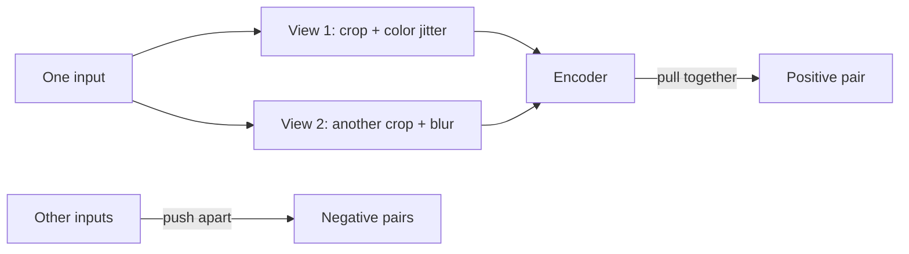

Labeling is expensive, and unlabeled data is unlimited: every image on
the web, every sentence ever typed, no tags attached. Self-supervised
learning closes that gap with a simple move: **manufacture the labels
from the data itself**. Hide part of the input and ask the model to
predict it, or make two transformed views of the same input and ask
which views belong together. The data supervises itself, and the labels
are free.

This sounds like a trick, and it is a productive one: to predict what is
hidden, or to recognize two views as the same, the model must learn the
*structure* of the domain. A model that can fill in a masked word must
know syntax, facts, and style. A model that recognizes two crops of one
photo must know what objects and textures look like from any angle. The
pretext task is a means; the learned representation is the point, and it
is why self-supervised pretraining is the engine behind
[transfer learning](/ai-ml/concepts/transfer-learning) at foundation-model
scale.

## The taxonomy, and where this sits

It slots between the classic
[families](/ai-ml/concepts/what-is-machine-learning): the supervision
signal *looks* supervised (an input, a target, a loss), but no human
labeled anything, so it is unsupervised in cost and supervised in
mechanics. Almost all of what the field calls "unsupervised pretraining"
today is this.

## The two big families of tasks

**Masked prediction (generative-style).** Corrupt the input, predict the
corruption. Mask 15% of a sentence's tokens and predict them: that is
BERT, and the mask makes the model bidirectional, since it can look at
both sides of the gap. Mask a random patch of an image and reconstruct
it: that is the same recipe in vision. The model learns by filling in,
and it shares its shape with the
[denoising idea](/ai-ml/concepts/diffusion-models) at the heart of
diffusion models.

**Contrastive learning.** Two augmented views of the same input are
*positives*: pull them together in representation space. Views of other
inputs are *negatives*: push them apart. The loss asks "which of these
candidates is the true pair?", which is just
[classification](/ai-ml/concepts/linear-and-logistic-regression) with
the label "same input" manufactured for free.

The catch in contrastive learning: it needs *many* negatives to work,
because the interesting information is "what this thing is *not*", and
learning "not this specific image" requires thousands of specific
images. Contrastive methods therefore need large batches or explicit
negative queues, and some (CLIP-style) replace negatives-in-a-batch
with a whole second modality: match images to their captions, and every
other caption in the batch becomes a natural negative, which is how
[vision-language models](/ai-ml/concepts/vision-language-models) are
pretrained.

The modern wrinkle that escapes the negatives arms race: some methods
drop contrast entirely. Distill the teacher into the student without
negatives, or align the two views' predictions and *stop* the
representations from collapsing, and it still works, which tells you
the contrast was scaffolding, not the essence.

## Why augmentation is doing heavy lifting

The whole construction rests on **augmentation**: two crops of the same
image are only a positive pair if the transforms preserved what the
representation should capture. Choose transforms that destroy nothing
(crop, color, blur), and the model is forced to learn shape and
semantics, because that is the only thing stable across the views.
Choose transforms that *do* change the meaning, and the model learns
your bug instead. Self-supervised learning makes
[data augmentation](/ai-ml/concepts/data-augmentation) the *engine* of
the objective rather than a helper, and it is why the augmentation
recipe is the most-tuned hyperparameter in these systems.

## The scaling payoff

Self-supervision is what made pretraining cheap enough to run at
[scaling-law](/ai-ml/concepts/language-models-and-scaling) scale: the
labels were the bottleneck, and now there are none. Train a
[transformer](/ai-ml/concepts/transformers) to predict the next token on
trillions of words, and the task, "predict the next token", is a
self-supervised pretext task with a century of free supervision. The
resulting representations are then *adapted* (fine-tune, prompt, LoRA)
to real tasks, the
[fine-tuning vs prompting vs RAG](/ai-ml/systems/fine-tuning-vs-prompting-vs-rag)
decision. That chain, pretrain on unlabeled data then adapt on a
little labeled data, is the modern recipe, and it exists because
self-supervision made the first stage free.

## What can go wrong

- **Shortcut learning**: the pretext task is solvable with features you
  did not want (a model matches views through watermarks or color
  histograms, not semantics), and the representation inherits the
  shortcut. The augmentation recipe is the defense.
- **Negative sampling bias**: sampled negatives define what "different"
  means, and unlucky sampling teaches the wrong boundaries.
- **Pretext/evaluation mismatch**: a representation good at masking
  pixels is not automatically good at your downstream task, and the
  only way to know is to measure on the task, not on the pretext loss.

## Related concepts

- [Transfer Learning](/ai-ml/concepts/transfer-learning) is what the
  pretrained representations are for.
- [Data Augmentation](/ai-ml/concepts/data-augmentation) is the
  machinery the contrastive objective builds on.
- [Language Models & Scaling Laws](/ai-ml/concepts/language-models-and-scaling)
  is the pretext task, scaled to the limit.
- [Autoencoders](/ai-ml/concepts/autoencoders) are the masked-prediction
  family's ancestor, without the mask.
- [What Machine Learning Is](/ai-ml/concepts/what-is-machine-learning)
  frames where this sits in the three families.
