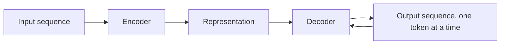

Many tasks take one sequence and produce another: translate English
to French, summarize a document, convert speech to text, turn a
question into an answer. The **sequence-to-sequence (seq2seq)**
architecture is the general pattern for these, an **encoder** that
reads the input sequence into a representation, and a **decoder**
that generates the output sequence from it. It powered the first
strong neural machine translation, and its encoder-decoder shape
survives inside every modern [transformer](/ai-ml/concepts/transformers).

## The architecture

- **Encoder**: reads the input sequence (say, an English sentence)
  one element at a time, updating its hidden state, until the whole
  input is compressed into a representation (the final hidden state,
  or a set of states).
- **Decoder**: generates the output sequence *one element at a time*,
  conditioned on the encoder's representation and on what it has
  generated so far. At each step it predicts the next token, feeds
  that prediction back in, and continues until an end-of-sequence
  token.

This "generate one token, feed it back" loop is **autoregressive
generation**, and it is the same mechanism (scaled up) behind
[large language models](/ai-ml/concepts/language-models-and-scaling):
predict the next token, append it, repeat.

## The bottleneck and the fix

The original seq2seq compressed the *entire input* into a *single
fixed-size vector* (the encoder's last hidden state), and the decoder
had to reconstruct everything from it, which works for short
sentences and fails badly for long ones (a long document cannot fit
into one vector). The fix was
[**attention**](/ai-ml/concepts/attention-mechanism): instead of
compressing the input to one vector, let the decoder *look back at all
the encoder's states* and weight them by relevance at each output
step. Attention removed the bottleneck, and it was so effective that
the *next* step was to throw out the recurrence entirely and build the
[transformer](/ai-ml/concepts/transformers): attention alone, no
RNN.

## Where the pattern applies

The encoder-decoder framing is task-general: **anything that
transforms one sequence into another** fits, translation,
summarization, question answering, speech-to-text, code generation,
and (with the decoder taking a prompt) text generation of every kind.
Modern models differ in scale and architecture (transformer instead
of RNN), but the *shape*, read the input, then generate the output
token by token, is unchanged. Recognizing that shape is what makes
"translation model", "summarizer", and "chatbot" look like variations
of one idea.

## The training detail worth knowing

Seq2seq models are trained with **teacher forcing**: during training,
the decoder is fed the *correct* previous token (not its own
prediction), which stabilizes learning. The mismatch between training
(seeing ground truth) and inference (seeing its own output) is called
**exposure bias**, the reason generation can drift, and one of the
things [RLHF](/ai-ml/concepts/rlhf) and other post-training methods
try to correct.

## Related concepts

- [Recurrent Neural Networks](/ai-ml/concepts/recurrent-neural-networks)
  and [LSTMs & GRUs](/ai-ml/concepts/lstm-and-gru): the original
  encoder/decoder building blocks.
- [The Attention Mechanism](/ai-ml/concepts/attention-mechanism): the
  fix for the fixed-vector bottleneck.
- [Transformers](/ai-ml/concepts/transformers): the modern
  encoder-decoder.
- [Language Models & Scaling](/ai-ml/concepts/language-models-and-scaling):
  autoregressive generation, scaled up.
