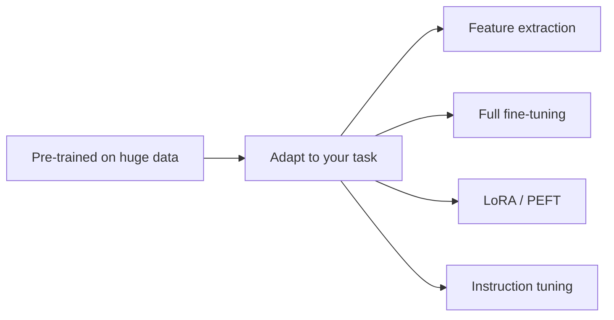

Transfer learning is the practice that made modern AI practical:
instead of training a model from scratch for each task, you take a
model **pre-trained** on a huge, general dataset and **adapt** it to
your specific problem. The pre-trained model already knows general
structure (edges and shapes for images; grammar, facts, and reasoning
for text), so you only need a little data and compute to specialize
it. Almost every deployed model today is a pre-trained model that was
fine-tuned, which is why "train from scratch" is now the rare case.

## Why it works

Training from scratch needs enormous labeled data and compute — and
most real problems have neither. Transfer learning exploits the fact
that **general knowledge transfers**: the early and middle layers of a
model trained on a broad task learn features that are useful for many
specific tasks. Adapting reuses those features and only learns the
task-specific parts, which needs far less data and time. It is the
neural-network version of "don't reinvent the wheel" — and the reason
a small team can build a strong model by starting from someone else's
giant one.

## The spectrum of adaptation

From cheapest to most involved:

- **Feature extraction** (freeze the pre-trained model and use its
  [embeddings](/ai-ml/concepts/word-embeddings) as inputs to a small
  new model — no retraining of the big model at all).
- **Fine-tuning** (continue training the pre-trained model on your
  data, updating its weights — the model adapts its representations to
  your task. The standard approach, with variants that freeze early
  layers and train later ones).
- **Parameter-efficient fine-tuning** (PEFT — update only a *small*
  number of added parameters, leaving the base model frozen. **LoRA**
  is the famous example: train tiny low-rank matrices alongside the
  frozen weights, which is dramatically cheaper and lets you keep
  many task-specific adapters on one base model. This is how most
  teams customize [large language
  models](/ai-ml/concepts/language-models-and-scaling) today).
- **Instruction tuning** (fine-tune a base language model on
  *instruction-following* examples so it responds to commands rather
  than merely completing text — the step that turns a base model into
  a usable assistant).

## The caveats

- **Catastrophic forgetting** (fine-tuning too aggressively can
  overwrite the general knowledge — a reason PEFT, which freezes the
  base, is popular).
- **Distribution mismatch** (the pre-training data may not match your
  domain — a general model fine-tuned on legal text helps, but the
  starting point still matters).
- **Data quality** (fine-tuning on small, clean, well-chosen data
  often beats large, noisy data — the data matters more than the
  quantity at this stage).

## Why it reshaped the field

Transfer learning is why AI became *practical*: a handful of huge
pre-trained models now serve as the foundation for thousands of
downstream applications, each adapted cheaply. The phrase "foundation
model" captures exactly this — a general model that other models are
built on top of, via fine-tuning, prompting, or
[RLHF](/ai-ml/concepts/rlhf). It turned model development from
"train your own" into "start from a foundation and adapt".

## Related concepts

- [Language Models & Scaling](/ai-ml/concepts/language-models-and-scaling):
  the foundation models being adapted.
- [Word Embeddings](/ai-ml/concepts/word-embeddings): the reusable
  representations.
- [RLHF](/ai-ml/concepts/rlhf): the alignment step after
  instruction tuning.
- [LoRA & Parameter-Efficient Fine-Tuning](/ai-ml/systems/lora-peft): the systems
  view of adaptation.
