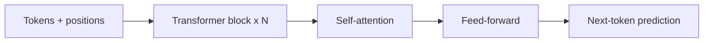

The transformer is the architecture that took over AI. Introduced in
2017 with the paper "Attention Is All You Need", it replaced
recurrence with [**self-attention**](/ai-ml/concepts/attention-mechanism):
letting every position in a sequence look at every other position,
in parallel. That single change made models **parallelizable**
(trainable on enormous data and hardware) and **better at long-range
dependencies**, and it is the foundation of essentially every large
model today: GPT, Claude, Gemini, BERT, ViT, and the
[vision-language](/ai-ml/concepts/vision-language-models) and
[diffusion](/ai-ml/concepts/diffusion-models) systems built on them.

## The architecture

A transformer is a stack of identical **blocks**, each containing two
sub-layers:

- **Self-attention**: every token attends to every other token (the
  mechanism that lets the model relate any two positions directly).
- **A feed-forward network**: a small
  [MLP](/ai-ml/concepts/perceptrons-and-mlps) applied to each position
  independently (where much of the model's "knowledge" is stored).

Wrapped around each are **[residual connections and LayerNorm](/ai-ml/concepts/normalization-and-initialization)**
(the training-stability plumbing), and before attention,
**positional encodings** are added, because attention itself is
*order-blind* (it sees a *set* of tokens, not a sequence), so the
model must be told where each token is.

Three variants share the architecture: **encoder-only** (BERT-style:
understand a sequence, for classification/embedding),
**decoder-only** (GPT-style: generate a sequence, what most modern
chat models are), and **encoder-decoder** (translation-style:
[seq2seq](/ai-ml/concepts/sequence-to-sequence)).

## Why it won

- **Parallelism**: unlike an RNN, all positions are processed at once,
  so training exploits GPUs/TPUs fully, the reason models could scale
  to billions of parameters and trillions of tokens.
- **Direct long-range connections**: any two positions interact in one
  step, so dependencies do not have to survive a long recurrence.
- **Generality**: attention makes no assumptions about the input's
  structure, so the *same* architecture works on text, images (as
  patches), audio, and more.
- **Scalability**: the architecture scales predictably with data,
  compute, and parameters, the [scaling
  laws](/ai-ml/concepts/language-models-and-scaling) that justified
  the enormous training runs.

The cost: **quadratic attention** (every token attends to every other,
so cost grows with the *square* of sequence length), which is the
central efficiency problem: motivating the entire field of efficient
attention, long-context tricks, and [Mixture-of-Experts](/ai-ml/concepts/mixture-of-experts)
for cheaper scaling.

## What it means in practice

The transformer is the *substrate* of modern AI: pre-training a large
transformer on massive text produces a
[language model](/ai-ml/concepts/language-models-and-scaling), which
[transfer learning](/ai-ml/concepts/transfer-learning) adapts to
tasks and [RLHF](/ai-ml/concepts/rlhf) aligns to human preferences.
Nearly everything you have heard about in AI over the last several
years is a transformer, or a model built around one. Understanding its
two sub-layers (attention + feed-forward) and its three variants is
understanding the architecture of the current era.

## Related concepts

- [The Attention Mechanism](/ai-ml/concepts/attention-mechanism): the
  core operation.
- [Language Models & Scaling](/ai-ml/concepts/language-models-and-scaling):
  what transformers become at scale.
- [Mixture-of-Experts](/ai-ml/concepts/mixture-of-experts): scaling
  transformers more cheaply.
- [Normalization & Initialization](/ai-ml/concepts/normalization-and-initialization):
  the training-stability ingredients.
