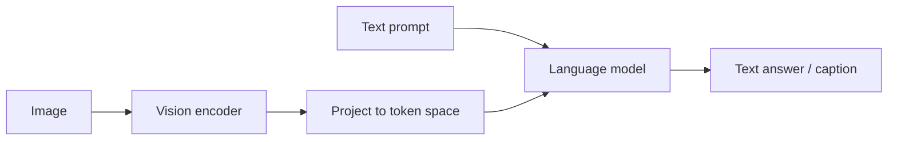

A vision-language model (VLM) connects **images and text** in one
model — so it can describe an image, answer questions about it, find
the image matching a caption, or follow a visual instruction. The key
idea is a **shared representation**: embed images and text into the
*same* vector space (via [embeddings](/ai-ml/concepts/word-embeddings)),
so a picture and its description land near each other — and then
reason across both. VLMs are how "multimodal" AI works, and they sit
at the center of the current wave (chat with images, image search,
document understanding, visual agents).

## The foundation: a shared space (CLIP)

The breakthrough was **contrastive** pre-training: train an image
encoder and a text encoder *together* so that a matching image-caption
pair has **similar** embeddings and mismatched pairs are **pushed
apart**. Given millions of (image, caption) pairs from the web, the
model learns to align the two modalities — the image of a dog and the
text "a dog" end up close. This is **CLIP**, and its consequence is
**zero-shot classification**: to classify images into new categories,
just embed the category names as text and find the nearest — no
task-specific training at all. That flexibility (a fixed model,
arbitrary text labels) is why CLIP-style encoders became the vision
front-end of choice.

## The architecture: encoder + connector + LLM

Modern VLMs bolt vision onto a
[language model](/ai-ml/concepts/language-models-and-scaling):
an **image encoder** (often a [ViT](/ai-ml/concepts/transformers))
turns the image into a set of vectors, a **connector** projects those
into the language model's token space (so image patches become
"tokens" the LLM can attend to), and the **LLM** does the reasoning
and generates text. The image is, quite literally, turned into tokens
the language model reads alongside the text — which is why
[cross-attention and transformers](/ai-ml/concepts/attention-mechanism)
are the machinery, and why the same LLM can caption, answer questions,
and follow visual instructions.

## What VLMs enable

- **Captioning and visual question answering** (describe an image,
  answer "how many people are in this photo?").
- **Image-text search** (retrieve images by description, or find the
  best caption for an image — the shared space at work, served by
  [vector search](/ai-ml/systems/similarity-search-ann)).
- **Document and UI understanding** (read charts, forms, screenshots —
  a major enterprise application).
- **Grounding and open-vocabulary detection** (find the object a text
  describes — connecting to
  [detection](/ai-ml/concepts/object-detection-and-segmentation)).
- **The generative side**: text-to-image models use a VLM-style text
  encoder to *steer* [diffusion](/ai-ml/concepts/diffusion-models) —
  the text understanding that turns a prompt into the right picture.

## The unifying idea

The VLM is the concrete form of a deep principle: **modalities are
just different token streams, and a shared representation lets a model
reason across them.** Once images become tokens in a language model's
space, vision and language stop being separate fields — which is why
the frontier is one model handling text, images, audio, and video
together. The shared embedding space, the transformer, and the
language model are the three ingredients, and the VLM is where they
combine.

## Related concepts

- [Word Embeddings](/ai-ml/concepts/word-embeddings): the shared-space
  idea across modalities.
- [Transformers](/ai-ml/concepts/transformers): the backbone and the
  vision encoder.
- [Diffusion Models](/ai-ml/concepts/diffusion-models): text
  conditioning for generation.
- [Image Classification](/ai-ml/concepts/image-classification): what
  zero-shot CLIP generalizes.
