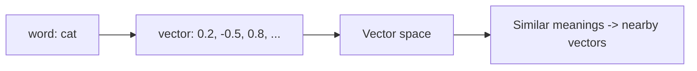

A model cannot do arithmetic on the word "cat". **Word embeddings**
solve this by mapping each word to a **vector** — a list of numbers —
such that words with similar meanings end up *close together* in that
vector space. This turns language into geometry: meaning becomes
distance, and analogies become vector arithmetic ("king" − "man" +
"woman" ≈ "queen"). Embeddings are the bridge between discrete symbols
and the continuous math that
[neural networks](/ai-ml/concepts/perceptrons-and-mlps) require, and
the same idea now extends to sentences, images, and entire documents.

## The core idea

Each word gets a vector (say, 300 numbers), *learned* from data rather
than hand-designed. The learning signal: **words that appear in
similar contexts have similar meanings** (the distributional
hypothesis — "you shall know a word by the company it keeps"). Train a
model to predict a word from its context (or the context from the
word), and the vectors that make those predictions work turn out to
organize themselves by meaning — related words cluster, and the
geometry captures semantic relationships.

Classic methods (**Word2Vec, GloVe, fastText**) produce static
embeddings — one fixed vector per word. Their limitation: a word with
multiple meanings ("bank") gets a single, averaged vector, and the
vector ignores context.

## Contextual embeddings

The modern approach: make the embedding *depend on context*, so "bank"
in "river bank" and "bank account" get *different* vectors. This is
exactly what [transformers](/ai-ml/concepts/transformers) do —
their internal representations *are* contextual embeddings, and
[language models](/ai-ml/concepts/language-models-and-scaling) produce
them as a by-product of next-token prediction. The progression: static
embeddings (one vector per word) → contextual embeddings (one vector
per word *in context*), which is a major reason modern NLP handles
polysemy and nuance so much better.

## Why embeddings are everywhere

The concept generalizes far beyond words — an **embedding** is any
learned mapping from an object to a vector where *similarity in the
space means similarity in meaning*. That single abstraction powers:

- **Semantic search** ([similarity search &
  ANN](/ai-ml/systems/similarity-search-ann)): embed documents and
  queries, retrieve by vector closeness.
- **Recommendations**: embed users and items, match by proximity.
- **Multimodal models**
  ([vision-language](/ai-ml/concepts/vision-language-models)):
  embed images and text into a *shared* space, so a picture and its
  caption land near each other.
- **Retrieval-augmented generation**
  ([RAG](/ai-ml/systems/rag)): embed a knowledge base,
  retrieve relevant chunks by similarity.

The embedding is the *representation* that makes
[clustering, k-NN, and vector search](/ai-ml/concepts/clustering-and-knn)
work on language and images — the space encodes the meaning, and
everything downstream operates on distances in that space.

## Related concepts

- [Clustering & k-Nearest Neighbors](/ai-ml/concepts/clustering-and-knn):
  the distance-based methods embeddings feed.
- [Transformers](/ai-ml/concepts/transformers): produce contextual
  embeddings.
- [Similarity Search & ANN](/ai-ml/systems/similarity-search-ann):
  scalable search over embeddings.
- [Vision-Language Models](/ai-ml/concepts/vision-language-models):
  a shared embedding space across modalities.
