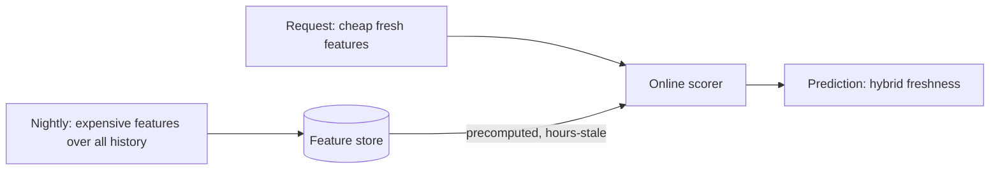

[Offline vs online inference](/ai-ml/systems/offline-vs-online-inference)
covers the *architectural* split (two infrastructures, one model).
This page covers the *product* side of the same decision: **when
predictions are made, what that buys, and which products can
tolerate which staleness.** The distinction sounds like a
restatement, but the design conversation is different — this is
about picking the mode per product, per feature, per prediction,
and about the **retraining loop** that plugs into whichever mode
you chose.

## The product decision: staleness, cost, and blast radius

The three questions, product-first:

- **How fast does a prediction become stale?** ("Is this user
  likely to churn?" — a week-stale score is identical to a fresh
  one, because churn is slow. "Will this user click *this* item
  *now*?" — the prediction dies with the request.) The faster the
  staleness, the further toward online.
- **How expensive is one prediction?** (A tiny
  [GBDT](https://en.wikipedia.org/wiki/Gradient_boosting) score:
  microseconds, affordable per request. A
  [LLM](/ai-ml/systems/ml-system-design-basics) call: hundreds
  of milliseconds and real money — per request is a *budget*
  conversation, and "batch the nightly" is how most expensive
  models ship.) The more expensive, the further toward batch.
- **What happens when the prediction is wrong or stale?** (A stale
  coupon shown to a user: harmless. A stale
  [fraud verdict](/system-design/hld/fraud-detection): the
  transaction already cleared.) The higher the blast radius, the
  more the design must be *fresh and explainable*, not just cheap.

The grid of real products, positioned by those axes:

| Product | Mode | Why |
| --- | --- | --- |
| Churn scores, credit lines | **Batch (nightly)** | Slow-stale, expensive features, consumed offline |
| Search ranking, [feed ranking](/system-design/hld/recommendation-system) | **Online** | Request-fresh, cheap per item, high volume |
| Fraud/abuse verdicts | **Online + rules** | Now-stale, money on the line, must degrade |
| [LLM features](/ai-ml/systems/ml-system-design-basics) in products | **Online, but budgeted** | Now-stale, expensive: the cost axis bites |
| Model outputs for analytics ("predicted LTV") | **Batch** | Consumed by queries, not requests |

## The batch shape, designed

A nightly (or hourly) scoring job is the
[warehouse](/system-design/fundamentals/olap-vs-oltp)-tier
pipeline: **join** the event data into feature tables, **score**
every row (the model applied as a pure function: no request, no
serving tier, just a [batch](/system-design/fundamentals/stream-vs-batch-processing)
transform), **publish** the scores as a versioned table (per run:
the scores are derived data, rebuildable, and their *provenance*
— which model version, which data window — is part of the output),
and the product **reads** the table with a known staleness
contract.

The batch mode's quiet virtues: **cost** (score a billion rows
overnight on cheap compute: the [spot-instance](/system-design/fundamentals/capacity-planning-and-estimation)
economics), **feature freedom** (any aggregate over all history,
no millisecond limit: the expensive features exist here), and
**reproducibility** (a run can be *re-run and compared*, which is
what [experiment tracking](/ai-ml/systems/ml-system-design-basics)
and audit actually want). Its vices: the staleness, the pipeline
dependency ([one late job](/system-design/hld/distributed-job-scheduler)
delays everything downstream), and the *publish* step's visibility
(the product must know how stale what it reads is: the contract,
stated).

## The real-time shape, designed

The serving path is a [latency-budgeted](/system-design/fundamentals/latency-vs-throughput)
tier: the model in memory (or on a
[GPU](/system-design/fundamentals/capacity-planning-and-estimation))
on the [stateless tier](/system-design/fundamentals/scalability),
the request's features fetched in milliseconds (the
[feature store](/ai-ml/systems/feature-stores)'s online
half), and the score returned synchronously — the
[fraud-scoring](/system-design/hld/fraud-detection) shape, in
full, on this site.

The real-time mode's virtues: **freshness** (the prediction uses
*this* request's data), **feedback tightness** (the outcome of the
prediction can be logged and joined immediately: the
[label](/ai-ml/systems/data-labeling-annotation) pipeline
shortens from weeks to hours), and **product capability** (some
products *are* impossible stale: search ranking is
request-scoring or nothing). Its vices: the budget (every
[request pays](/system-design/fundamentals/latency-vs-throughput)),
the degradation contract (the scorer is on a critical path:
[fallbacks](/system-design/fundamentals/availability-and-reliability)
are part of the design), and the *feature* constraint (only
what is fetchable in milliseconds can be an input).

## The hybrid, which is most real systems

The standard resolution, visible across this track: **precompute
the expensive and slow-stale, score the cheap and fast-stale.**

The [recommendation](/system-design/hld/recommendation-system)
design is the canonical instance: candidates precomputed offline
(embeddings, co-visitation: slow-stale, expensive), the *final
ranking* online (the user's request context: fresh, cheap). The
split is the answer to "the model is too expensive to run per
request" more often than "make it a batch job": usually the model
is fine per request and the *features* are the impossible part,
which is the [feature store](/ai-ml/systems/feature-stores)'s
entire reason for existing.

## The retraining loop plugs in here

The mode decision determines the **feedback cadence**: batch
products learn slowly (nightly outcomes → nightly retraining:
weeks to improve), online products can learn fast (request
outcomes → streaming
[features](/system-design/fundamentals/stream-vs-batch-processing)
→ daily or continuous retraining). The [fraud
detector](/system-design/hld/fraud-detection) is the extreme case
(adversarial drift demands *fast* retraining), and the honest
question — *how fast does the model need to improve?* — is often
the real answer to "batch or real-time": not "how fresh are the
predictions" but "how fresh is the *learning*."

## Related concepts

- [Offline vs Online Inference](/ai-ml/systems/offline-vs-online-inference):
  the architecture side of this same decision.
- [Feature Stores](/ai-ml/systems/feature-stores): the
  hybrid's machinery.
- [Stream vs. Batch](/system-design/fundamentals/stream-vs-batch-processing):
  the underlying two-tier pattern.
- [Design a Fraud Detection System](/system-design/hld/fraud-detection)
  and [Design a Recommendation System](/system-design/hld/recommendation-system):
  the two modes' canonical products.
