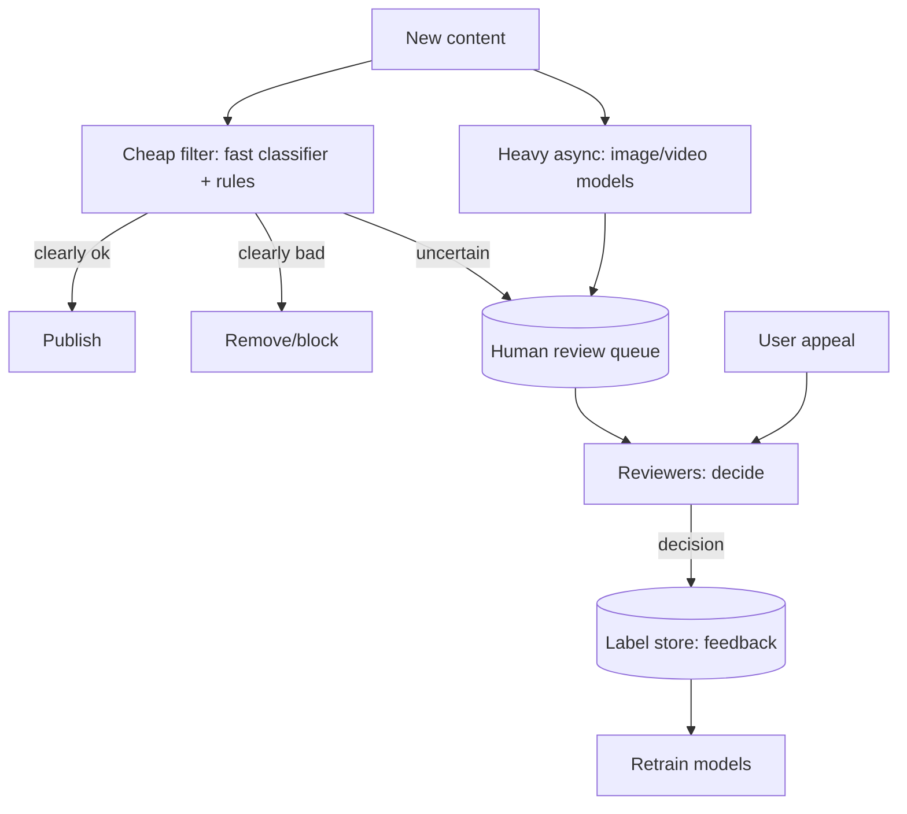

A content moderation system classifies user content (posts, images,
videos, comments) against a *policy* (spam, harassment, violence,
CSAM, misinformation) and *acts* on it (allow, block, flag for
review, demote) — at the firehose scale of a user-generated-content
platform, where the volume forbids human review of everything and
the stakes (harm, legal, trust) forbid pure automation. It is the
[fake-detection](/system-design/hld/fraud-detection) shape
(adversarial, delayed labels, human-in-the-loop) applied to
*content*, with the added dimensions of *multimodal* content,
*policy* (the rules are contested and change), and *appeal* (the
decision affects a user, who can contest it).

## Requirements

**Functional**

- Classify content against policy categories (spam, abuse,
  violence, adult, misinformation), per content type (text, image,
  video).
- Act: auto-remove, demote, flag for human review, age-gate,
  escalate (to law enforcement for the worst categories).
- Human review: a queue for flagged content, with a reviewer UI.
- Appeal: a user contests a decision; it is re-reviewed.
- Feedback: reviewer decisions improve the models.

**Non-functional**

- **Latency** (some moderation is *pre-publish* (block before it is
  seen: the [synchronous](/ai-ml/systems/offline-vs-online-inference)
  path, with a latency budget), some is *post-publish* (catch it
  after: the asynchronous path) — the *policy* decides which, and
  the two have different budgets).
- **Scale** (millions of items/day: the
  [throughput](/system-design/fundamentals/capacity-planning-and-estimation),
  and the reason *most* items pass a *cheap* classifier).
- **Precision/recall, weighted by harm** (the [metric](/ai-ml/systems/evaluation-metrics)
  trade: a false positive removes legitimate content (a *censorship*
  complaint), a false negative lets harm through (a *trust/safety*
  incident) — and the *weight* varies *by category* (CSAM: recall at
  all costs; spam: precision matters), which is the policy's
  arithmetic).
- **Adversarial** (users *adapt* to the classifier: the
  [concept-drift](/ai-ml/systems/concept-drift-retraining)
  problem, adversarial and fast).
- **Auditability** (every decision logged, explainable, appealable:
  the [governance](/ai-ml/systems/model-governance-compliance)
  requirement, and for some categories, a legal one).

## The architecture

- **The cascade** (the [cost-ordered classifier
  stack](/ai-ml/systems/inference-optimization): a cheap
  filter (rules + a small model) handles the *bulk* (most content is
  clearly fine, some is clearly bad), and only the *uncertain* goes
  to a heavier model or a human — the [cascade](https://en.wikipedia.org/wiki/Cascading_classifiers)
  is the *whole design*, because reviewing everything is
  unaffordable and reviewing nothing is unacceptable).
- **Multimodal** (text, image, video: *different models*, different
  costs, different pipelines — the video case (frames, audio,
  captions) is the most expensive, and usually *async*).
- **Human review** (the [case-management](/system-design/hld/fraud-detection)
  queue: prioritized (the *harmful* categories first), the reviewer
  UI, the *decisions* that become labels — the human-in-the-loop,
  and the *well-being* dimension (reviewers see the worst content:
  a real operational concern, the [responsible-AI](/ai-ml/systems/responsible-ai-safety)
  page's organizational note)).
- **Appeal** (the [re-review](/ai-ml/systems/bias-fairness-explainability)
  path: a decision can be contested, and the *appeal* is both a
  fairness requirement and a *label* source (a reviewer overturning
  a model is a training signal) — the [error-correction](/ai-ml/systems/responsible-ai-safety)
  loop).
- **The feedback loop** (reviewer decisions → labels → retrain: the
  [retraining loop](/ai-ml/systems/concept-drift-retraining),
  and the [feedback-loop bias](/system-design/hld/recommendation-system)
  (the model only sees what it flagged: exploration (random
  sampling of *unflagged* content for review) is required to avoid
  the model collapsing onto its own biases).

## The hard parts

- **Policy as code** (the moderation *policy* (what counts as
  harassment) is *contested*, *changes*, and must be *encoded* (into
  the classifier's labels, the rules, the reviewer guidelines): the
  [prompt-as-artifact](/ai-ml/systems/prompt-engineering-systems)
  discipline, for policy, and the reason policy changes are
  *migrations* (old decisions were made under old policy: the
  [label-era](/ai-ml/systems/data-labeling-annotation)
  boundary)).
- **Multimodal and adversarial content** (text is easy-ish; images
  and video need heavy models; and the adversarial users *evolve*
  (leetspeak, adversarial images) — the [adversarial
  drift](/ai-ml/systems/concept-drift-retraining), continuous).
- **Precision/recall by category** (the [threshold
  per category](/ai-ml/systems/evaluation-metrics): the
  *policy's* numbers, and the [calibration](/ai-ml/systems/evaluation-metrics)
  that keeps the thresholds meaningful — a single global threshold
  is *wrong* (the categories have different harm weights)).
- **The appeal and fairness loop** (appeals reveal model errors,
  and *systematic* appeal patterns (a demographic's content flagged
  more) are the [fairness](/ai-ml/systems/bias-fairness-explainability)
  signal: the moderation system is a *high-stakes* fairness surface,
  and the per-segment error monitoring is *required*).
- **The scale of the human tier** (the review queue is the *cost*
  and the *bottleneck*: the cascade's job is to *minimize* what
  reaches it (better models → smaller queue), and the queue's
  *prioritization* (the harmful first) is the operational design).

## Capacity sketch

The arithmetic: ~100M items/day, the cheap filter scoring *all* of
them (the [throughput](/ai-ml/systems/batching-and-latency)
tier: a small model at high RPS), the heavy models scoring the
uncertain (~1-5%), and the human queue reviewing the uncertain-but-
not-clear (~0.1-1%: ~100k-1M items/day, the *reviewer fleet*
sizing: the [human-in-the-loop](/ai-ml/systems/agents-and-tool-use)
cost, and the reason the models' *precision on the uncertain band*
is the lever that shrinks the queue); the training is the
[retraining loop](/ai-ml/systems/concept-drift-retraining)
over the reviewer labels, adversarial and continuous.

## Related concepts

- [Design a Fraud Detection System](/system-design/hld/fraud-detection):
  the same shape (adversarial, delayed labels, human loop).
- [Guardrails & Output Validation](/ai-ml/systems/llm-guardrails-validation):
  the LLM-content moderation sibling.
- [Bias, Fairness & Explainability](/ai-ml/systems/bias-fairness-explainability):
  the per-segment error monitoring.
- [Responsible AI & Safety](/ai-ml/systems/responsible-ai-safety):
  the governance and reviewer well-being.
- [Inference Optimization](/ai-ml/systems/inference-optimization):
  the cheap-filter cascade.
