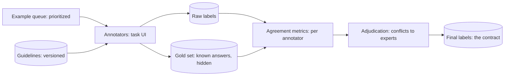

Labels are the currency of supervised learning
([the label economy](/ai-ml/systems/supervised-unsupervised-rl)),
and this page is about *minting* them: the human annotation
pipeline, the programmatic (weak) supervision that scales it, and
the quality control that decides whether the resulting ground
truth deserves the name. The reason this is a *systems* topic
rather than a vendor decision: **a label is an opinion collected
at scale**, and everything about the pipeline (guidelines, annotator
training, agreement measurement, adjudication) exists to turn
individual noisy opinions into a stable, reproducible contract —
which the model will then absorb completely. Garbage in this
pipeline is not a wrong row; it is a *wrong model*.

## The label sources, priced

The sourcing stack, in rising cost and falling volume:

1. **Logged outcomes** (the free labels): the
   [event log](/system-design/fundamentals/event-sourcing-and-cqrs)
   already records what happened (clicks, purchases, chargebacks).
   The [recommendation](/system-design/hld/recommendation-system)
   and [fraud](/system-design/hld/fraud-detection) systems run on
   these. Biased by construction (you only observe outcomes of
   what you *showed*), delayed by the outcome's nature
   (chargebacks: weeks), and *the cheapest labels that exist*, so
   every serious system maxes these out first.
2. **Weak supervision / programmatic** (labels from rules): domain
   experts write *labeling functions* ("three spam reports = spam",
   "regex on the email body"), each noisy, many voting, and the
   [Snorkel](https://en.wikipedia.org/wiki/Snorkel_(software))-shaped
   machinery learns the *voters' accuracies* (a generative model
   over the conflicts) to produce a probabilistic label. The
   systems value: a labeling *codebase* (versioned, testable,
   re-runnable over new data: labels as a *derived artifact* of
   rules + data, the
   [event-sourcing](/system-design/fundamentals/event-sourcing-and-cqrs)
   instinct applied to ground truth) — labels become reproducible
   *because they are computed*, not because someone saved a CSV.
3. **Human annotation** (the accurate, expensive path): humans read
   examples and assign labels, through the pipeline below.
4. **Model-assisted labeling** (the modern hybrid): a model
   pre-labels, humans verify — dramatically cheaper per label,
   with the known bias (humans anchor on the pre-label: the
   disagreement cases are where the value is, so the good designs
   *surface the model's confidence* and route the uncertain to
   full attention).

## The human pipeline, designed

The annotation pipeline as a real system (the
[case-management](/system-design/hld/fraud-detection) shape,
applied to opinions):

The components that make labels *trustworthy* rather than merely
numerous:

- **Guidelines** (the contract, written): what "spam" means, edge
  cases, worked examples — *versioned*, because guideline changes
  mean old labels are from a different era (the
  [schema evolution](/system-design/fundamentals/serialization-and-schema-evolution)
  discipline, applied to truth: a guideline change is a labeling-
  era boundary, and mixing eras in one training set is a silent
  bug).
- **Gold sets and honeypots** (the quality probe): known-answer
  examples mixed into annotators' queues, *unannounced*, measuring
  each annotator's accuracy continuously — the
  [health check](/system-design/hld/load-balancer-system)
  discipline, applied to labelers.
- **Inter-annotator agreement** (the measurement): multiple
  annotators per example (the expensive, correct default for
  ambiguous tasks), disagreement metrics per annotator and per
  *example class* (the "this category is ill-defined" detector: low
  agreement on a category is a *guidelines* bug, surfacing it
  before it becomes a model bug), and adjudication (expert review
  of conflicts: the expensive resolution that defines the final
  contract).
- **The task design itself** (the quiet lever): order effects,
  batch composition, and UI affordances move accuracy more than
  annotator skill does; the systematic answer is *randomized
  assignment* (which annotator sees which example, in which order:
  the [A/B](/system-design/fundamentals/reliability-engineering)
  machinery, applied internally).

## The quality-control arithmetic

The honest numbers that shape the pipeline: human labels are
~95-99% accurate per binary task (not 100: the
[gold set](#the-human-pipeline-designed) measures this), agreement
between annotators is the ceiling for what the *model* can learn
(the model cannot exceed the consistency of its teachers: a task
with 80% inter-annotator agreement has an 80%-accurate *ground
truth*, and "the model is at 82%" means it is *overfitting the
annotators' noise*), and the cost economics (a million labels at
$0.05 each: a $50k program, which is why the
[weak supervision](#the-label-sources-priced) stack exists: the
rules are free to run again).

The design consequence, worth stating as the page's takeaway: **the
label pipeline's quality bar is the model's quality bar**, and the
investment conversation (how much to spend on annotation vs.
architecture vs. models) is the ML system's most underexamined
budget line — a 1% label-quality improvement routinely beats a
modeling breakthrough, because labels multiply through everything
downstream.

## Related concepts

- [Supervised, Unsupervised & RL](/ai-ml/systems/supervised-unsupervised-rl):
  the label economy this pipeline serves.
- [Training Data Pipelines](/ai-ml/systems/training-data-pipelines):
  the join layer that consumes the labels.
- [Data Versioning & Lineage](/ai-ml/systems/data-versioning-lineage):
  labeling eras and reproducibility.
- [Design a Fraud Detection System](/system-design/hld/fraud-detection):
  the delayed-outcome label pipeline in production.
