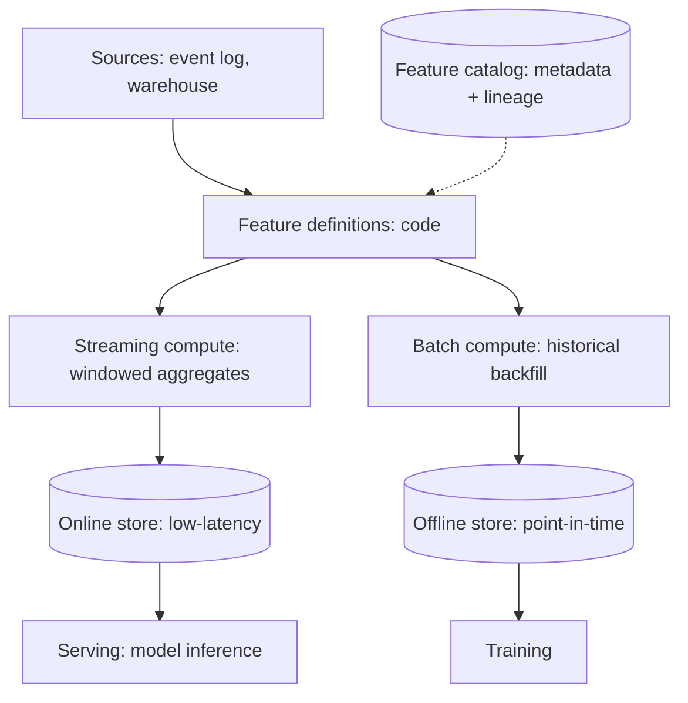

A feature platform is the [feature store](/ai-ml/systems/feature-stores)
*as shared infrastructure*: the company-wide service that computes,
stores, and serves features for *every* team, with the ingestion
pipelines, the online/offline consistency, the discovery catalog,
and the governance that make features a *platform* rather than a
per-team chore. It is the [multi-tenant](/ai-ml/systems/multi-tenant-ml-platforms)
discipline applied to features, and its HLD subject is the
*pipeline* (features are computed from streams and batches) plus the
*contract* (one definition, both serving paths).

## Requirements

**Functional**

- Define features (as code: a computation over sources, versioned).
- Compute them: streaming (near-real-time) and batch (historical).
- Serve them: online lookups (low-latency, per entity) and offline
  point-in-time reads (for training).
- Discover and reuse: a catalog of existing features.
- Govern: lineage, access control, freshness SLAs.

**Non-functional**

- **Consistency** (the store's *whole reason*: the online value and
  the offline training value come from *one definition* — the
  [training/serving skew](/ai-ml/systems/feature-engineering-basics)
  eliminated *structurally*).
- **Latency** (online reads in single-digit ms: the
  [feature-store's](/ai-ml/systems/feature-stores) requirement).
- **Freshness** (per-feature contracts: minutes for streaming,
  hours for batch — the [SLO](/system-design/fundamentals/reliability-engineering)
  discipline, per feature).
- **Scale** (millions of entities, thousands of features: the
  [capacity-planning](/system-design/fundamentals/capacity-planning-and-estimation)
  question).

## The architecture

- **Feature definitions as code** (each feature is a *versioned
  definition* (the [data-versioning](/ai-ml/systems/data-versioning-lineage)
  discipline): the *one source of truth* that both the streaming and
  batch compute execute — the *consistency* mechanism, structural).
- **The two compute paths** (streaming (the
  [windowed aggregates](/system-design/fundamentals/stream-vs-batch-processing),
  feeding the *online* store: the freshness) and batch (the
  historical [backfill](/ai-ml/systems/feature-model-backfills),
  feeding the *offline* store: the training history) — the *same
  definition*, two executions, which is the
  [feature-store's](/ai-ml/systems/feature-stores) core).
- **The online store** (a [low-latency KV
  store](/system-design/hld/distributed-cache): entity → feature
  vector, written by the stream, read per request).
- **The offline store** (a [warehouse](/system-design/fundamentals/olap-vs-oltp)
  table: point-in-time queryable (the
  [as-of](/ai-ml/systems/feature-stores) reads), written by
  the batch).
- **The catalog** (the metadata: what features exist, their
  definitions, owners, freshness, lineage — the *discovery* and
  *governance* surface, and the platform's *leverage*: the same
  feature reused across models, computed once).

## The hard parts

- **Online/offline consistency, at scale** (the *point* of the
  platform, and its hardest engineering: the streaming and batch
  paths must produce *identical* values for the same entity-time,
  which means shared *code* (the definitions), shared *semantics*
  (the [window definitions](/system-design/fundamentals/stream-vs-batch-processing),
  the point-in-time contract), and the *testing* that catches drift
  between them — the *feature-consistency test* every platform
  needs).
- **The point-in-time offline store** (the training reads "features
  as of T": the offline store is [event-sourced](/system-design/fundamentals/event-sourcing-and-cqrs)
  (the feature's *history*, not its current value), so "as of T" is
  an indexed query — the [feature-store's](/ai-ml/systems/feature-stores)
  machinery, and the reason the offline store is a *log*, not a
  snapshot).
- **Backfills** (a new feature needs its history: the
  [backfill](/ai-ml/systems/feature-model-backfills) pipeline,
  *and* the consistency requirement (the backfilled history must
  match what serving produces: the [one-definition
  rule](/ai-ml/systems/feature-stores))).
- **Freshness contracts per feature** (a feature has an *SLA* (the
  value is at most N-minutes-stale): the platform *monitors* it (the
  [feature-freshness](/ai-ml/systems/feature-stores) metric)
  and *alerts* (a stale feature silently degrades every model using
  it: the [monitoring](/ai-ml/systems/model-monitoring-drift)
  discipline, at the feature layer — the *upstream* cause of many
  model incidents).
- **Governance and access control** (features carry
  [permissions](/system-design/fundamentals/multi-tenancy-and-data-residency)
  (a feature derived from PII is restricted): the catalog's access
  control, and the [lineage](/ai-ml/systems/data-versioning-lineage)
  that says which features a model *uses* (the
  [governance](/ai-ml/systems/model-governance-compliance)
  query)).

## Capacity sketch

The arithmetic: ~10k features, ~100M entities, the online store
holding the *current* vector per entity (~10k features × 100M
entities × bytes = the memory tier: the
[feature-store](/ai-ml/systems/feature-stores) sizing, and the
reason only *needed* features are materialized per entity), the
streaming compute (the [windowed
aggregates](/system-design/fundamentals/stream-vs-batch-processing)
over the event firehose), and the offline store (the
[warehouse](/system-design/fundamentals/olap-vs-oltp): the history,
the backfills, the training reads). The platform's *value* metric:
features reused across N models (the reuse that justifies the
platform), and the *incidents prevented* (the skew and staleness
the platform structurally avoids).

## Related concepts

- [Feature Stores](/ai-ml/systems/feature-stores): the core
  concept, in depth.
- [Feature Engineering Basics](/ai-ml/systems/feature-engineering-basics):
  what a feature is.
- [Stream vs. Batch](/system-design/fundamentals/stream-vs-batch-processing):
  the two compute paths.
- [Multi-Tenant ML Platforms](/ai-ml/systems/multi-tenant-ml-platforms):
  the isolation/governance discipline.
- [Feature/Model Backfills](/ai-ml/systems/feature-model-backfills):
  the backfill machinery.
