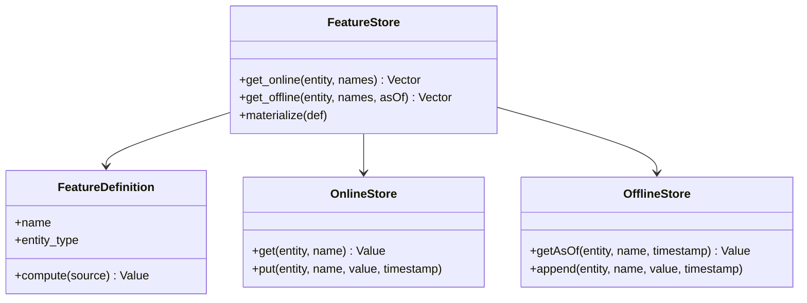

The [feature-store concept](/ai-ml/systems/feature-stores)
and [feature-platform HLD](/ai-ml/systems/feature-platform)
cover the system; this is the *code-level* design: the classes and
interfaces that make "one definition, two serving paths" a
*structure* rather than a convention. The design's whole point is
the *consistency* guarantee, so the LLD's whole point is *how the
code enforces it*, the interfaces that make a skew *impossible to
express*.

## The requirements (as code)

- `get_online(entity_id, feature_names) -> vector` (the low-latency
  serving read).
- `get_offline(entity_id, feature_names, as_of_time) -> vector`
  (the point-in-time training read).
- `materialize(feature_definition)` (compute + store, both paths).
- The *same* feature definition drives both paths (the consistency).

## The class model



The load-bearing interface is **`FeatureDefinition.compute`**: a
*single* function over the source (the events/warehouse), used by
*both* the streaming materializer (online) and the batch backfill
(offline). The consistency is *structural*: there is *one*
computation, and the two stores are just *where its outputs land*.

## The C++ sketch

```cpp
struct FeatureValue {
    // The timestamped value: the time is what makes point-in-time work.
    std::chrono::system_clock::time_point at;
    double value;
};

// The ONE definition: compute this feature for an entity as of a time.
class FeatureDefinition {
public:
    std::string name;
    std::string entityType;
    // The contract: given the source and an as-of time, produce the value
    // AS IT WOULD HAVE BEEN at that time (the point-in-time rule).
    virtual std::optional<double> compute(
        const Source& source,
        const std::string& entityId,
        std::chrono::system_clock::time_point asOf) const = 0;
};

class FeatureStore {
public:
    // Online: the CURRENT value, low-latency (the serving path).
    std::vector<double> getOnline(
        const std::string& entityId,
        const std::vector<std::string>& names) {
        std::vector<double> out;
        for (const auto& name : names) {
            out.push_back(online_.get(entityId, name));   // O(1) lookup
        }
        return out;
    }

    // Offline: the value AS OF a past time (the training path).
    std::vector<double> getOffline(
        const std::string& entityId,
        const std::vector<std::string>& names,
        std::chrono::system_clock::time_point asOf) {
        std::vector<double> out;
        for (const auto& name : names) {
            // The point-in-time read: the newest value at or before asOf.
            auto value = offline_.getAsOf(entityId, name, asOf);
            out.push_back(value.value_or(NAN));   // missing -> the model's default
        }
        return out;
    }

    // Materialize: run the definition and write BOTH stores (consistency).
    void materialize(const FeatureDefinition& def, const Source& source) {
        auto now = std::chrono::system_clock::now();
        for (const auto& entity : source.entities(def.entityType)) {
            auto value = def.compute(source, entity, now);   // ONE computation
            if (!value) {
                continue;
            }
            online_.put(entity, def.name, *value, now);       // current
            offline_.append(entity, def.name, *value, now);   // history
        }
    }

private:
    OnlineStore online_;      // KV: entity -> {feature -> value}
    OfflineStore offline_;    // event log: (entity, feature, time) -> value
};
```

Three design decisions carry the consistency:

- **One `compute`, two stores** (the definition is the *single
  source*; the online and offline stores are *destinations*, not
  *implementations*, so a feature cannot be "computed two ways",
  which is the skew, *unexpressible* by construction).
- **The `asOf` parameter is in the *interface*** (both the online
  "now" read and the offline "as of T" read go through the same
  computation *shape*: the point-in-time discipline is *baked into
  the signature*, so an implementer *cannot* forget it).
- **The offline store is an *append-only log*** (the
  [event-sourced](/system-design/fundamentals/event-sourcing-and-cqrs)
  form: `(entity, feature, time) -> value`, so `getAsOf` is a
  *time-indexed* read, the point-in-time query, and the reason the
  history is *recomputable* (the
  [backfill](/ai-ml/systems/feature-model-backfills))).

## The consistency test (the LLD's proof)

The code design *enables* a test that *proves* consistency: for a
sample of entities and past times, `getOffline(entity, name, T)`
must equal what the *online* store held *at* time T, and the
*structural* guarantee (one `compute`) means the test *passes by
construction* (unless the *stores* diverge, which is the operational
monitoring: the [feature-freshness](/ai-ml/systems/feature-stores)
and consistency checks). The design lesson: **make the correct
thing the *only expressible* thing** (one compute function, the
as-of in the signature), so consistency is a *property of the code*,
not a *discipline of the programmers*, the same
[make-invalid-states-unrepresentable](https://en.wikipedia.org/wiki/Type_system)
principle as the [design-data-structures](/dsa/patterns/design-data-structures)
pattern.

## Related concepts

- [Feature Stores](/ai-ml/systems/feature-stores): the
  concept and the guarantees.
- [Design a Feature Platform](/ai-ml/systems/feature-platform):
  the HLD.
- [Event Sourcing & CQRS](/system-design/fundamentals/event-sourcing-and-cqrs):
  the append-only offline store.
- [Feature/Model Backfills](/ai-ml/systems/feature-model-backfills):
  the recomputation.
- [Design a Feature Transform Pipeline](/ai-ml/systems/feature-transform-pipeline):
  the transform layer, as code.
