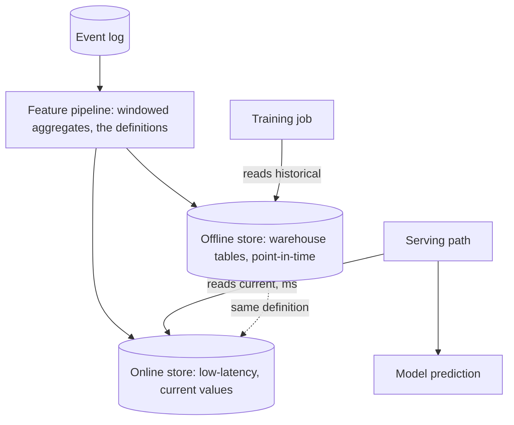

The feature store exists to solve the two problems the
[feature engineering](/ai-ml/systems/feature-engineering-basics)
page ended with: **training/serving skew** (the same feature
computed two ways) and **the latency budget** (expensive
aggregates that cannot run in a millisecond request). Its design:
a *serving-optimized store* of precomputed features, fed by a
pipeline from the event log, with **one definition, two
executions**, the batch trainer reads historical windows, the
online server reads the current values, and both come from the same
materialized table, which is what makes the feature *the same
feature* in both places.

## The architecture

The store is two [planes](/system-design/hld/object-storage-system)
with one contract: the **offline store** (the
[warehouse](/system-design/fundamentals/olap-vs-oltp) tables: full
history, point-in-time queryable, "user 42's features as of
October 3", which is the [training pipeline](/ai-ml/systems/training-data-pipelines)'s
point-in-time correctness, served as an index) and the **online
store** (the [low-latency](/system-design/hld/distributed-cache)-class
tier: the current values, keyed by entity, readable in
milliseconds), both written by the same pipeline from the same
definitions, which is the whole trick.

## The contract: freshness per feature

Each feature in the store carries a **freshness contract**, the
[SLO](/system-design/fundamentals/reliability-engineering)
discipline applied to derived data, because "how stale may this
be?" is a product decision with real costs:

- **Minutes-stale** (the fraud "current session" features: the
  [streaming](/system-design/fundamentals/stream-vs-batch-processing)
  path computes them from the event stream, near-real-time), 
- **Hours-stale** (the nightly aggregates: 30-day spend, monthly
  counts: the [batch](/ai-ml/systems/batch-vs-real-time-prediction)
  tier), 
- **Days-stale** (the embeddings, the categorical
  [target encodings](/ai-ml/systems/feature-engineering-basics):
  recomputed per retrain, fine).

The store's design decision per feature: *which tier computes it*
(the streaming pipeline, the batch pipeline, or on-request), and
the honest answer is the [hybrid](/ai-ml/systems/batch-vs-real-time-prediction)
pattern, expensive and slow-stale precomputed, fresh and cheap
computed in the request path, with the store as the *registry of
which is which*: the contract, stated per feature, enforced by the
tier that serves it.

## The systems design questions

**The point-in-time correctness** (the offline store's hard
requirement): training reads "features as of time T", and the
store must answer that query *without leaking T's future* (the
[value-as-of-T](/ai-ml/systems/training-data-pipelines)
problem: the offline table is
[event-sourced](/system-design/fundamentals/event-sourcing-and-cqrs),
the feature's history as a log of changes, not a mutable current
value, which is what makes "as of" an indexable query rather than
a reconstruction), and the online store's "current value" is
simply the newest entry in the same log (the two planes, one
storage model: the [CQRS](/system-design/fundamentals/event-sourcing-and-cqrs)
shape, verbatim, in the feature store's design).

**The backfill** (the bootstrap problem): a new feature's history
must be *computed over the past* before training can use it (the
[backfill](/system-design/fundamentals/message-queues-and-pubsub)
pattern: replay the event log with the new definition, materialize
the historical values), which is why the offline store is
[warehouse](/system-design/fundamentals/olap-vs-oltp)-shaped: the
backfill is a batch job over the log, and the feature definitions
are *code* (the [data versioning](/ai-ml/systems/data-versioning-lineage)
discipline: the definition's git sha is part of the feature's
identity, and "which definition computed this table" is answerable).

**The online tier's mechanics** (the serving side): keyed by
entity (user id, [device](/system-design/hld/fraud-detection),
merchant), the current values in a
[distributed cache](/system-design/hld/distributed-cache)-class
store (Redis-class: entity → feature vector), written by the
pipeline (write-through: the pipeline computes, the store serves,
the serving path never computes), with the *degradation* contract
(missing entity: defaults, not errors, a model must score a
never-seen user, and the feature vector's "unknown" values are
part of the model's training
[imputation](https://en.wikipedia.org/wiki/Imputation_(statistics)),
which is the training/serving consistency again: the *defaults*
must match).

**The consistency machinery** (the store's whole reason): the
*same definition* executed for both planes is enforced structurally
(the pipeline writes both from one computation, or the online
value is the newest offline entry: the log, one truth), which is
the fix for the [skew](/ai-ml/systems/feature-engineering-basics)
trap, the store does not *encourage* consistency, it *is*
consistency, which is the sentence that justifies the component.

## What a feature store buys, and what it costs

The honest buy/sell: **bought**, the consistency guarantee (one
definition, both planes), the point-in-time history (training
correctness), the reuse (features shared across models: the
[monetization](/system-design/hld/recommendation-system) team and
the [fraud](/system-design/hld/fraud-detection) team using the same
7-day-spend, computed once), and the discovery surface (a catalog
of features: "what exists, what it means, how fresh", the
registry, and the org-level leverage of not recomputing
everything per team). **Cost**, a new component to run (the
pipeline, the two stores, the registry: real
[operational surface](/system-design/fundamentals/microservices-vs-monolith)),
and the discipline overhead (the definitions as
[first-class artifacts](/ai-ml/systems/data-versioning-lineage),
which is work, and the reason small systems start without a store
and grow into one *when the second model appears*: the store is a
multi-consumer component, born from reuse, exactly like every other
shared-infrastructure decision on this site).

## Related concepts

- [Feature Engineering Basics](/ai-ml/systems/feature-engineering-basics):
  what a feature *is*, and the traps the store neutralizes.
- [Training Data Pipelines](/ai-ml/systems/training-data-pipelines):
  the point-in-time contract the offline store serves.
- [Event Sourcing & CQRS](/system-design/fundamentals/event-sourcing-and-cqrs):
  the architecture (log of changes, current value as projection).
- [Design a Distributed Cache](/system-design/hld/distributed-cache):
  the online tier's machinery.
- [Design a Fraud Detection System](/system-design/hld/fraud-detection):
  the canonical consumer (its streaming features are the
  minutes-stale tier, in production).
