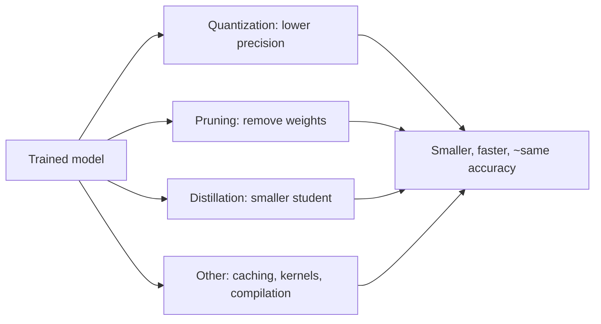

Serving a model is often *too expensive*, the GPU bill, the
latency, the memory, and the fix is **inference optimization**: the
family of techniques that make a *trained* model cheaper to run,
trading a little accuracy for a lot of speed, memory, or money. The
discipline is the [capacity planning](/system-design/fundamentals/capacity-planning-and-estimation)
instinct applied to a model: the model is a *cost*, the technique is
the *dial*, and the accuracy delta is the *price*, measured and
accepted deliberately (not discovered in production).

## The three families

**Quantization** (the biggest win, the default first move): store
and compute with **lower-precision numbers**, 32-bit floats to
16-bit (half precision), 8-bit integers (int8), or 4-bit. The
payoffs: **4x less memory** (fp32→int8), **faster matmuls** (integer
and fp16 units are wider on modern hardware), and **less bandwidth**
(the model moves faster across the
[GPU](/ai-ml/systems/gpu-accelerator-management)'s memory bus,
which is often the real bottleneck). The two forms: **post-training
quantization** (PTQ: quantize the trained weights directly, with a
calibration pass: cheap, sometimes lossy) and **quantization-aware
training** (QAT: train with simulated quantization so the model
adapts: more accurate, more work), and the accuracy cost is
*usually* small (a fraction of a percent) but **must be
measured per model** (some are quantization-sensitive: the honest
step is the [eval suite](/ai-ml/systems/evaluation-metrics)
run on the quantized model, not an assumption).

**Pruning** (remove what is not needed): zero out or drop weights
(structured pruning: whole neurons/heads, which actually speeds up
dense hardware; unstructured: individual weights, which needs
sparse hardware to pay off), then fine-tune to recover. The honest
caveat: unstructured sparsity looks great on paper (90% zeros!) and
gives *no* speedup on standard GPUs (dense matmul is
dense): the win requires *structured* pruning or sparse-aware
hardware, which is why quantization usually beats pruning in
practice.

**Distillation** (train a smaller model to imitate a bigger one):
the big model (teacher) generates soft labels, a small model
(student) trains on them, and the student often beats a
same-size model trained on hard labels alone (the teacher's
*probability distribution* carries more information than the
answer). The cost: a *training* run (not post-processing), and the
accuracy ceiling (the student is smaller: it cannot match the
teacher), but the payoff is a model that is *architecturally*
cheap (the small one), which composes with quantization.

## The other levers (the "O" in the diagram)

- **KV-cache and attention optimization** (the
  [LLM-specific](/ai-ml/systems/model-serving-architectures)
  family: the autoregressive generation's repeated attention is the
  cost, and the KV cache, paged attention, and flash-attention
  kernels are the whole field's response, the
  [batching page's](/ai-ml/systems/batching-and-latency)
  companion).
- **Compilation and kernel fusion** (the
  [runtimes page's](/ai-ml/systems/model-runtimes-compilation)
  subject: turning the graph into fused, hardware-specific kernels,
an *inference* optimization as much as a runtime one).
- **Speculative decoding** (the LLM trick: a small model drafts
  tokens, the big model verifies in parallel: the big model's
  expensive forward passes amortized, ~2-3x speedup at no accuracy
  cost, the *interesting* modern technique, and a good one to name).
- **Caching** (identical requests, cached answers: the
  [semantic cache](/system-design/fundamentals/caching), covered on
  the [caching page](/ai-ml/systems/model-caching-warm-pools)).

## The discipline: measure, then choose

The honest workflow, and the page's actual lesson:

1. **Profile first** (what is the bottleneck? compute-bound
   (matmuls), memory-bound (the weights don't fit), or
   bandwidth-bound (moving weights)? , each points at a different
   technique, and guessing wastes the effort).
2. **Quantize first** (the biggest win for the least work, and the
   most composable).
3. **Measure the accuracy delta** (the [eval
   suite](/ai-ml/systems/evaluation-metrics) on the optimized
   model, per [segment](/ai-ml/systems/bias-fairness-explainability)):
   an optimization that is "fine on average" and terrible on a
   minority segment is a [fairness](/ai-ml/systems/bias-fairness-explainability)
   regression wearing a performance costume.
4. **Then distill/prune** (if still too expensive, and only with
   the accuracy budget to spend).
5. **Keep the optimized model as a *version*** (the
   [lineage](/ai-ml/systems/data-versioning-lineage): "the
   serving model is the int8 distillation of m-2026-09, accuracy
   -0.4%": the provenance that makes the trade auditable and
   revertible).

## Related concepts

- [Model Runtimes & Compilation](/ai-ml/systems/model-runtimes-compilation):
  the graph-to-kernels half of the same cost problem.
- [Batching & Latency](/ai-ml/systems/batching-and-latency):
  the throughput techniques that compose with these.
- [GPU & Accelerator Management](/ai-ml/systems/gpu-accelerator-management):
  the resource the optimizations economize.
- [Evaluation Metrics for ML](/ai-ml/systems/evaluation-metrics):
  measuring the accuracy price.
- [Design a Recommendation System](/system-design/hld/recommendation-system):
  a consumer where serving cost is a first-class constraint.
