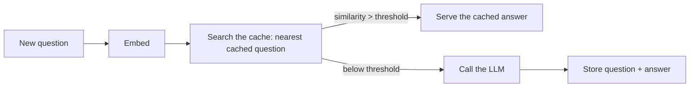

LLM inference is expensive and often *repetitive* (the same system
prompt, the same FAQ question, the same document summarized by many
users), which makes it a natural caching target, with two distinct
caches that solve different repetitions: **prompt caching** (reuse
the *computation* over a shared prefix, at the model-serving layer)
and **semantic caching** (reuse the *answer* for a semantically-
similar question, at the application layer). Both are the
[caching](/system-design/fundamentals/caching) pattern, and both
have the LLM-specific twist that the "key" is *text*, not an id.

## Prompt caching (KV reuse)

The mechanism, from the [serving page](/ai-ml/systems/llm-serving):
generation caches the *keys and values* of every token (the
[KV cache](/ai-ml/systems/llm-serving)), and **a shared
prefix has an identical KV prefix**, so if two requests begin with
the same system prompt (or the same document), the model can *reuse*
the computed KV for that prefix instead of recomputing the prefill.
The payoff: **the prefill (the expensive part for a long prompt) is
computed once** across all requests sharing the prefix, cutting
latency and cost for everything after the shared prefix.

The design consequences, which are *prompt-engineering* consequences:

- **Stable prefixes are cheap; changing prefixes are not** (put the
  *static* content (system instructions, the retrieved-but-shared
  context) at the *front*, the *varying* content (the user's
  question) at the *back*, the prefix-cache-friendly ordering, and
  the reason a "stable system prompt" is both a prompting *and* a
  cost [optimization](/ai-ml/systems/cost-token-budgets)).
- **The cache is per-prefix and bounded** (the framework caches the
  most-recent prefixes, evicting by [LRU](/system-design/fundamentals/caching):
  a large fleet serves many prefixes, and the hot ones (the common
  system prompts) stay cached, the
  [warm-pool](/ai-ml/systems/model-caching-warm-pools)
  discipline, at the KV layer).
- **It is provider-side and mostly automatic** (the serving
  framework (or the API provider) does it: the *application's* job
  is *structuring prompts* to have long shared prefixes, a design
  choice with a direct cost benefit, and the rare case where
  prompt *layout* is a systems optimization).

## Semantic caching (answer reuse)

The application-layer cache, and the one with the interesting
design: **if a new question is *semantically similar* to a
previously-answered one, serve the cached answer**: keyed not by
exact text but by [embedding](/ai-ml/systems/embeddings-vector-representations)
similarity. "What is your return policy?" and "how do I return an
item?" are different strings, the same question, and a semantic
cache answers the second from the first.

The design decisions, each a [caching-page](/system-design/fundamentals/caching)
concept in LLM clothes:

- **The similarity threshold** (how similar counts as "the same
  question": too *high* and the cache rarely hits (no saving), too
  *low* and it serves a *wrong* answer to a *different* question
  (the cache-staleness failure, and the worst kind, a confidently
  wrong answer, the [hallucination](/ai-ml/systems/evaluating-llm-systems)
  the user cannot tell from a real one). The threshold is tuned
  against the [eval set](/ai-ml/systems/evaluating-llm-systems),
  and it is a *precision/recall* trade, like every threshold).
- **The invalidation** (the answer is *time-sensitive*: "what is
  your return policy" changes, and the cache must [expire](/system-design/fundamentals/caching):
  TTL by content type, and the [RAG](/ai-ml/systems/rag)
  grounding (the answer cited *this* document version) informs the
  cache key, a *stale* answer is a *wrong* answer, the
  [cache-invalidation](/system-design/fundamentals/caching) problem
  at its hardest, because the "value" is prose).
- **Scope and tenancy** (the cache must respect permissions: a
  cached answer computed for *one* tenant's data must never serve
  *another*, the [multi-tenancy](/system-design/fundamentals/multi-tenancy-and-data-residency)
  discipline, and a real leak if the cache key ignores tenant: the
  cache is a *shared* store of *sensitive* answers, and the key must
  include the authorization scope).
- **The hit-rate economics** (the cache's value is its hit rate ×
  the per-call saving: for a *FAQ-heavy* product (the same questions
  repeatedly) the hit rate is high and the saving is large; for a
  *novel-query* product it is near zero and the cache is overhead,
the [hit-rate arithmetic](/system-design/fundamentals/caching),
  deciding whether to build it at all).

## The two caches, together

The layered picture: **prompt caching** saves the *prefill* for
*shared prefixes* (automatic, per-request, at the serving layer);
**semantic caching** saves the *entire call* for *similar questions*
(application-level, higher hit-value, higher risk). A mature system
uses both, and the design conversation is the
[cost-budget](/ai-ml/systems/cost-token-budgets) one: which
repetition is worth caching, what threshold, what TTL, and what
scope, the [caching page's](/system-design/fundamentals/caching)
questions, with text as the key and prose as the value.

## Related concepts

- [LLM Serving Basics](/ai-ml/systems/llm-serving): the KV
  cache prompt caching reuses.
- [Cost & Token Budgets](/ai-ml/systems/cost-token-budgets):
  the saving the caches produce.
- [Embeddings & Vector Representations](/ai-ml/systems/embeddings-vector-representations)
  and [Vector Databases](/ai-ml/systems/vector-databases): the
  semantic cache's lookup machinery.
- [Caching](/system-design/fundamentals/caching): the pattern, its
  invalidation and hit-rate disciplines.
- [Prompt Engineering as a System Concern](/ai-ml/systems/prompt-engineering-systems):
  the prefix-stability the prompt cache rewards.
