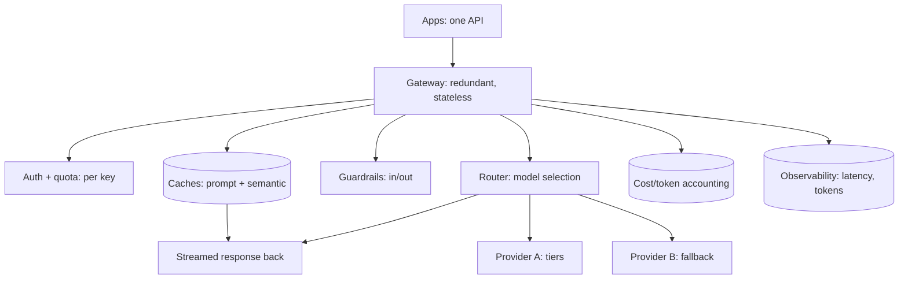

An LLM gateway is the [LLM-gateways concept](/ai-ml/systems/llm-gateways)
as a production HLD: one service, in front of *many* model
providers and model tiers, that applications call instead of calling
providers directly. It is the [API gateway](/system-design/fundamentals/api-gateway-and-service-mesh)
pattern, and its HLD subject is the *scale and reliability* of the
shared tier: it sits on the critical path of *every* LLM request in
the company (or product), so its latency, availability, and cost
accounting are the design's core.

## Requirements

**Functional**

- One API for applications; route to the right model (provider ×
  tier × version) per request.
- Provider fallback (A down → B), retries, timeouts.
- Caching (prompt + semantic: the [LLM caches](/ai-ml/systems/llm-caching)).
- Guardrails (input/output validation:
  [the guardrails page](/ai-ml/systems/llm-guardrails-validation)).
- Quotas and cost tracking, per app / tenant / key.
- Observability: tokens, cost, latency, per request.

**Non-functional**

- **Latency: negligible overhead** (the gateway is *in front of* a
  multi-second generation: its own overhead must be ~single-digit
  ms, the [latency budget](/system-design/fundamentals/latency-vs-throughput),
  and the reason it *streams* (passing tokens through, not buffering:
  the [streaming](/ai-ml/systems/model-serving-architectures)
  requirement).
- **Availability: high** (the gateway down = every LLM feature down:
  the [SPOF](/system-design/fundamentals/availability-and-reliability),
  redundant instances mandatory).
- **Throughput**: all the company's LLM traffic (the
  [scale](/system-design/fundamentals/capacity-planning-and-estimation),
  and the reason the gateway is often *stateless* (scale out) with
  *stateful* side services (caches, quota counters)).
- **Correctness of accounting** (the *cost* per request must be
  right: the [unit-economics](/ai-ml/systems/cost-optimization-ml),
  and the quota enforcement).

## The architecture

- **Stateless gateway tier** (the request path: auth, cache check,
  guardrail, route, stream, [horizontally
  scaled](/system-design/fundamentals/scalability), the
  [stateless tier](/system-design/fundamentals/load-balancing), with
  the *stateful* pieces (caches, quotas) as backing services).
- **Routing** (the [model-selection](/ai-ml/systems/llm-gateways)
  decision: difficulty (cheap vs. large), task, tenant, experiment,
the [cost lever](/ai-ml/systems/cost-token-budgets), and the
  [A/B](/ai-ml/systems/ab-testing-experimentation) assignment).
- **Fallback** (the [multi-provider](/ai-ml/systems/llm-gateways)
  resilience: provider A rate-limited or down → B, with the
  *model-appropriate prompt* (the [prompt-model
  coupling](/ai-ml/systems/prompt-engineering-systems): the
  gateway stores variants)).
- **Caches** (the [prompt + semantic caches](/ai-ml/systems/llm-caching):
  the zero-token path, *the* cost lever, and the *tenancy* scoping
  (a cached answer must respect permissions)).
- **Guardrails** (the [input/output validation](/ai-ml/systems/llm-guardrails-validation):
  centralized, one place)).
- **Accounting and observability** (the [cost per
  request](/ai-ml/systems/cost-optimization-ml) (token counts
  × prices), the quotas, and the [latency/token
  metrics](/system-design/fundamentals/observability): the *one
  place* that sees all LLM traffic, the platform's value, and the
  [decision log](/system-design/hld/fraud-detection) for audit).

## The hard parts

- **Streaming through the gateway** (the response is *streamed*
  (tokens emitted as generated): the gateway must *pass tokens
  through* (not buffer and forward), which means the auth, caching,
  and accounting *cannot wait for the full response*, the
  [streaming](/ai-ml/systems/model-serving-architectures)
  design, and the reason gateway implementations are *not* naive
  HTTP proxies (they handle the token stream).
- **Caching with correctness** (the [semantic
  cache](/ai-ml/systems/llm-caching): the *threshold* (too low
  = wrong answers, too high = no hits), the *invalidation* (answers
  go stale), and the *tenancy* (a cache hit for the wrong user is a
  *leak*): the gateway's cache is the *riskiest* component, and the
  scoping is the design).
- **Quota enforcement at the token level** (the [budget](/ai-ml/systems/cost-token-budgets)
  is *tokens*, not requests: the gateway *counts tokens* (a
  pre-count via the [tokenizer](/ai-ml/systems/llm-serving),
  then the actual) and *enforces* (reject/truncate over-budget):
  the [rate-limiting](/system-design/fundamentals/rate-limiting)
  discipline, token-denominated, and the reason the counter is a
  [shared store](/system-design/hld/distributed-cache) (all
  instances see all usage)).
- **Provider abstraction without capping** (the gateway abstracts
  the *common* surface but must *pass through* provider-specific
  features (a new capability), or it becomes the bottleneck: the
  [gateway-page](/system-design/fundamentals/api-gateway-and-service-mesh)
  tension, LLM-shaped).
- **The SPOF** (the gateway on the critical path of everything: the
  [redundant-pair](/system-design/fundamentals/load-balancing)
  discipline, and the [fail-open/fail-closed](/system-design/lld/rate-limiter-lld)
  decision (gateway down → apps call providers directly? the honest
  *escape hatch* design)).

## Capacity sketch

The arithmetic: the company's ~100k LLM requests/day, each ~2-10s
generation with ~1-8k tokens: the gateway's *own* overhead is
~single-digit ms (the requirement), so the gateway fleet is sized by
*concurrency* (the in-flight streams: ~thousands, each holding a
connection: the [connection-count](/system-design/hld/load-balancer-system)
sizing) rather than by throughput; the caches are the *cost*
lever (the hit rate × the per-call saving: the
[caching](/ai-ml/systems/llm-caching) economics); and the
accounting store is the [observability](/system-design/fundamentals/observability)
tier (per-request token/cost records: the
[unit-economics](/ai-ml/systems/cost-optimization-ml) data).

## Related concepts

- [LLM Gateways & Routing](/ai-ml/systems/llm-gateways): the
  concept, in depth.
- [API Gateway & Service Mesh](/system-design/fundamentals/api-gateway-and-service-mesh):
  the pattern.
- [Caching for LLMs](/ai-ml/systems/llm-caching) and
  [Cost & Token Budgets](/ai-ml/systems/cost-token-budgets):
  the cost levers.
- [Guardrails & Output Validation](/ai-ml/systems/llm-guardrails-validation):
  the safety layer.
- [LLM Serving Basics](/ai-ml/systems/llm-serving): the
  token/stream mechanics.
