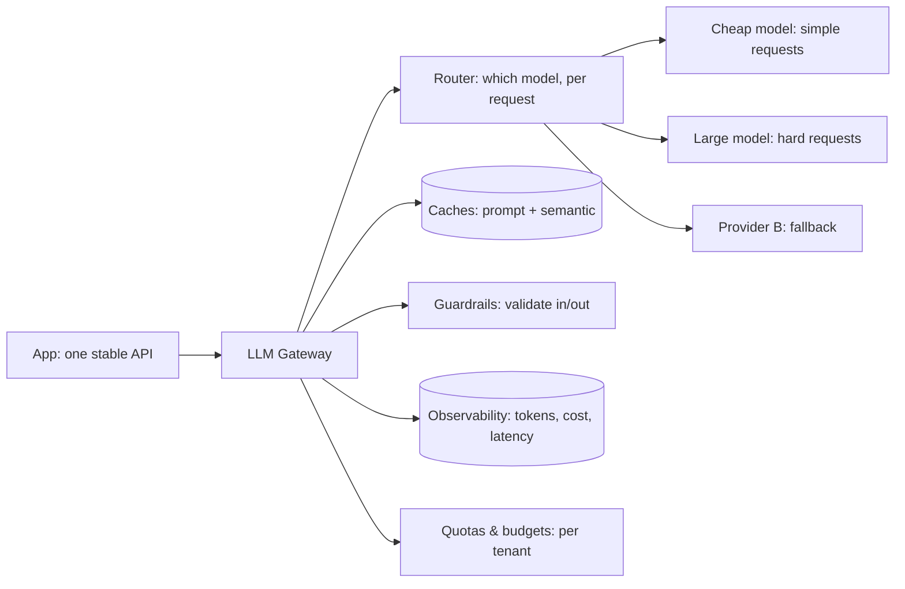

An LLM gateway is the [API gateway](/system-design/fundamentals/api-gateway-and-service-mesh)
of the AI era: **one endpoint in front of many models** (from
multiple providers, and multiple tiers of each), so applications
talk to *a gateway* rather than to *a specific model API*. It exists
because the LLM landscape's defining feature is *change and
multiplicity*: models improve monthly, prices shift, providers have
outages, and different requests want different models (a cheap one
for classification, an expensive one for reasoning). The gateway
absorbs all of that variation behind a stable interface, the
[gateway pattern's](/system-design/fundamentals/api-gateway-and-service-mesh)
reasons (decoupling, cross-cutting concerns), LLM-shaped.

## What the gateway does

- **Routing** (the *which model* decision, per request: by
  *difficulty* (the [cost-budget](/ai-ml/systems/cost-token-budgets)
  lever: cheap model for easy, large for hard, a classifier or a
  heuristic picks), by *task* (a routing table: "summarize" →
  model A, "reason" → model B), by *tenant* (the customer's
  configured model), or by *experiment* (the
  [A/B](/ai-ml/systems/ab-testing-experimentation)
  assignment: the gateway is where the model-version bucketing
  lives).
- **Fallback and retry** (provider A is down or rate-limited →
  route to provider B: the [failover](/system-design/fundamentals/availability-and-reliability)
  discipline, and the *reason* a multi-provider gateway exists:
LLM provider outages are real, and a single-provider application
  goes down with it. The subtlety: the *prompts differ per model*
  (the [prompt-model coupling](/ai-ml/systems/prompt-engineering-systems)),
  so the fallback needs a *model-appropriate* prompt variant, which
  is why the gateway stores prompt variants, not just model names).
- **Cross-cutting concerns** (the gateway's whole point, each a
  [gateway-page](/system-design/fundamentals/api-gateway-and-service-mesh)
  concern, LLM-shaped): **auth and quotas** (per-tenant keys, token
  budgets, [rate limits](/system-design/fundamentals/rate-limiting):
  the token-denominated quota, enforcing the
  [cost budget](/ai-ml/systems/cost-token-budgets)),
  **caching** (the [prompt and semantic
  caches](/ai-ml/systems/llm-caching) live here: one place,
  all applications benefit), **guardrails** (the
  [input/output validation](/ai-ml/systems/llm-guardrails-validation)
  applied centrally), and **observability** (the *token and cost*
  metrics per request, per app, per tenant: the
  [unit-economics](/system-design/fundamentals/capacity-planning-and-estimation)
  dashboard, and the one place that sees *all* the LLM traffic).
- **The stable interface** (the applications code against *the
  gateway's* API, not a provider's: switching models, adding a
  provider, changing prices is a *gateway config change*, invisible
  to the apps, the [decoupling](/system-design/fundamentals/api-gateway-and-service-mesh)
  value, and the reason "model-agnostic" is achievable at all).

## Why it is its own tier

The gateway earns its place (rather than each app calling providers
directly) for the same reasons the [API
gateway](/system-design/fundamentals/api-gateway-and-service-mesh)
did, and one LLM-specific one:

- **Centralized cost control** (the *token spend* is the new cloud
  bill, and it must be *seen and capped* in one place: per-app,
  per-tenant, per-feature, a gateway is the only vantage point that
  sees all of it).
- **Provider abstraction** (the model landscape churns; the
  gateway is the [anti-corruption
  layer](https://en.wikipedia.org/wiki/Domain-driven_design#Strategic_patterns)
  between your code and the churn, a provider's API change or
  deprecation is a gateway update, not a fleet-wide refactor).
- **The cross-cutting features** (caching, guardrails, quotas,
  routing: each is *built once* in the gateway rather than *per
  app*, the same "build it once at the shared layer" argument as
  every gateway).
- **The multi-provider reality** (no single provider is always best
  or always up: the gateway makes *portability* and *resilience*
  real, which single-provider code cannot).

## The honest costs

The gateway's costs, so the decision is priced: an **extra hop**
(latency, usually negligible against a multi-second generation),
a **shared dependency** (the gateway down = all LLM features down:
the [SPOF](/system-design/fundamentals/availability-and-reliability)
mitigation, redundant gateway instances, applies), and the
**feature-lag risk** (a provider ships a *new capability* (a new
API, a new mode) and the gateway does not expose it yet, the
gateway must *pass through* new features or it becomes the
bottleneck, the same tension every abstraction layer faces). The
design's answer: the gateway abstracts the *common* surface and
*passes through* provider-specific capabilities, so it decouples
without capping.

## Related concepts

- [API Gateway & Service Mesh](/system-design/fundamentals/api-gateway-and-service-mesh):
  the pattern this instantiates.
- [Cost & Token Budgets](/ai-ml/systems/cost-token-budgets):
  the routing and quota levers.
- [Caching for LLMs](/ai-ml/systems/llm-caching): the caches
  the gateway centralizes.
- [Guardrails & Output Validation](/ai-ml/systems/llm-guardrails-validation):
  the validation the gateway applies.
- [Model Serving Architectures](/ai-ml/systems/model-serving-architectures)
  and [Multi-Model Serving](/ai-ml/systems/multi-model-serving-routing):
  the tiers behind the gateway.
