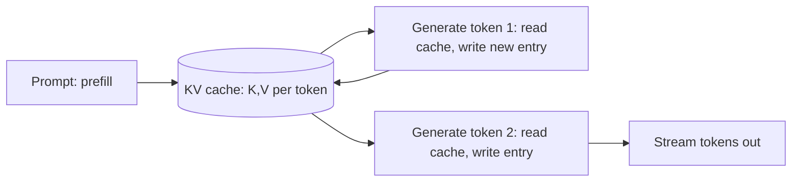

Serving an LLM is [serving a model](/ai-ml/systems/model-serving-architectures)
with three properties that change the whole engineering: the model
is **enormous** (billions of parameters: it barely fits, let alone
batches), the output is **generated token by token** (a loop, not a
single forward pass), and the cost is **per token** (both input and
output: the bill and the latency are denominated in tokens). The
vocabulary that organizes it — tokens, the KV cache, context windows
— is not jargon to memorize; each term is a resource that shapes the
architecture, and this page is the serving tier's version of the
[inference](/ai-ml/systems/model-serving-architectures) and
[batching](/ai-ml/systems/batching-and-latency) pages,
LLM-shaped.

## Tokens: the unit of everything

A **token** is a chunk of text (roughly ¾ of an English word: "unbelievable"
is three tokens) that the model reads and writes, and every cost
denominates in tokens:

- **Input tokens** (the prompt: the system message, the user
  message, the retrieved context): *processed in parallel* (the
  whole prompt is one forward pass — the prefill), so input tokens
  are cheap in *latency* but real in *money*.
- **Output tokens** (the generated text): produced *one at a time*,
  each requiring a full forward pass — so output tokens are the
  *latency* story (time-to-first-token vs. tokens-per-second) and
  the *expensive* story (output tokens often cost several times
  input tokens).
- **The tokenizer** (the model-specific text↔token mapping: not a
  library detail, because the *count* drives the budget and the
  context limit — a prompt "of 4000 characters" is a *count* only
  after tokenization, and the counts vary by model).

## The KV cache: the generation's memory

The mechanism that makes generation *feasible* at all, and the
single most important LLM-serving concept: a transformer's attention
needs the **keys and values of every prior token** to generate the
next one, and recomputing them from scratch for each token would be
quadratic-in-sequence work repeated n times. The **KV cache** stores
those keys and values as generation proceeds, so each new token's
forward pass reuses the cached context and computes only the *new*
token's contribution.

The consequences, and they *are* the architecture:

- **The cache is memory** (per request: sequence-length × layers ×
  hidden-size: a long context's cache is *gigabytes*, and it competes
  with the model weights for [VRAM](/ai-ml/systems/gpu-accelerator-management)).
- **The cache is *per request*** (each in-flight generation has its
  own: memory scales with *concurrency*, which is why LLM serving
  is memory-bound, not compute-bound, and why the
  [batching](/ai-ml/systems/batching-and-latency) is
  *continuous* (requests join and leave as their sequences finish:
  a static batch wastes the GPU on the long ones).
- **The cache enables *reuse*** (a shared *prefix* — the same system
  prompt across all requests — has an identical KV prefix, which the
  [prompt cache](/ai-ml/systems/llm-caching) reuses: the reason
  a stable system prompt is both a prompting *and* a serving
  optimization).

## The context window: the hard limit

The **context window** (the maximum tokens the model can attend to
at once: a few thousand to a few million) is a *hard* constraint
that shapes every LLM system's design:

- **Input + output share it** (the prompt and the generation together
  must fit: a 4000-token window with a 3000-token prompt leaves
  1000 for the answer — the *budget arithmetic* every
  [RAG](/ai-ml/systems/rag) system does).
- **It bounds what "long context" can hold** (the retrieval and
  memory designs — how much context to *include* — are all
  context-window budgeting, and the [chunking
  page](/ai-ml/systems/chunking-indexing-strategies) is
  downstream of it).
- **Attention cost grows with it** (the prefill is quadratic-ish in
  sequence length: a huge prompt costs latency *and* money, which is
  the [cost-budget page's](/ai-ml/systems/cost-token-budgets)
  central tension — "just put everything in the context" is a
  *budget* decision, not a free one).

## The serving implications, collected

- **Time-to-first-token (TTFT)** (the prefill latency: the *prompt*
  dominates it, so a huge retrieved context makes the *first* token
  slow — the [RAG](/ai-ml/systems/rag) latency trap) versus
  **tokens-per-second** (the decode rate: the *generation* story,
  the streaming [perceived-latency](/ai-ml/systems/model-serving-architectures)
  trick).
- **Continuous batching + paged attention** (the modern serving
  stack, from the [batching page](/ai-ml/systems/batching-and-latency):
  variable-length requests batched per-iteration, the KV cache
  managed in pages so memory fragmentation does not waste the GPU —
  the vLLM/TGI family, and the reason LLM serving is its own
  framework class).
- **Quantization and the memory wall** (the weights *and* the caches
  compete for VRAM, so [quantization](/ai-ml/systems/inference-optimization)
  buys *concurrency* as much as speed: a smaller model leaves room
  for more KV caches, which is more requests in flight — the
  [throughput](/ai-ml/systems/batching-and-latency) win,
  re-expressed).

## Related concepts

- [Model Serving Architectures](/ai-ml/systems/model-serving-architectures):
  the tier this specializes.
- [Batching & Latency](/ai-ml/systems/batching-and-latency):
  continuous batching and paged attention, in depth.
- [Caching for LLMs](/ai-ml/systems/llm-caching): the KV/prompt
  cache reuse.
- [Cost & Token Budgets](/ai-ml/systems/cost-token-budgets):
  the per-token economics.
- [Retrieval-Augmented Generation](/ai-ml/systems/rag): the
  context-window budgeting, applied.
