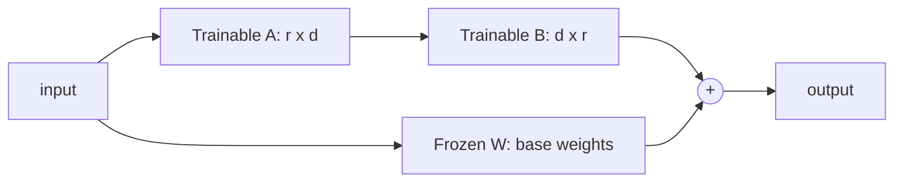

Full fine-tuning of an LLM means updating *every* weight (billions),
which costs a full training run's compute, produces a *full copy* of
the model (billions of parameters *per variant*), and is
correspondingly expensive to do *many times*. **Parameter-efficient
fine-tuning (PEFT)** is the family that avoids this: freeze the base
model and train a *tiny* set of added parameters, so the "fine-tuned
model" is the base *plus a small adapter* (megabytes, not gigabytes).
The flagship technique is **LoRA** (Low-Rank Adaptation), and its
serving consequence is the interesting part: many fine-tunes, one
base model.

## LoRA, the mechanism

The observation: fine-tuning's *update* to a weight matrix has low
*intrinsic rank* (the useful change is far simpler than the full
matrix), so instead of learning the full update `ΔW`, learn two small
matrices `A` and `B` such that `ΔW ≈ BA` (with `A` and `B` having a
small inner dimension `r`, the *rank*, e.g. 8 or 16). The base
weights `W` stay *frozen*; only `A` and `B` train.

The arithmetic: for a 4096×4096 weight matrix (16M parameters), a
rank-16 LoRA adds `2 × 4096 × 16 = 131k` parameters, **~0.8% of the
original**, and *only those* train. The consequences:

- **Training is cheap** (a fraction of the compute: no gradients
  through the frozen base, far less optimizer state, the reason a
  single GPU can fine-tune a model that would otherwise need a
  cluster).
- **The artifact is tiny** (the adapter is megabytes: you can store
  *hundreds* of them, one per task/tenant/customer, the
  [model-registry](/ai-ml/systems/data-versioning-lineage)
  economics, transformed).
- **No catastrophic forgetting** (the base is untouched: the adapter
  *adds* behavior, and disabling it returns the pristine base, the
  [fine-tuning-risk](/ai-ml/systems/fine-tuning-vs-prompting-vs-rag)
  mitigated by construction).

## The serving consequence: one base, many adapters

This is the systems payoff, and it changes the serving tier's
economics entirely:

- **The base model is loaded once** (shared across all adapters: the
  [multi-model serving](/ai-ml/systems/multi-model-serving-routing)
  problem *dissolves*, instead of N full models in
  [VRAM](/ai-ml/systems/gpu-accelerator-management), one base
  plus N tiny adapters, and the
  [warm-pool](/ai-ml/systems/model-caching-warm-pools) holds
  adapters trivially).
- **Per-request adapter switching** (the serving framework applies
  the request's adapter at inference time (a small matmul added to
  the forward pass): the router picks the adapter (per tenant, per
  task), the base stays resident, and the switching cost is
  negligible, the reason "one fine-tune per customer" became
  *economically possible*, and a real product pattern).
- **The adapter is the deploy unit** (a new fine-tune is a new small
  artifact, [versioned](/ai-ml/systems/data-versioning-lineage)
  and rolled out like any model: the
  [multi-model routing's](/ai-ml/systems/multi-model-serving-routing)
  version matrix, with the artifacts *small*).

## The broader PEFT family (worth naming)

- **Adapters** (the original: small bottleneck layers *inserted*
  between the model's blocks, slightly more invasive than LoRA,
  similar economics).
- **Prefix/prompt tuning** (train a small set of *virtual tokens*
  prepended to the input: the "soft prompt", even cheaper, less
  expressive, and it composes with the
  [prompt-as-artifact](/ai-ml/systems/prompt-engineering-systems)
  discipline).
- **QLoRA** (LoRA *on a quantized base*: the base in 4-bit, the
  adapter in higher precision, the reason a *single* consumer GPU
  can fine-tune a large model, and the technique that democratized
  fine-tuning: the [quantization](/ai-ml/systems/inference-optimization)
  and [LoRA](/ai-ml/systems/lora-peft) pages meeting).
- **The full-fine-tune case** (when the task needs *deep* behavior
  change, a new language, a large domain shift, LoRA may be too
  light: the honest answer is that PEFT is a *default*, not a law,
  and the choice is measured on the [eval
  set](/ai-ml/systems/evaluating-llm-systems)).

## Related concepts

- [Fine-Tuning vs Prompting vs RAG](/ai-ml/systems/fine-tuning-vs-prompting-vs-rag):
  when to fine-tune at all.
- [Multi-Model Serving & Routing](/ai-ml/systems/multi-model-serving-routing):
  the one-base-many-adapters serving pattern.
- [Inference Optimization](/ai-ml/systems/inference-optimization):
  quantization (QLoRA) and the cost levers.
- [Model Caching & Warm Pools](/ai-ml/systems/model-caching-warm-pools):
  the adapter economics.
- [Data Versioning & Lineage](/ai-ml/systems/data-versioning-lineage):
  the adapter as a versioned artifact.
