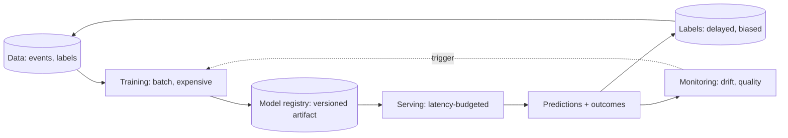

Every machine-learning system, from a spam filter to a chatbot, walks
the same lifecycle: **data is collected, a model is trained, the
model is deployed, its predictions are monitored, and it is
retrained when reality drifts.** That loop is the subject of this
whole track, because each stage is where a *systems* problem hides:
training is a [batch pipeline](/system-design/fundamentals/olap-vs-oltp),
serving is a [latency-budgeted](/system-design/fundamentals/latency-vs-throughput)
service, monitoring is [observability](/system-design/fundamentals/observability)
over predictions instead of requests, and the retrain loop is a
[streaming](/system-design/fundamentals/stream-vs-batch-processing)
question about feedback. The model itself — the math — is one box in
the diagram, and this site's AI/ML track is the engineering around
that box.

The difference from classic software engineering, stated once so the
whole track can lean on it: **code is written, but a model is
*fit*.** The behavior is not authored; it is *induced from data*, which
means every property of the system (what it does well, what it gets
wrong, when it stops working) is a property of the data it saw. That
single fact generates the discipline of this entire field: version
the data, measure on held-out data, watch for the world drifting
from the data, and treat the model as a *derived artifact* (the
[event-sourcing](/system-design/fundamentals/event-sourcing-and-cqrs)
instinct: the data is the source of truth, the model is a
projection) rather than as code you can read and reason about.

## The lifecycle, and the systems cost of each stage

- **Data collection** is a
  [pipeline](/system-design/fundamentals/message-queues-and-pubsub)
  problem (events in, curated training sets out: the
  [ETL](/system-design/fundamentals/olap-vs-oltp) tier with a
  labeling and versioning layer on top, the subjects of this
  track's next pages).
- **Training** is a [batch](/system-design/fundamentals/stream-vs-batch-processing)
  workload: expensive (hours to weeks of compute), interruptible,
  checkpointable, and *reproducible or worthless* (the same data
  and the same code should give the same model, which is the
  [experiment tracking](https://en.wikipedia.org/wiki/MLOps) half of
  MLOps).
- **Serving** is a normal distributed-systems problem with one
  twist: the artifact is *big* (megabytes to gigabytes of weights)
  and *stateful* (the model has its own memory of versions, and
  every request needs the *right* one), which is what
  [model serving](/system-design/hld/search-autocomplete)'s tier
  looks like.
- **Monitoring** is [observability](/system-design/fundamentals/observability)
  over *predictions* (not just uptime): input distributions
  (drift), output distributions, and the outcomes that reveal
  whether predictions were *good* — the honest hard part, because
  the ground truth arrives late and biased (the
  [fraud detector](/system-design/hld/fraud-detection)'s
  weeks-late label problem is the canonical example).
- **Retraining** closes the loop on a trigger (drift detected,
  schedule elapsed, or label volume accumulated), and the loop's
  *cadence* (days? weeks? continuous?) is one of the biggest
  architecture decisions in the field.

## The three questions that organize every ML design

1. **What is the prediction for?** (A ranking
  [feed](/system-design/hld/recommendation-system)? A fraud
  [verdict](/system-design/hld/fraud-detection)? A generated
  answer? The *task* determines the metric, the metric determines
  the data, and the data determines everything else.)
2. **What does the model see at prediction time?** (The raw
  request? Precomputed [features](/system-design/fundamentals/rate-limiting)?
  History? The latency budget and the feature freshness contract
  fall out of this answer — it is the question that separates
  offline from online inference inference.)
3. **How does the system learn it was wrong?** (Immediate labels?
  Delayed outcomes? Only *some* outcomes, biased by what the
  system chose to do? The feedback path determines the retraining
  loop and, with it, most of the system's long-term health.)

Every topic in this track (features, stores, evaluation, serving,
drift, the LLM-era machinery) is a deeper answer to one of those
three questions.

## Where this sits in the curriculum

This track deliberately covers the *engineering* side:
[pipelines](/system-design/fundamentals/stream-vs-batch-processing),
[features](/system-design/fundamentals/caching) (as state),
[serving tiers](/system-design/fundamentals/load-balancing),
[evaluation](/system-design/fundamentals/reliability-engineering)
(as measurement with consequences) — the same concepts as the rest
of this site, wearing ML's vocabulary. It does **not** cover
gradient descent, backpropagation, or transformer internals: those
are the *math* of the field, a different course, and the systems
designer's honest need is to know *what* each stage needs (data
shapes, compute, latency, feedback) rather than how the fitting
algorithm works inside the box.

## Related concepts

- [Stream vs. Batch Processing](/system-design/fundamentals/stream-vs-batch-processing):
  the training/serving split's machinery.
- [Event Sourcing & CQRS](/system-design/fundamentals/event-sourcing-and-cqrs):
  data as the source of truth, model as a projection.
- [Design a Recommendation System](/system-design/hld/recommendation-system)
  and [Design a Fraud Detection System](/system-design/hld/fraud-detection):
  the two canonical consumers of this machinery, already designed
  on this site.
