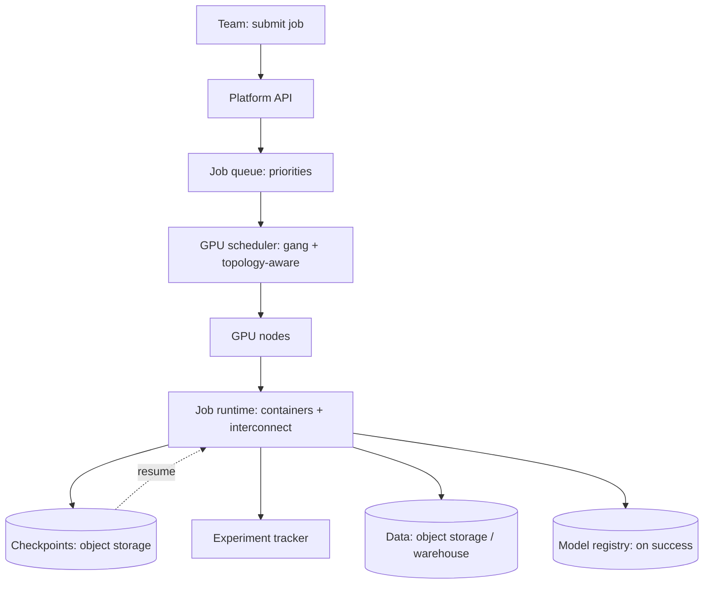

An ML training platform is the infrastructure that runs *training
jobs* at fleet scale: it takes a job definition (code + data +
config), schedules it onto the right
[GPUs](/ai-ml/systems/gpu-accelerator-management), runs it
([distributed](/ai-ml/systems/distributed-training)), tracks
it ([experiments](/ai-ml/systems/experiment-tracking)),
checkpoints it (resilience), and hands the result to the
[registry](/ai-ml/systems/model-registry). It is the
[model-serving-platform's](/ai-ml/systems/model-serving-platform)
training-side sibling, the other half of the platform pair, and
its HLD subject is *orchestration under scarcity*: many teams'
jobs, contending for scarce GPUs, with the scheduling, fault
tolerance, and cost accounting that make it operable.

## Requirements

**Functional**

- Submit a training job (image, command, resources, data refs);
  get it scheduled, run, and tracked.
- Distributed training support ([data/model/pipeline
  parallelism](/ai-ml/systems/distributed-training): the job
  declares its shape; the platform provides the topology).
- Checkpoint/resume, fault tolerance.
- Integration with the [experiment tracker](/ai-ml/systems/experiment-tracking)
  and [registry](/ai-ml/systems/model-registry).

**Non-functional**

- **GPU utilization** (the platform's *reason*: the
  [utilization](/ai-ml/systems/gpu-accelerator-management) of
  the scarce, expensive accelerators, and the
  [cost](/ai-ml/systems/cost-optimization-ml) argument).
- **Scheduling fairness** (many teams, one GPU pool: the
  [multi-tenant](/ai-ml/systems/multi-tenant-ml-platforms)
  discipline, quotas, priority, preemption: no team starves).
- **Fault tolerance** (a multi-day distributed job *will* fail: the
  [checkpoint/resume](/ai-ml/systems/distributed-training)
  machinery, and the *automatic* recovery (the
  [job scheduler's](/system-design/hld/distributed-job-scheduler)
  lease/retry discipline, at training scale)).
- **Cost attribution** (per-team, per-job: the
  [unit-economics](/ai-ml/systems/cost-optimization-ml)).

## The architecture

- **The job queue + scheduler** (the [GPU
  scheduler](/ai-ml/systems/gpu-accelerator-management)'s
  hardest case: *gang scheduling* (all a job's GPUs at once),
  *topology-awareness* (the [interconnect](/ai-ml/systems/distributed-training)
  locality), and *preemption* (the [spot/priority](/ai-ml/systems/cost-optimization-ml)
  classes), the [job-scheduler](/system-design/hld/distributed-job-scheduler)
  machinery, GPU-shaped).
- **The runtime** (the containers, the distributed-training
  framework, the interconnect config: the job's *environment*,
  pinned (the [reproducibility](/ai-ml/systems/reproducibility-metadata)
  discipline)).
- **Checkpointing** (periodic state to
  [object storage](/system-design/fundamentals/object-storage): the
  *resilience*, and the reason a failed job costs minutes, the
  [distributed-training](/ai-ml/systems/distributed-training)
  requirement, and the platform's *biggest* operational win).
- **Data access** (the jobs read training data (the
  [data lake](/system-design/fundamentals/olap-vs-oltp) / object
  storage): the *input pipeline* (the data-loader) is a common
  utilization bottleneck (the [GPU waits for
  data](/ai-ml/systems/cost-optimization-ml)), so the
  platform's data path (caching, sharding, fast storage) is part of
  its job).
- **Tracking + registry integration** (the job logs to the
  [tracker](/ai-ml/systems/experiment-tracking), the winning
  model to the [registry](/ai-ml/systems/model-registry): the
  platform *is* the pipeline's runtime (the
  [MLOps](/ai-ml/systems/mlops-cicd) machinery, executed)).

## The hard parts

- **Gang scheduling + topology** (a distributed job needs *all* its
  GPUs *at once* and *co-located*: the scheduler must reserve
  *simultaneously* (no partial allocation: a job holding half its
  GPUs is wasting them) and *place* with the interconnect in mind,
the [bin-packing](/system-design/fundamentals/capacity-planning-and-estimation)
  problem, with the topology constraint, and the reason GPU
  schedulers are their own specialty).
- **Fault tolerance for multi-day jobs** (a node dies at hour 40 of
  a 72-hour run: the platform must *detect*, *recover* (from
  checkpoint, possibly *reconfiguring* the parallelism), and
  *continue*, the [distributed-systems](/system-design/fundamentals/availability-and-reliability)
  discipline, and the checkpoint *frequency* dial (frequent =
  expensive, rare = more lost work: the
  [backup-frequency](/system-design/fundamentals/availability-and-reliability)
  trade)).
- **The data bottleneck** (the GPUs are *fast* and the data
  pipeline is *slow*: the [utilization](/ai-ml/systems/cost-optimization-ml)
  gap is often the *data*, not the model, the platform's data path
  (prefetch, cache, shard, fast storage) is a *first-class* feature,
  and the [input-pipeline](/system-design/fundamentals/stream-vs-batch-processing)
  engineering is where a lot of the "make training faster" wins
  live).
- **Spot instances and preemption** (the [cost
  lever](/ai-ml/systems/cost-optimization-ml): the platform
  runs jobs on preemptible capacity, *checkpointing* so preemption
  is cheap, the trade that makes large-scale training affordable,
  and the platform's job to manage).
- **Fairness across teams** (the [multi-tenant](/ai-ml/systems/multi-tenant-ml-platforms)
  scheduling: quotas (each team's guaranteed share), priorities
  (the important jobs preempt the rest), and the *politics* of GPU
  scarcity, a *socio-technical* problem the platform's policy
  encodes).

## Capacity sketch

The arithmetic: a platform of ~1000 GPUs serving ~50 teams: the
*utilization* target (~70-90%: the [cost](/ai-ml/systems/cost-optimization-ml)
number the platform exists to maximize), the job mix (many short
experiments + a few long runs: the *queue* and the *scheduling
policy* balance them), the *checkpoint* storage (the model state ×
the frequency × the job count: the [object
storage](/system-design/fundamentals/object-storage) tier), and the
*data* (the training sets read repeatedly: the
[caching](/system-design/fundamentals/caching) tier, and the
utilization bottleneck). The platform's *value* metric: GPU
utilization (the efficiency) and time-to-first-result (the
usability), the two numbers that justify it.

## Related concepts

- [Distributed Training](/ai-ml/systems/distributed-training):
  what the jobs run.
- [GPU & Accelerator Management](/ai-ml/systems/gpu-accelerator-management):
  the scheduler.
- [MLOps & CI/CD for Models](/ai-ml/systems/mlops-cicd) and
  [Experiment Tracking](/ai-ml/systems/experiment-tracking):
  the pipeline the platform runs.
- [Multi-Tenant ML Platforms](/ai-ml/systems/multi-tenant-ml-platforms):
  the fairness/isolation discipline.
- [Design a Model Serving Platform](/ai-ml/systems/model-serving-platform):
  the serving-side sibling.
