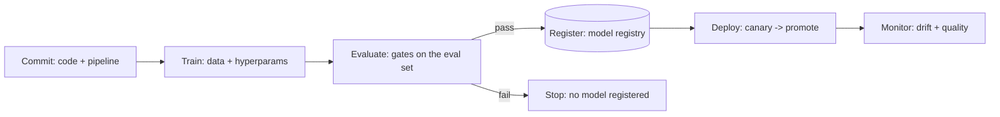

MLOps is the [CI/CD](/system-design/fundamentals/reliability-engineering)
discipline applied to the [ML lifecycle](/ai-ml/systems/ml-system-design-basics),
and the reason it is *different* from ordinary CI/CD is the same
reason the whole track exists: **a model is not code, it is a
*derived artifact* of code + data + configuration.** Ordinary CI
builds a binary from source; ML CI must build a model from a
dataset, a training run, and a set of hyperparameters — and
"reproducible" means pinning *all* of them, because the same code
on different data is a different model. This page is the pipeline
that turns a commit into a served model, safely.

## The two pipelines

MLOps has **two** CI/CD pipelines, and confusing them is the classic
mistake:

- **The code pipeline** (ordinary CI/CD: lint, test, build, deploy
  the *service* around the model — the
  [serving tier](/ai-ml/systems/model-serving-architectures)'s
  code). This is standard software engineering.
- **The model pipeline** (the ML-specific one: data validation →
  training → evaluation → registration → deployment of the *model
  artifact*). This is what MLOps adds, and its "build" is a training
  run (minutes to weeks), its "test" is the
  [eval suite](/ai-ml/systems/evaluating-llm-systems), and its
  "artifact" is the weights.

## The stages, and the gates

- **Data validation** (the first gate, and the one most teams skip:
  *validate the training data* (schema, distribution, freshness,
  no NaNs, no leakage) *before* training — because a training run
  on corrupt data wastes hours and produces a bad model
  confidently. The [data-versioning](/ai-ml/systems/data-versioning-lineage)
  discipline supplies the *expected* shape; validation checks the
  *actual*).
- **Training** (the build: reproducible — the
  [same data + code + config](/ai-ml/systems/reproducibility-metadata)
  gives the same model — and *parameterized* (the training run is
  a *job*, not a notebook: the [job-scheduler](/system-design/hld/distributed-job-scheduler)
  machinery, with [experiment tracking](/ai-ml/systems/experiment-tracking)
  recording everything).
- **Evaluation gates** (the tests: the model must pass the
  [offline eval suite](/ai-ml/systems/evaluating-llm-systems)
  (accuracy, fairness per segment, latency, cost) to be
  *registrable* — the gate that turns "we trained a model" into
  "we have a *candidate*" — and the gate is *automated*, because a
  human gate does not scale to the model count).
- **Registration** (the artifact into the
  [registry](/ai-ml/systems/model-registry), with its
  [lineage](/ai-ml/systems/data-versioning-lineage) and
  stage: the "build artifact" step, ML-shaped).
- **Deployment** (the [canary](/system-design/fundamentals/reliability-engineering)
  path: shadow → small % → promote, with the *automatic rollback*
  on guardrail breach — the [retraining loop's](/ai-ml/systems/concept-drift-retraining)
  deploy step, which is the same as any model's).

## Why it is hard (the ML-specific hazards)

- **The test is probabilistic** (a code test passes or fails; a
  model's eval is a *distribution* — "better on average" can hide a
  segment regression, so the gate is a *suite* of metrics and
  thresholds, not a single assertion: the
  [evaluation](/ai-ml/systems/evaluating-llm-systems) page's
  decomposition).
- **The build is expensive and non-deterministic** (a training run
  costs hours of GPUs and, without care, is not reproducible
  (floating-point non-determinism, data ordering, seed handling):
  the [reproducibility](/ai-ml/systems/reproducibility-metadata)
  discipline is the *prerequisite* for a trustworthy pipeline).
- **The inputs are external** (the data is not in the repo: the
  pipeline depends on a *dataset version*, and "the data changed"
  is a build input change — the reason [data
  versioning](/ai-ml/systems/data-versioning-lineage) is part
  of MLOps, not adjacent to it).
- **The trigger is not just a commit** (a model pipeline runs on a
  *schedule* (weekly retrain), a *drift breach* (the
  [retraining trigger](/ai-ml/systems/concept-drift-retraining)),
  or *new labels* — the [job-scheduler](/system-design/hld/distributed-job-scheduler)
  triggers, not just git hooks).

## The maturity ladder

The honest progression, and where most teams are:

1. **Manual notebooks** (the data scientist trains by hand, hands
   over a pickle: the pipeline is a person).
2. **Scripted pipeline** (the training is a script, run by hand or
   a cron: reproducible-ish, no gates).
3. **Automated pipeline with gates** (train → eval → register
   automatically, a human approves the *deploy*: the common mature
   state).
4. **Fully automated** (retrain → eval → canary → promote, with
   automatic rollback: the [fraud](/system-design/hld/fraud-detection)
   state, viable only with good guardrails).
5. **Continuous** (the pipeline runs on every trigger, many models,
   a platform team: the [multi-model](/ai-ml/systems/multi-model-serving-routing)
   fleet, the platform's job).

The ladder is a *cost* ladder: each rung buys automation with
infrastructure and discipline, and the right rung is the *lowest*
one that meets the drift rate and the model count — a
[capacity-planning](/system-design/fundamentals/capacity-planning-and-estimation)
decision for engineering investment.

## Related concepts

- [Model Registry & Versioning](/ai-ml/systems/model-registry):
  the artifact store the pipeline writes.
- [Reproducibility & Metadata](/ai-ml/systems/reproducibility-metadata):
  the pipeline's trustworthiness.
- [Experiment Tracking](/ai-ml/systems/experiment-tracking):
  the training-run record.
- [Concept Drift & Retraining](/ai-ml/systems/concept-drift-retraining):
  the trigger and the loop.
- [Design an ML Training Platform](/ai-ml/systems/ml-training-platform):
  the fleet-scale version.
