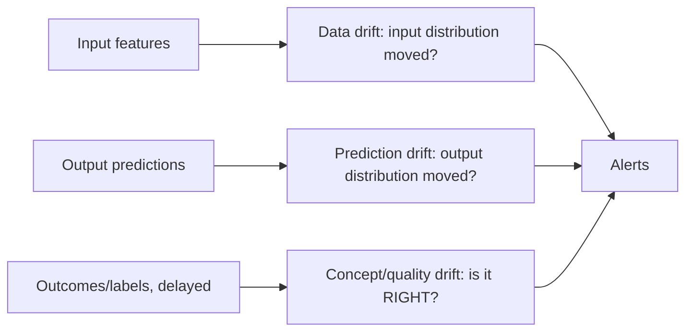

A deployed model is a **function frozen in time, applied to a world
that keeps moving**, and the gap between the two is what monitoring
exists to catch: the model was fit to last quarter's data
distribution, production is serving *this* quarter's, and nothing
about the model *code* changed while its quality silently decayed.
The distinctive thing about ML monitoring (vs. classic
[observability](/system-design/fundamentals/observability)) is
that **the failure is not an error** — the service returns 200s,
the latency is fine, the error rate is zero, and the *predictions
are just wrong* — which is why the monitoring must watch the
*predictions and inputs*, not the service.

## The three layers of monitoring

- **Data drift** (covariate shift): the *inputs* moved
  (a new user cohort, a season, a schema change upstream: the
  feature distribution no longer matches training). Detected
  *early* (no labels needed: compare the live feature histogram to
  the training snapshot: the
  [drift](/ai-ml/systems/data-versioning-lineage) of the
  [feature store](/ai-ml/systems/feature-stores)'s output),
  and it is a *warning*, not proof (the model may be robust to it).
- **Prediction drift**: the *outputs* moved (the score distribution
  shifted: fraud scores trending up, recommendations narrowing).
  Cheap to measure (no labels), a *symptom* (something changed),
  and often the first visible sign.
- **Concept drift / quality drift**: the *relationship* changed
  (the same input now means a different outcome: the
  [concept-drift page's](/ai-ml/systems/concept-drift-retraining)
  subject) — the *only* layer that measures whether the model is
  *right*, and the one that needs **labels**, which arrive late and
  biased (the [weeks-late chargeback](/system-design/hld/fraud-detection)
  problem). This is the honest ground truth, and it is why the
  other two layers exist: they are *early proxies* for a signal
  that arrives too late to be an alarm.

## Detecting drift, mechanically

- **Statistical tests on feature distributions** (per feature,
  live window vs. training reference: the
  [KS test](https://en.wikipedia.org/wiki/Kolmogorov%E2%80%93Smirnov_test),
  [PSI](https://en.wikipedia.org/wiki/Population_stability_index)
  (population stability index), or a simple histogram-distance: the
  [streaming-aggregate](/system-design/fundamentals/stream-vs-batch-processing)
  machinery computing per-feature summaries and comparing), with
  the per-feature alert (which feature moved) and the *model-level*
  rollup (how much drift, weighted by feature importance).
- **The "is it right" proxy**: when labels lag, the honest
  *immediate* quality signal is a **proxy metric** (a
  [recommendation](/system-design/hld/recommendation-system)'s
  immediate click-through, a [fraud](/system-design/hld/fraud-detection)
  model's challenge rate: a *related* signal available now, whose
  relationship to the true label was learned in the training set —
  a proxy, stated as one, not the truth).
- **The performance dashboard** (the [offline
  metrics](/ai-ml/systems/evaluation-metrics) recomputed on
  live data *once labels arrive*: the delayed, authoritative number,
  the one the [retraining trigger](/ai-ml/systems/concept-drift-retraining)
  fires on).

## The alerting discipline (and its trap)

The trap that makes naive drift monitoring useless: **alerting on
every drift.** Distributions move constantly (traffic is seasonal,
cohorts shift, an A/B test perturbs inputs) and a system that pages
on every statistical drift fires perpetually and gets muted (the
[alert-fatigue](/system-design/fundamentals/reliability-engineering)
death). The honest design, layered like the
[SLO](/system-design/fundamentals/reliability-engineering)
discipline:

- **Drift is a *warning*, not a page**: it feeds a dashboard and a
  daily digest (the "these features moved" review), because drift
  is common and usually harmless (the model is robust to a lot).
- **Quality degradation is a page**: the *proxy* metric (or the
  delayed true metric) breaching a threshold is the actionable
  signal, the one that means "users are getting worse answers," and
  it is tied to a
  [retraining decision](/ai-ml/systems/concept-drift-retraining).
- **The correlation is the calibration** (which drift *predicted*
  which quality drops, learned per system: the same
  [offline/online](/ai-ml/systems/offline-vs-online-evaluation)
  gap-calibration discipline, applied to monitoring — and the
  reason a mature system's drift alerts are *specific features*,
  not a generic score).

## The infrastructure

The monitoring is the [observability](/system-design/fundamentals/observability)
pillar pointed at model I/O, so it rides the same machinery: the
**exposure/feature log** (every request's features and prediction,
logged: the [event-sourcing](/system-design/fundamentals/event-sourcing-and-cqrs)
shape, and the *input* to every downstream analysis), the
**streaming aggregates** (per-feature live windows: the
[metrics system](/system-design/hld/metrics-monitoring-system)'s
shape), the **reference snapshot** (the training distribution, from
the [lineage](/ai-ml/systems/data-versioning-lineage)
record), and the **label join** (the delayed outcomes, joined to
the exposures: the [batch](/system-design/fundamentals/stream-vs-batch-processing)
pipeline the [fraud](/system-design/hld/fraud-detection) and
[ad-click](/system-design/hld/ad-click-aggregator) designs already
have). The model monitoring tier is, structurally, "the
observability stack with prediction-shaped data," which is why it
belongs to the platform team, not each model's owner.

## Related concepts

- [Concept Drift & Retraining](/ai-ml/systems/concept-drift-retraining):
  what to *do* when monitoring fires.
- [Evaluation Metrics for ML](/ai-ml/systems/evaluation-metrics):
  the metrics recomputed on live data.
- [Observability](/system-design/fundamentals/observability):
  the classic three pillars this specializes.
- [Feature Stores](/ai-ml/systems/feature-stores): the input
  distributions being monitored.
- [Design a Fraud Detection System](/system-design/hld/fraud-detection):
  the delayed-label monitoring, in production.
