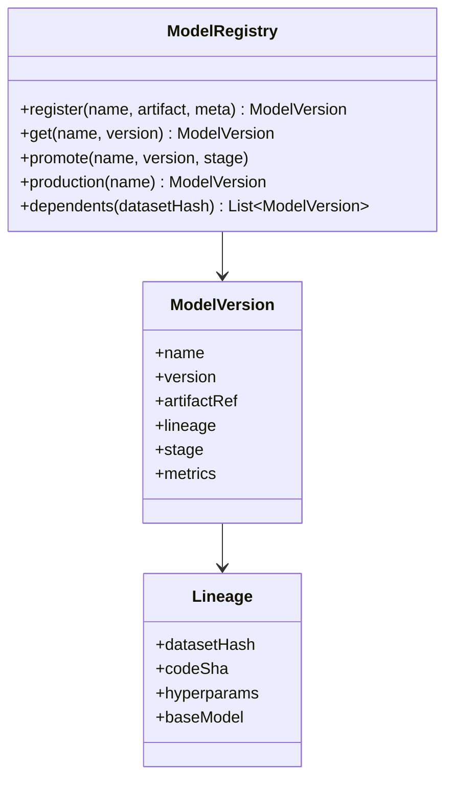

The [model registry concept](/ai-ml/systems/model-registry)
covers the system; this is the code-level design: the classes for
models, versions, stages, and lineage, and the *invariants* the
code enforces (immutable versions, one production version, valid
stage transitions). The design's value is the *guarantees* — the
registry is the *system of record*, so its rules must be
*structural*, not conventional.

## The requirements (as code)

- `register(model, artifact, metadata) -> Version` (immutable).
- `get_version(model, version) -> ModelVersion`.
- `promote(model, version, stage)` (the stage transition, with the
  *one-production* invariant).
- `lineage(version) -> provenance` (the recorded inputs).
- Query: what is in production, what depends on a dataset.

## The class model



The two invariants the code enforces: **versions are immutable**
(a registered `ModelVersion` is never mutated — a fix is a *new*
version), and **a model has exactly one `production` version** (the
promotion *moves* the pointer, atomically, and the previous
production version is retained for rollback).

## The C++ sketch

```cpp
enum class Stage { Staging, Production, Archived };

struct Lineage {
    std::string datasetHash;
    std::string codeSha;
    std::map<std::string, std::string> hyperparams;
    std::optional<std::string> baseModel;   // for fine-tunes
};

struct ModelVersion {
    std::string name;
    int version;
    std::string artifactRef;                // the object-storage reference
    Lineage lineage;
    Stage stage = Stage::Staging;
    std::map<std::string, double> metrics;  // the eval results
};

class ModelRegistry {
public:
    // Register: an immutable new version. Never overwrites.
    ModelVersion registerVersion(const std::string& name,
                                 const std::string& artifactRef,
                                 const Lineage& lineage,
                                 const std::map<std::string, double>& metrics) {
        std::lock_guard<std::mutex> guard(mtx_);
        int next = ++versionCounter_[name];  // monotonic, per model
        ModelVersion v{name, next, artifactRef, lineage, Stage::Staging, metrics};
        versions_[name][next] = v;           // append-only
        return v;
    }

    // Promote: the ONE-production invariant, enforced atomically.
    void promote(const std::string& name, int version, Stage stage) {
        std::lock_guard<std::mutex> guard(mtx_);
        auto& modelVersions = versions_[name];
        auto it = modelVersions.find(version);
        if (it == modelVersions.end()) {
            throw std::runtime_error("no such version");
        }
        if (stage == Stage::Production) {
            for (auto& [v, mv] : modelVersions) {
                if (mv.stage == Stage::Production) {
                    mv.stage = Stage::Archived;   // the previous one demoted
                }
            }
        }
        it->second.stage = stage;
    }

    // The production pointer: the serving tier's source of truth.
    std::optional<ModelVersion> production(const std::string& name) {
        std::lock_guard<std::mutex> guard(mtx_);
        for (const auto& [v, mv] : versions_[name]) {
            if (mv.stage == Stage::Production) {
                return mv;
            }
        }
        return std::nullopt;
    }

    // Reverse lineage: which versions depend on this dataset? (blast radius)
    std::vector<ModelVersion> dependents(const std::string& datasetHash) {
        std::lock_guard<std::mutex> guard(mtx_);
        std::vector<ModelVersion> out;
        for (const auto& [name, byVersion] : versions_) {
            for (const auto& [v, mv] : byVersion) {
                if (mv.lineage.datasetHash == datasetHash) {
                    out.push_back(mv);       // the migration-planning query
                }
            }
        }
        return out;
    }

private:
    std::mutex mtx_;
    std::map<std::string, std::map<int, ModelVersion>> versions_;
    std::map<std::string, int> versionCounter_;
};
```

The design decisions:

- **The version counter is per-model and monotonic** (never reused:
  a *deleted* version's number is *retired*, not recycled — the
  [immutability](/system-design/fundamentals/event-sourcing-and-cqrs)
  discipline, so "model v7" means the same artifact forever).
- **`promote` demotes the previous production *in the same critical
  section*** (the *one-production* invariant, enforced atomically —
  the [concurrency](/system-design/fundamentals/concurrency-and-parallelism)
  discipline: no window where two versions are production, and no
  window where *none* is).
- **The artifact is a *reference*, not the bytes** (the registry
  stores the [object-storage](/system-design/fundamentals/object-storage)
  path: the [metadata/data-plane split](/system-design/hld/object-storage-system),
  and the reason the registry stays *small and fast* while the
  artifacts are *huge and immutable*).
- **The reverse-lineage query is *the* operational value** (which
  models use this dataset/base: the
  [migration](/ai-ml/systems/feature-model-backfills) planning,
  and the reason the lineage is *indexed*, not just *stored*).

## The production usage

The [serving tier](/ai-ml/systems/multi-model-serving-routing)
resolves "what to load" through `production(name)`; the
[pipeline](/ai-ml/systems/mlops-cicd) calls `registerVersion`;
the [governance](/ai-ml/systems/model-governance-compliance)
gates the `promote` (the stage transition *requires* the approval
record); and the [lineage](/ai-ml/systems/data-versioning-lineage)
is what makes the [reproducibility](/ai-ml/systems/reproducibility-metadata)
and migration queries answerable — the registry is the *hub* the
whole AI/ML track's other systems read and write.

## Related concepts

- [Model Registry & Versioning](/ai-ml/systems/model-registry):
  the concept and system.
- [Data Versioning & Lineage](/ai-ml/systems/data-versioning-lineage):
  the provenance the registry records.
- [Reproducibility & Metadata](/ai-ml/systems/reproducibility-metadata):
  the lineage's purpose.
- [Model Governance & Compliance](/ai-ml/systems/model-governance-compliance):
  the promotion gates.
- [Design a Feature Store (Code-Level)](/ai-ml/systems/feature-store-lld):
  the sibling LLD.
