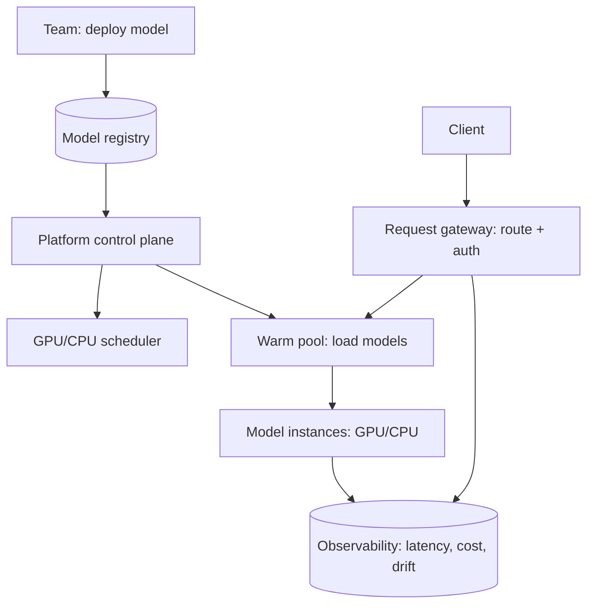

A model serving platform is the infrastructure that turns "we have
models" into "we serve models": a shared fleet that hosts *many*
models, *many* versions, for *many* teams, with the routing,
warming, scaling, and observability that make it operable. It is the
[multi-model serving](/ai-ml/systems/multi-model-serving-routing)
and [serving-architecture](/ai-ml/systems/model-serving-architectures)
pages as a *platform* — the internal product every ML org builds —
and the HLD's job is the *platform* concerns: onboarding, isolation,
utilization, and the deploy path, on top of the serving tier's
single-model mechanics.

## Requirements

**Functional**

- Deploy a model (from the [registry](/ai-ml/systems/model-registry))
  to the fleet; get an endpoint.
- Route requests to the *right* model version (the
  [A/B/canary](/ai-ml/systems/ab-testing-experimentation)
  assignment).
- Support many models, many teams, GPU and CPU, batch and real-time.
- Rollback, drain, and version lifecycle.

**Non-functional**

- **Reliability** (the platform is *shared infrastructure*: its
  outage is *every* team's outage — the
  [SLO](/system-design/fundamentals/reliability-engineering) is
  high, and the [blast radius](/system-design/fundamentals/multi-tenancy-and-data-residency)
  containment matters).
- **Utilization** (the platform's *reason to exist* (vs. per-team
  fleets) is *efficiency*: [GPU
  utilization](/ai-ml/systems/gpu-accelerator-management) and
  packing, the [cost](/ai-ml/systems/cost-optimization-ml)
  argument).
- **Isolation** (teams share the fleet: a bad model must not
  degrade others — the [multi-tenant](/ai-ml/systems/multi-tenant-ml-platforms)
  discipline).
- **Deploy speed** (a team ships a model in minutes, not days: the
  platform's *usability* is a requirement, or teams route around
  it).

## The architecture

- **Control plane** (the platform's *API*: register a model,
  configure its routing and resources, manage versions — the
  [metadata plane](/system-design/hld/object-storage-system),
  backed by the [registry](/ai-ml/systems/model-registry)).
- **The serving fleet** (the shared resource: GPU and CPU pools,
  running the model instances — the
  [serving tier](/ai-ml/systems/model-serving-architectures),
  *shared*).
- **The warm pool** (the [model
  caching](/ai-ml/systems/model-caching-warm-pools): hot
  models resident, the tail loaded on demand — the *utilization*
  mechanism).
- **The gateway** (the [request routing](/ai-ml/systems/multi-model-serving-routing):
  model-version-aware, auth, quotas, observability — the
  [LLM-gateway](/ai-ml/systems/llm-gateways) idea,
  platform-wide).
- **The scheduler** (the [GPU scheduler](/ai-ml/systems/gpu-accelerator-management):
  placing models on devices, packing, preemption).

## The hard parts

- **Utilization vs. isolation** (the platform's central tension:
  *pack* models onto GPUs for efficiency (the *reason* for a
  platform), *isolate* them for safety (the *reason* teams distrust
  one) — the [MIG/MPS](/ai-ml/systems/gpu-accelerator-management)
  partitioning and the per-model resource limits, the dial).
- **The warm-pool sizing** (which models are warm, how many, at
  what cost: the [hot/cold
  split](/ai-ml/systems/multi-model-serving-routing), a
  *capacity-planning* problem the platform *automates* (teams
  declare a priority; the platform warms the important ones) — and
  the [stampede](/ai-ml/systems/model-caching-warm-pools)
  when a cold model spikes).
- **Version routing and experiments** (the platform *is* the
  [experimentation](/ai-ml/systems/ab-testing-experimentation)
  platform's serving half: the routing percentages, the sticky
  assignment, the [canary](/system-design/fundamentals/reliability-engineering)
  — a *product feature* the platform must expose, or teams build
  their own, badly).
- **The deploy path** (team submits a model → the platform
  validates (the [guardrails](/ai-ml/systems/llm-guardrails-validation)
  and [governance](/ai-ml/systems/model-governance-compliance)
  gates) → loads → routes → monitors: the *paved road* that makes
  the platform *used* — a bad deploy UX means teams bypass it,
  which defeats the platform's whole purpose).
- **Observability and cost attribution** (the platform sees *all*
  the traffic: the [token/GPU cost per team per
  model](/ai-ml/systems/cost-optimization-ml), the
  [drift](/ai-ml/systems/model-monitoring-drift) per model —
  the *unit economics* that justify the platform, and the
  [showback](/ai-ml/systems/multi-tenant-ml-platforms) that
  drives good behavior).

## Capacity sketch

The arithmetic: a platform hosting ~1,000 models for ~50 teams:
the hot set (~50 models, covering ~95% of traffic) is resident on a
GPU pool sized for the peak (the [warm
pool](/ai-ml/systems/model-caching-warm-pools)); the tail
(~950 models, ~5% of traffic) is loaded on demand (the
[serverless-ish](/ai-ml/systems/serverless-inference) tier);
the request gateway is a [stateless,
autoscaled](/ai-ml/systems/autoscaling-inference) tier; and
the *platform's* cost is the GPU pool's utilization × the per-GPU
price — the number the whole platform exists to *minimize*.

## Related concepts

- [Model Serving Architectures](/ai-ml/systems/model-serving-architectures)
  and [Multi-Model Serving & Routing](/ai-ml/systems/multi-model-serving-routing):
  the tier mechanics.
- [Model Caching & Warm Pools](/ai-ml/systems/model-caching-warm-pools)
  and [GPU & Accelerator Management](/ai-ml/systems/gpu-accelerator-management):
  the utilization machinery.
- [Multi-Tenant ML Platforms](/ai-ml/systems/multi-tenant-ml-platforms):
  the isolation discipline.
- [MLOps & CI/CD for Models](/ai-ml/systems/mlops-cicd):
  the deploy path.
- [Design an ML Training Platform](/ai-ml/systems/ml-training-platform):
  the training-side sibling.
