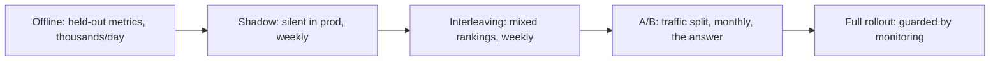

The central uncomfortable fact of applied ML: **offline evaluation
and online performance are different questions, and the first does
not imply the second.** A model can improve every held-out metric
and degrade the product; a model can regress offline and help
online. The reason is structural, not a bug: the offline dataset is
a *frozen, biased sample of the past*, and the online world is a
*reactive system* the model changes by existing. This page is the
two evaluations, why they diverge, and the discipline that connects
them.

## The two evaluations

**Offline** (the fast, cheap, safe loop): a held-out dataset, the
[metric suite](/ai-ml/systems/evaluation-metrics), and a
comparison of candidate models. It runs in minutes, costs nothing,
touches no users, and is the only loop you can run a thousand times
a day, which is why it *must* exist, and why trusting it *alone*
is the classic mistake.

**Online** (the slow, expensive, real loop): the model in front of
real users, measured on business metrics, usually through
[A/B testing](/ai-ml/systems/ab-testing-experimentation). It
is the *ground truth* ("did the product get better?"), it costs
traffic and weeks, and it can only answer a few questions at a time,
which is why it is the *final* filter, not the exploration loop.

## Why they diverge (the honest list)

The divergence sources, each a named production surprise:

- **The offline data is not the online distribution** (the
  [training/serving skew](/ai-ml/systems/feature-engineering-basics)
  and [drift](/ai-ml/systems/model-monitoring-drift) families:
  the model is measured on data that no longer matches production).
- **The offline data is biased by the previous model** (the
  [feedback loop](/system-design/hld/recommendation-system): you
  only have outcomes for what the *old* model showed, so "better
  offline" can mean "better at predicting the old system's
  behavior").
- **The metric is a proxy for the goal** (the
  [metric-vs-goal](/ai-ml/systems/evaluation-metrics) trap:
  a better click-prediction model can *lower* long-term retention:
  the [ad-click](/system-design/hld/ad-click-aggregator) and
  feed-saturation dynamics).
- **The online system reacts** (a model that improves ranking for
  one segment shifts traffic patterns, supply, and competitor
  behavior: the offline set could not have contained the
  equilibrium the new model creates).
- **Non-model effects** (the [latency](/system-design/fundamentals/latency-vs-throughput)
  of a bigger model, the cost, the UX changes bundled with it:
  online measures the *whole* change, offline only the model).

## The connecting disciplines

The machinery that keeps the two loops honest and *connected*:

- **Counterfactual/off-policy evaluation** (the honest offline
  estimate of a *new policy*'s online value: using the logged
  [propensities](/system-design/hld/recommendation-system)
  (what the old system would have done) to re-weight the observed
  outcomes: the [bandit](https://en.wikipedia.org/wiki/Multi-armed_bandit)
  machinery that lets a candidate ranking be *estimated* offline
  without deploying it, and the reason exploration is logged at
  all).
- **Interleaving** (the cheap online probe: rather than splitting
  users A/B, *mix* the two models' rankings in one session and
  measure which model's items the user engages with: far more
  sensitive per user than an A/B, and the standard pre-A/B step for
  ranking changes).
- **Shadow deployment** (the new model runs *silently* beside the
  old: same traffic, both score, only the old one serves, the
  differences logged, the [fraud detector's](/system-design/hld/fraud-detection)
  standard pre-launch, and the way to catch serving-path failures
  (feature lookup bugs, latency regressions) with *zero* user risk
  before the A/B).
- **The offline-online metric mapping** (the discipline of
  *tracking both* and studying the gap: the dashboard that plots
  "offline NDCG delta" against "online engagement delta" across
  launches is the *only* way to learn how much to trust offline,
and it is a per-system, per-metric calibration that every mature
  ML org has and no textbook provides).

## The evaluation funnel, designed

The standard pipeline that uses both loops correctly, in order of
increasing cost and decreasing frequency:

Each stage is a *filter* that catches what the previous cannot:
offline catches broken models cheaply, shadow catches serving bugs
and latency, interleaving catches ranking regressions with high
sensitivity, and the A/B settles the business question. The funnel's
existence is the page's thesis: **"offline said so" is a hypothesis,
and the funnel is the falsification machinery.**

## Related concepts

- [Evaluation Metrics for ML](/ai-ml/systems/evaluation-metrics):
  what the offline loop measures.
- [A/B Testing & Experimentation](/ai-ml/systems/ab-testing-experimentation):
  the online loop's machinery.
- [Model Monitoring & Data Drift](/ai-ml/systems/model-monitoring-drift):
  the production signal that feeds back.
- [Design a Recommendation System](/system-design/hld/recommendation-system):
  the canonical offline/online-gap product.
- [Reliability Engineering](/system-design/fundamentals/reliability-engineering):
  the canary/guardrail discipline the funnel borrows.
