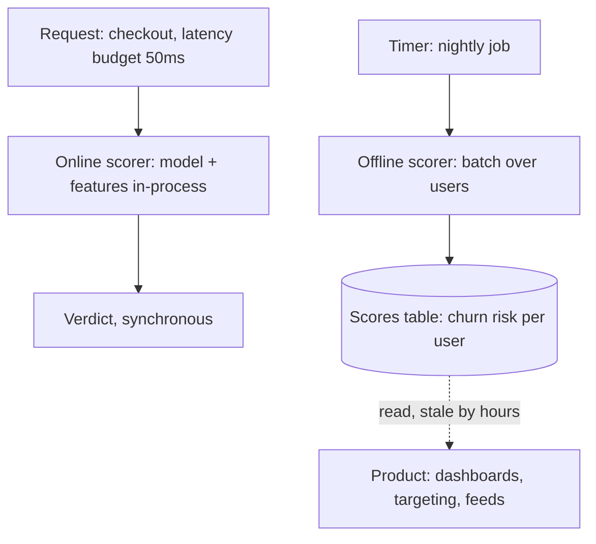

Every prediction a system makes falls into one of two modes, and the
difference is not an optimization detail — it is **two different
architectures with opposite latency budgets, opposite consistency
requirements, and opposite failure modes.** In **online inference**,
the prediction happens *inside a request* ("is this transaction
fraud?" while the checkout waits), so the budget is milliseconds
and the system is a real-time service. In **offline inference**,
the prediction happens *on a schedule over a dataset* ("score every
user's churn risk tonight"), so the budget is hours and the system
is a [batch pipeline](/system-design/fundamentals/stream-vs-batch-processing).
The same model can run in both modes for different products
(churn-risk scores: offline; a
fraud verdict: online), and the choice is a *product* decision made
per prediction, not a property of the model.

## The two shapes

**Online** is a [latency-budgeted](/system-design/fundamentals/latency-vs-throughput)
service: the model sits in memory (or on a GPU) on the serving tier,
the *features* must be fetched in single-digit milliseconds
([feature stores](/ai-ml/systems/feature-stores) exist exactly
because "compute the user's 90-day aggregates" is not a
millisecond-scale operation), and every request is scored
synchronously. The engineering: model loading and versioning on
the serving tier, [feature freshness](#the-freshness-contract) (the
feature was precomputed *when*? a "current balance" feature
precomputed an hour ago is a lie), and the graceful degradation of
the whole subsystem (fraud scoring down: allow-with-challenge, not
checkout-down: the [fail-open question](/system-design/lld/rate-limiter-lld),
with money on the answer).

**Offline** is a [batch](/system-design/fundamentals/olap-vs-oltp)
workload: the same model applied to a whole table on a schedule,
writing scores back for *later* consumption (the product reads
precomputed values, minutes-to-hours stale, exactly the
[cache](/system-design/fundamentals/caching)-precompute trade at
ML scale). The engineering: the pipeline itself (join events,
compute features, score, write: the
[warehouse](/system-design/fundamentals/olap-vs-oltp) tier), the
*schedule* (nightly is fine for churn, useless for
"today's deal email": the freshness requirement decides), and the
publishing discipline (scores are *derived*: rebuildable, versioned
per run, and the consumer's staleness tolerance is its contract).

## The freshness contract

The decision rule, which this track keeps returning to: **what
does the prediction depend on, and how fresh must that be for the
prediction to be honest?**

- A churn score depends on 90-day behavior: freshness of *hours*
  is invisible → offline, precomputed.
- A fraud verdict depends on the *current* transaction: freshness
  of *now*, by definition → online, and its features are the
  [streaming](/system-design/fundamentals/stream-vs-batch-processing)
  windowed aggregates ([the fraud design](/system-design/hld/fraud-detection)'s
  whole feature pipeline).
- A [feed](/system-design/hld/recommendation-system) ranking
  depends on "what did you engage with *today*": freshness of
  minutes → online, but over *precomputed* candidates: the
  two-stage trick that lets an expensive model run in a
  latency-budgeted path by scoring *few* items against *fresh*
  features.

That last case is the standard hybrid and the most instructive:
**the product's freshness need applies to the features, not the
model**, so the architecture splits — compute the expensive
aggregates offline (the feature store), fetch-and-score online
(the small, fresh, per-request features), and the "impossible"
budget becomes a small one. Most real ML systems are this hybrid,
and *drawing the line* (which features are precomputed, which
computed per request) is the design's actual work.

## The failure modes, per mode

**Online's** classic failures: the model *loading* cold (the
[multi-GB](/system-design/fundamentals/scalability) artifact
pulled into a new pod: warm pools), the *feature lookup* as the
real latency (the model is microseconds, the 10-store fan-out is
the budget), and the **degradation contract** (when scoring
fails, what does the request do? fail-open, fail-closed, or
challenge — a product decision, designed like any
[fallback](/system-design/fundamentals/availability-and-reliability)).

**Offline's** classic failures: the *stale score* consumed
confidently (the dashboard reads yesterday's churn scores as if
current: the [CQRS](/system-design/fundamentals/event-sourcing-and-cqrs)
read-model staleness, wearing ML clothes), the **pipeline
dependency** (the nightly job is late, everything downstream is
late: the [job scheduler](/system-design/hld/distributed-job-scheduler)'s
whole subject), and the *silent* one — the model was retrained and
the offline scores changed meaning, and nobody noticed that the
churn-score distribution moved (the
[drift](/system-design/fundamentals/observability) discipline,
applied to your own outputs).

## Related concepts

- [Batch vs Real-Time Prediction](/ai-ml/systems/batch-vs-real-time-prediction):
  the same decision, made per-product, with the pipeline shapes.
- [Feature Stores](/ai-ml/systems/feature-stores): the
  machinery the freshness contract runs on.
- [Stream vs. Batch Processing](/system-design/fundamentals/stream-vs-batch-processing):
  the underlying two-tier architecture.
- [Design a Fraud Detection System](/system-design/hld/fraud-detection):
  the canonical online-inference consumer.
- [Latency vs. Throughput](/system-design/fundamentals/latency-vs-throughput):
  the budget that the online half must fit.
