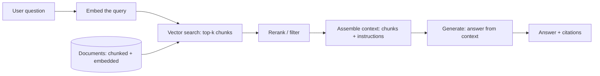

A large language model knows what it was trained on and nothing
else: ask it about *your* documents, *last week's* data, or anything
outside its training cut-off, and it will either say it does not
know or, worse, **confidently make something up**. **Retrieval-
Augmented Generation (RAG)** is the standard fix: before generating,
*retrieve* relevant documents and put them *in the prompt*, so the
model answers from the retrieved context rather than from memory.
The design is a pipeline (retrieve → assemble → generate) and the
craft is in the joins between the stages, where every real RAG
failure lives.

## The pipeline

**Offline** (the index): documents are [chunked](/ai-ml/systems/chunking-indexing-strategies)
(split into retrievable pieces), embedded
([vectors](/ai-ml/systems/embeddings-vector-representations)),
and stored in a [vector database](/ai-ml/systems/vector-databases)
(plus often a keyword index for
[hybrid search](/system-design/fundamentals/search-and-inverted-index)).
**Online** (the query): embed the question, retrieve the nearest
chunks, (optionally rerank), assemble them with instructions into a
prompt, and generate.

## Where it fails (the honest failure taxonomy)

RAG's quality problems are almost never "the LLM is bad": they are
*pipeline* failures, and naming them is the design's content:

- **Retrieval miss** (the right chunk was not retrieved: the answer
  is not in the context, so the model either refuses or
  hallucinates, the *most common* failure, and the reason
  [chunking](/ai-ml/systems/chunking-indexing-strategies) and
  hybrid search dominate RAG quality work: you cannot generate from
  context you did not retrieve).
- **Chunking damage** (the chunk split the answer in half, a
  table's header in one chunk, its rows in another, so the
  retrieved context is *incomplete*: the
  [chunking page's](/ai-ml/systems/chunking-indexing-strategies)
  whole subject).
- **Context overload** (too many chunks retrieved, the relevant one
  buried among noise, and the model distracted: "lost in the
  middle" is a documented behavior, more context is *not* better,
  and the [rerank](/ai-ml/systems/rag) step exists to keep
  the *few* most relevant).
- **The generation ignores the context** (the model answers from
  memory despite the retrieved facts: the prompt's job is to
  *constrain* ("answer only from the context"), and the
  [guardrails](/ai-ml/systems/llm-guardrails-validation) and
  [evaluation](/ai-ml/systems/evaluating-llm-systems) pages
  measure and enforce it).
- **Stale index** (the documents changed, the index did not: the
  [freshness](/system-design/fundamentals/caching) problem, and the
  reason the offline pipeline is a *standing* system, not a one-time
  job, the [re-indexing](/ai-ml/systems/chunking-indexing-strategies)
  discipline).

## The design decisions

- **Retrieval strategy** (vector-only (semantic, misses exact terms),
  keyword-only (exact, misses paraphrase), or **hybrid** (both,
  merged: the modern default, and the
  [search page's](/system-design/fundamentals/search-and-inverted-index)
  hybrid argument), plus **reranking** (a second, slower model
  scores the top ~100 retrieved chunks and keeps the top ~5: the
  *precision* stage after the *recall* stage, the
  [filter-then-refine](/system-design/fundamentals/geospatial-indexing)
  pattern).
- **Context assembly** (how many chunks, in what order, with what
  instructions, under the [context-window](/ai-ml/systems/llm-serving)
  budget: the *prompt-construction* decision, and the
  [prompt-as-artifact](/ai-ml/systems/prompt-engineering-systems)
  discipline).
- **Citations and grounding** (the answer should cite *which chunk*
  it used: a *product* requirement (trust, verifiability) and a
  *quality* mechanism (a citation the user can check is a
  hallucination the system can catch), the
  [evaluation page's](/ai-ml/systems/evaluating-llm-systems)
  groundedness, surfaced to the user).
- **Access control** (retrieval must respect permissions: the
  user's search must only return *their* documents, the
  [multi-tenancy](/system-design/fundamentals/multi-tenancy-and-data-residency)
  discipline, and a real RAG vulnerability when the vector store
  ignores authz: the *filtered-search* problem, with security
  stakes).

## The latency and cost profile

RAG's serving shape: the **retrieval** is milliseconds (an
[ANN](/ai-ml/systems/similarity-search-ann) lookup), the
**generation** dominates (the [LLM](/ai-ml/systems/llm-serving)
call: seconds), and the **context size** is the cost lever (more
retrieved tokens = more prefill latency *and* more money: the
[token-budget](/ai-ml/systems/cost-token-budgets) page's
arithmetic, and the reason *fewer, better* chunks beat *more*). The
serving-tier consequences: the retrieval and generation are
*separate services* (the retrieval a low-latency [ANN
tier](/ai-ml/systems/vector-databases), the generation the
[streaming LLM tier](/ai-ml/systems/llm-serving)), the
[prompt cache](/ai-ml/systems/llm-caching) helps when the
*instructions* prefix is stable (the chunks vary, the system prompt
does not), and the whole thing is a
[pipeline](/system-design/fundamentals/message-queues-and-pubsub)
whose stages have different failure and scaling profiles.

## Related concepts

- [Chunking & Indexing Strategies](/ai-ml/systems/chunking-indexing-strategies):
  the offline half, and RAG's quality ceiling.
- [Embeddings & Vector Representations](/ai-ml/systems/embeddings-vector-representations)
  and [Vector Databases](/ai-ml/systems/vector-databases):
  the retrieval tier.
- [Search & Inverted Index](/system-design/fundamentals/search-and-inverted-index):
  hybrid retrieval and reranking.
- [LLM Serving Basics](/ai-ml/systems/llm-serving): the
  context-window and token budget.
- [Evaluating LLM Systems](/ai-ml/systems/evaluating-llm-systems):
  measuring retrieval and grounding.
