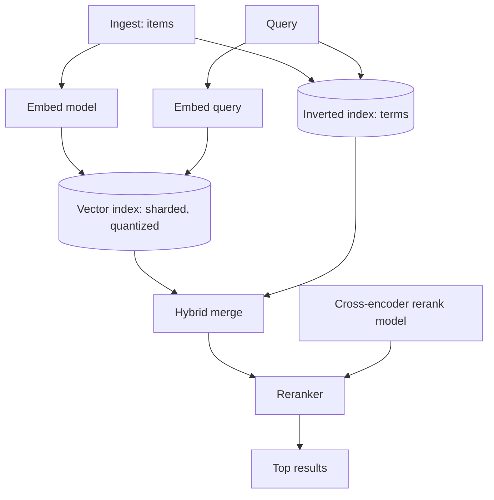

Semantic search ("find things that *mean* this, not just contain
this word") is the [vector-database](/ai-ml/systems/vector-databases)
and [ANN](/ai-ml/systems/similarity-search-ann) machinery as a
*product*: a search engine whose ranking is by *meaning-distance*
rather than term-match, usually *hybrid* with classic keyword search.
It is the retrieval half of [RAG](/ai-ml/systems/rag) without
the generation, and it is its own HLD because the requirements
(latency, scale, freshness, filtering) shape the architecture
independently of any LLM.

## Requirements

**Functional**

- Query in natural language; return ranked results (documents,
  products, passages) by semantic relevance.
- Hybrid: also match exact terms (the query "error code 0x42"
  must find the *literal* string, which embeddings may blur).
- Filters: by category, date, tenant, permissions.
- Freshness: new items searchable within minutes.
- Relevance tuning: the ranking is *tuned* against a labeled set.

**Non-functional**

- **Latency**: the search box's budget (tens to low hundreds of ms,
  the [autocomplete-class](/system-design/hld/search-autocomplete)
  requirement), *including* the query embedding and the ANN search.
- **Scale**: millions to billions of items, [sharded](/system-design/fundamentals/consistent-hashing).
- **Recall/precision**: the [ANN dial](/ai-ml/systems/similarity-search-ann)
  (approximate: the recall target is a *product* decision).
- **Cost**: the embedding + index memory (the
  [quantization](/ai-ml/systems/inference-optimization) lever).

## The architecture

- **The two indexes** (vector (semantic) + inverted (keyword): the
  [hybrid](/system-design/fundamentals/search-and-inverted-index)
  default, merged by a score-blend — the reason "just vectors" is
  usually wrong: keyword search catches the exact-match cases
  embeddings blur, and the merge is the ranking design).
- **The embedding model as infrastructure** (the query embeds
  *per request* (a [small model](/ai-ml/systems/model-serving-architectures),
  tens of ms: the latency budget's first line), the items embed
  *at ingest* (the [offline pipeline](/ai-ml/systems/batch-vs-real-time-prediction),
  the [feature-store](/ai-ml/systems/feature-stores) pattern:
  precomputed, versioned) — and the *model-era* discipline (a new
  embedding model = re-embed everything: the
  [migration](/ai-ml/systems/feature-model-backfills)).
- **The reranker** (the [two-stage
  retrieve-then-rank](/ai-ml/systems/rag) shape: the ANN
  returns ~100 candidates *fast* (recall), a
  [cross-encoder](https://en.wikipedia.org/wiki/Learning_to_rank)
  reranks the top ~20 *accurately* (precision) — the
  [filter-then-refine](/system-design/fundamentals/geospatial-indexing)
  pattern, and the quality lever).

## The hard parts

- **Hybrid ranking** (the *merge* of vector and keyword scores is a
  *relevance-modeling* problem: naive score addition is wrong
  (the scales differ), so the standard is [reciprocal rank
  fusion](https://plg.uwaterloo.ca/~gvcormac/cormacksigir09-rrf.pdf)
  or a learned blend — the [ranking](/system-design/hld/recommendation-system)
  problem, search-shaped, and tuned against a labeled set).
- **Filtered search** (the [filtered-vector-search
  problem](/ai-ml/systems/similarity-search-ann), again:
  "semantic search *within* category X / tenant Y" — the *actual*
  query, and the one the naive implementations get wrong).
- **The ANN dial as a product decision** (recall vs. latency vs.
  memory: the [HNSW/IVF/PQ](/ai-ml/systems/similarity-search-ann)
  choice and its tuning, and the *honest* statement of the recall
  target — a search engine that "misses 5% of the best results" is a
  *decision*, documented).
- **Freshness** (the ingest-to-searchable latency: the
  [incremental indexing](/ai-ml/systems/chunking-indexing-strategies)
  pipeline, and the ANN index's *update* story (HNSW is incremental;
  IVF rebuilds — the [index-choice](/ai-ml/systems/similarity-search-ann)
  consequence for freshness).
- **Evaluation** (search quality is measured on a *labeled*
  query→relevant-items set: the [NDCG](/ai-ml/systems/evaluation-metrics)
  metric, and the *offline/online* gap (a good NDCG offline may not
  improve engagement: the [evaluation
  funnel](/ai-ml/systems/offline-vs-online-evaluation))).

## Capacity sketch

The arithmetic: 100M items * 768-dim * 4 bytes = ~300 GB of raw
vectors (→ ~30-75 GB [quantized](/ai-ml/systems/inference-optimization),
the memory tier: a [sharded vector
store](/ai-ml/systems/vector-databases)); queries at ~10k/s
(each: one embed (~10ms) + shard-fan-out ANN (~10ms) + merge +
rerank (~20ms) = the ~50-100ms budget); the embedding-at-ingest is
the [batch](/system-design/fundamentals/stream-vs-batch-processing)
pipeline's throughput (the model-era migration's cost, when the
model changes).

## Related concepts

- [Vector Databases](/ai-ml/systems/vector-databases) and
  [Similarity Search & ANN](/ai-ml/systems/similarity-search-ann):
  the index tier.
- [Embeddings & Vector Representations](/ai-ml/systems/embeddings-vector-representations):
  the model layer.
- [Search & Inverted Index](/system-design/fundamentals/search-and-inverted-index):
  the hybrid half and the ranking.
- [Design a Search Autocomplete](/system-design/hld/search-autocomplete):
  the prefix-shaped sibling.
- [Design a RAG / Chat-With-Your-Docs System](/ai-ml/systems/rag-chat-system):
  the generation-adding sibling.
