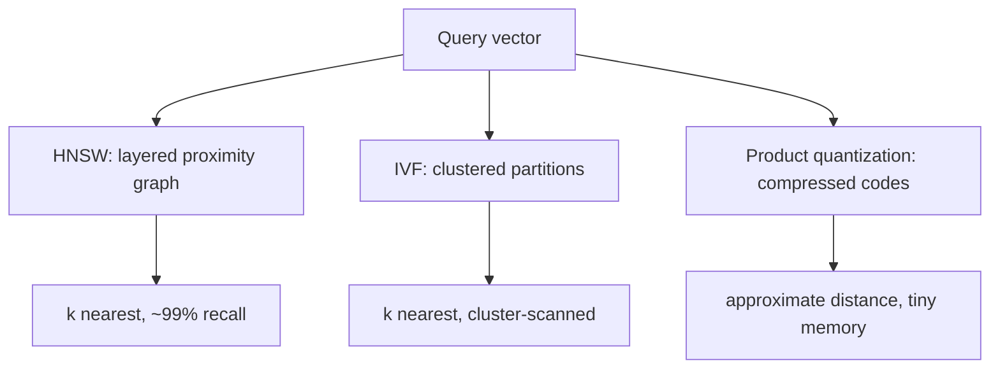

Nearest-neighbor search over a billion
[vectors](/ai-ml/systems/embeddings-vector-representations)
is the [geospatial indexing](/system-design/fundamentals/geospatial-indexing)
problem transplanted into meaning-space: "which k items are closest
to this query point?", asked at query rate, over a set too large to
scan. The exact answer (compare all, sort, take top k) is O(n·d) per
query — seconds over a billion — and the field's answer is
**Approximate Nearest Neighbor (ANN)**: indexes that find
*nearly* the nearest k in *milliseconds*, by giving up some recall
(the guarantee becomes "X% of the true top-k, with high
probability"), and the entire subject is the three structures and
the recall/speed/memory dial that tunes them.

## The idea: prune with geometry

Every ANN index exploits one insight: **the nearest neighbors of a
query are *reachable through* the neighbors of neighbors**, so you
do not need to compare against everything — you need a structure
that lets you *walk toward the answer*, comparing as you go, and
prune the rest. The three families each implement the walk
differently:



## HNSW: the graph walk (the default answer)

**Hierarchical Navigable Small World** ([HNSW](https://en.wikipedia.org/wiki/Hierarchical_Navigable_Small_World_Graph))
is the industry-standard index (pgvector, Pinecone, Qdrant,
Weaviate: everyone's default), and its structure: each vector links
to its **nearest neighbors as a graph**, in **layers** — a sparse
top layer (long-range edges, coarse navigation: "the general
direction"), each layer down denser (shorter edges, fine
navigation), and the search *greedily descends*: enter at the top,
walk toward the query's neighborhood, drop a layer, walk finer,
and end at the bottom layer's local cluster, comparing against a
few hundred candidates.

```cpp
// The search, in miniature (one layer's greedy walk):
std::vector<Id> searchLayer(const Vector& query, Id entry, int layer,
                           int maxCandidates) {
    PriorityQueue<Id, double> best;          // closest first
    std::unordered_set<Id> visited;
    best.push(entry, distance(query, entry));
    // Expand the closest unexpanded node's neighbors until the
    // frontier stops improving: the "walk toward the answer".
    while (best.hasUnexpanded() && best.size() < maxCandidates) {
        Id node = best.popUnexpanded();
        for (Id neighbor : graph_[node][layer]) {
            if (visited.count(neighbor)) {
                continue;
            }
            visited.insert(neighbor);
            best.push(neighbor, distance(query, neighbor));
        }
    }
    return best.topK();
}
```

The parameters that are the design conversation:
`M` (edges per node: more = better recall, more memory) and
`efSearch` (the frontier width at query time: the *runtime-tunable*
recall/speed dial, which is why HNSW is "good enough" for most:
you trade at query time, not rebuild time). The costs: **the
graph is memory-heavy** (the edges are ~2-4x the vector data), and
**the build is incremental** (insert each vector, connect to its
found neighbors: a real
[write path](/system-design/hld/distributed-cache), unlike the
cluster-rebuild indexes), which is why HNSW's *update* story is
good and its memory story is the cost.

## IVF: the cluster scan (the coarse-to-fine)

**Inverted File Index** ([IVF](https://en.wikipedia.org/wiki/Inverted_index#In_nearest_neighbor_search))
is the [geospatial](/system-design/fundamentals/geospatial-indexing)
cell idea transplanted: **cluster the vectors**
([k-means](https://en.wikipedia.org/wiki/K-means_clustering)-style:
a thousand centroids for a billion vectors), each vector assigned
to its nearest centroid, and the query compares against the
**nearest few centroids**, then scans *only those clusters*
(~1/100th of the data, if the clustering is honest). The design
conversation: `nprobe` (how many clusters to scan: the
recall/speed dial, again), and the build (a full
[k-means](https://en.wikipedia.org/wiki/K-means_clustering) pass:
an [offline batch](/ai-ml/systems/batch-vs-real-time-prediction)
job, per version), and IVF composes beautifully with the
compression family below (IVF-PQ: the production stack of the
billion-scale systems).

## Product quantization: the compression (paying memory with recall)

The memory problem (a billion 300-dim float vectors = 1.2 TB) meets
its answer in **PQ** ([product quantization](https://en.wikipedia.org/wiki/Product_quantization)):
split each vector into 8 chunks of ~37 dims each, **compress each
chunk independently** to an 8-bit code (a codebook of 256
prototypes per chunk, learned offline), and the stored item is 64
bytes of codes plus a shared codebook. Distance is then
**approximated from the codebooks** (the sum of chunk-code
distances: precomputed in a tiny table, so a distance estimate is
~8 lookups and adds instead of a 300-dim dot product), giving
~10-50x memory reduction at a *real* recall cost (the estimates
are coarse: the recall dial is the codebook size and the
re-rank step). The production stack — **IVF-PQ**: cluster the
compressed codes, scan the nearest clusters, **re-rank the top
candidates with the full vectors** (store the originals too, and
the approximate pass only narrows: the
[filter-then-refine](/system-design/fundamentals/geospatial-indexing)
discipline, applied at vector scale) — is how the billion-item
systems actually ship.

## The recall/speed/memory dial, formalized

The honest engineering conversation, per index:

| Index | Memory | Recall | Build | Best when |
| --- | --- | --- | --- | --- |
| Flat (exact) | 100% | 100% | none | n in millions, answers must be exact |
| HNSW | ~110-150% | ~95-99.9% (`efSearch`) | incremental | the default: millions-billions, mutable |
| IVF | ~110% | tunable (`nprobe`) | batch, per version | clustered data, composability |
| IVF-PQ | ~10-25% | lower + re-rank | batch | billion-scale, memory-bound |

The dial, stated as the design rule: **pick the structure by which
constraint binds** (memory: PQ; recall: HNSW with high `efSearch`;
simplicity: IVF), then tune the parameter that the structure
exposes (`efSearch`, `nprobe`: both are *runtime* knobs, which is
why the modern [vector databases](/ai-ml/systems/vector-databases)
expose them as per-query configuration: the same
[load-shedding](/system-design/fundamentals/backpressure-and-flow-control)
trade as every index tier).

## The filtered-query problem

The real-world query is *"nearest neighbors, **where category =
coffee and price < $10**"* — the pure ANN indexes answer
*unconditional* nearness, and the **filter** composes badly (the
filter-then-search (check the filter, then ANN: the filter might
void entire clusters) and the search-then-filter (ANN returns 100
candidates, 3 pass the filter: starved result) are both broken
naively). The standard answers: **pre-filter with the index aware**
(IVF per category: the [partitioning](/system-design/hld/distributed-message-queue)
idea, per filterable dimension), or **in-filter verification during
the walk** (HNSW's per-node filter check: expand only through
matching nodes), and the honest statement that this — *filtered
vector search* — is the actual hard problem of the vector-database
world, not the raw ANN.

## Related concepts

- [Embeddings & Vector Representations](/ai-ml/systems/embeddings-vector-representations):
  the data this index serves, and the metrics it computes.
- [Vector Databases](/ai-ml/systems/vector-databases): the
  store built around these indexes.
- [Geospatial Indexing](/system-design/fundamentals/geospatial-indexing):
  the same problem in physical space, and the filter-then-refine
  idea both use.
- [Design a Distributed Cache](/system-design/hld/distributed-cache):
  the memory-bound tier's sharding economics.
