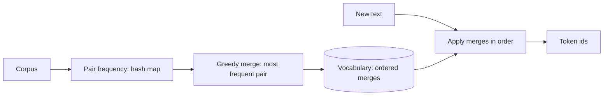

A tokenizer turns text into the integer tokens a model consumes, and
**byte-pair encoding (BPE)** is the standard algorithm (GPT, and most
modern LLMs). It is the *code-level* design of the
[tokenizer](/ai-ml/systems/llm-serving) that the
[LLM-serving page](/ai-ml/systems/llm-serving) mentions as the
unit of cost — here, the *algorithm* and the *data structures*: build
a vocabulary by repeatedly merging the most frequent adjacent pair,
and encode text by applying the merges. It is a [greedy
algorithm](/dsa/patterns/greedy-algorithms) with a
[hash-based](/dsa/patterns/hash-based-structures) counting core, and
a clean LLD because both halves are small and complete.

## The two phases

- **Training (build the vocabulary)**: start from characters (or
  bytes: *byte-level* BPE, the modern default (handles any Unicode)),
  count adjacent pairs in the corpus, merge the *most frequent* pair
  into a new token, repeat for N merges — the vocabulary is the
  *list of merges*, and its size (e.g., 50k tokens) is the
  hyperparameter (the [tokenizer](/ai-ml/systems/llm-serving)'s
  *cost* dial: more tokens = shorter sequences = less context per
  token, the [token-budget](/ai-ml/systems/cost-token-budgets)
  trade).
- **Encoding (apply the vocabulary)**: given text, apply the learned
  merges *in order* (the greedy: repeatedly merge the
  highest-priority pair present) until no merge applies — the output
  is the token sequence.

## The data structures



- **The pair-frequency map** (the counting core: a
  [hash map](/dsa/patterns/hash-based-structures) from *adjacent
  pair* to *count* — the [group-anagrams](/dsa/patterns/hash-based-structures/problems/group-anagrams)
  counting idea, over pairs).
- **The merge list** (the vocabulary *is* the ordered merges: merge
  #1 was applied before merge #2, and *order matters* — the
  encoding applies them in *priority order*, so the vocabulary is a
  *sequence*, not a set: the [ordered](/cpp/map) structure).

## The C++ sketch

```cpp
// Training: build the ordered merge list from a corpus.
class BpeTrainer {
public:
    explicit BpeTrainer(int targetVocabSize) : target_(targetVocabSize) {}

    // Returns the merges in order (each: a pair of token ids -> new id).
    std::vector<std::pair<std::pair<int, int>, int>> train(
        const std::vector<std::string>& corpus) {
        // Tokenize to bytes (ids 0..255): the byte-level base vocabulary.
        std::vector<std::vector<int>> words;
        for (const std::string& word : corpus) {
            words.push_back(toBytes(word));
        }

        std::vector<std::pair<std::pair<int, int>, int>> merges;
        int nextId = 256;                     // byte ids 0..255 taken

        while (nextId < target_) {
            // Count adjacent pairs across all words (the hash-map core).
            std::map<std::pair<int, int>, int> pairCounts;
            for (const auto& word : words) {
                for (size_t i = 0; i + 1 < word.size(); ++i) {
                    ++pairCounts[{word[i], word[i + 1]}];
                }
            }
            if (pairCounts.empty()) {
                break;
            }
            // The greedy: the most frequent pair (the [greedy] choice).
            auto best = std::max_element(
                pairCounts.begin(), pairCounts.end(),
                [](const auto& a, const auto& b) { return a.second < b.second; });
            auto pair = best->first;

            merges.push_back({pair, nextId});
            // Apply the merge in place across all words.
            for (auto& word : words) {
                mergeInWord(word, pair, nextId);
            }
            ++nextId;
        }
        return merges;
    }

private:
    static std::vector<int> toBytes(const std::string& s) {
        return std::vector<int>(s.begin(), s.end());   // byte-level base
    }

    static void mergeInWord(std::vector<int>& word,
                            const std::pair<int, int>& pair, int newId) {
        std::vector<int> out;
        for (size_t i = 0; i < word.size(); ++i) {
            if (i + 1 < word.size() && word[i] == pair.first &&
                word[i + 1] == pair.second) {
                out.push_back(newId);          // collapse the pair
                ++i;                            // skip the second element
            } else {
                out.push_back(word[i]);
            }
        }
        word = std::move(out);
    }

    int target_;
};

// Encoding: apply the merges in priority order (the greedy).
class BpeEncoder {
public:
    explicit BpeEncoder(
        const std::vector<std::pair<std::pair<int, int>, int>>& merges) {
        for (size_t i = 0; i < merges.size(); ++i) {
            rank_[merges[i].first] = static_cast<int>(i);   // merge priority
            idOf_[merges[i].first] = merges[i].second;
        }
    }

    std::vector<int> encode(const std::string& text) {
        std::vector<int> ids(text.begin(), text.end());   // start from bytes
        while (ids.size() >= 2) {
            // Find the highest-priority (lowest rank) adjacent pair present.
            int bestRank = INT_MAX;
            int bestIndex = -1;
            for (size_t i = 0; i + 1 < ids.size(); ++i) {
                auto it = rank_.find({ids[i], ids[i + 1]});
                if (it != rank_.end() && it->second < bestRank) {
                    bestRank = it->second;
                    bestIndex = static_cast<int>(i);
                }
            }
            if (bestIndex < 0) {
                break;                          // no merge applies: done
            }
            int newId = idOf_[{ids[bestIndex], ids[bestIndex + 1]}];
            ids[bestIndex] = newId;             // collapse
            ids.erase(ids.begin() + bestIndex + 1);
        }
        return ids;
    }

private:
    std::map<std::pair<int, int>, int> rank_;   // pair -> merge order
    std::map<std::pair<int, int>, int> idOf_;   // pair -> new token id
};
```

The design decisions:

- **Byte-level base** (start from bytes, not characters: handles
  *any* input (no unknown-token problem) — the modern default, and
  the reason the vocabulary is a *byte* vocabulary plus merges).
- **The merge *order* is the vocabulary** (the encoder applies
  merges by *rank*, not by "any applicable": the order is what
  makes the tokenization *deterministic* and *canonical* — the same
  text always tokenizes the same way, which the
  [reproducibility](/ai-ml/systems/reproducibility-metadata)
  discipline requires).
- **The greedy pair choice** (the most frequent pair: the
  [greedy](/dsa/patterns/greedy-algorithms) algorithm, and the
  reason BPE is *suboptimal* but *fast* and *good enough* — the
  honest [greedy-vs-optimal](/dsa/patterns/greedy-algorithms) trade,
  at the tokenizer layer).
- **The encoding is a *priority scan*** (find the highest-priority
  applicable pair, merge, repeat: the naive O(n²)-ish loop — real
  tokenizers use a heap/linked-list optimization, but the *naive*
  form is the *clear* one, and the LLD's point is the algorithm, not
  the constant factor).

## Related concepts

- [LLM Serving Basics](/ai-ml/systems/llm-serving): tokens and
  why the count matters.
- [Cost & Token Budgets](/ai-ml/systems/cost-token-budgets):
  the vocabulary-size trade.
- [Hash-Based Structures](/dsa/patterns/hash-based-structures) and
  [Greedy Algorithms](/dsa/patterns/greedy-algorithms): the DSA the
  algorithm rides.
- [Reproducibility & Metadata](/ai-ml/systems/reproducibility-metadata):
  why the merge order matters.
