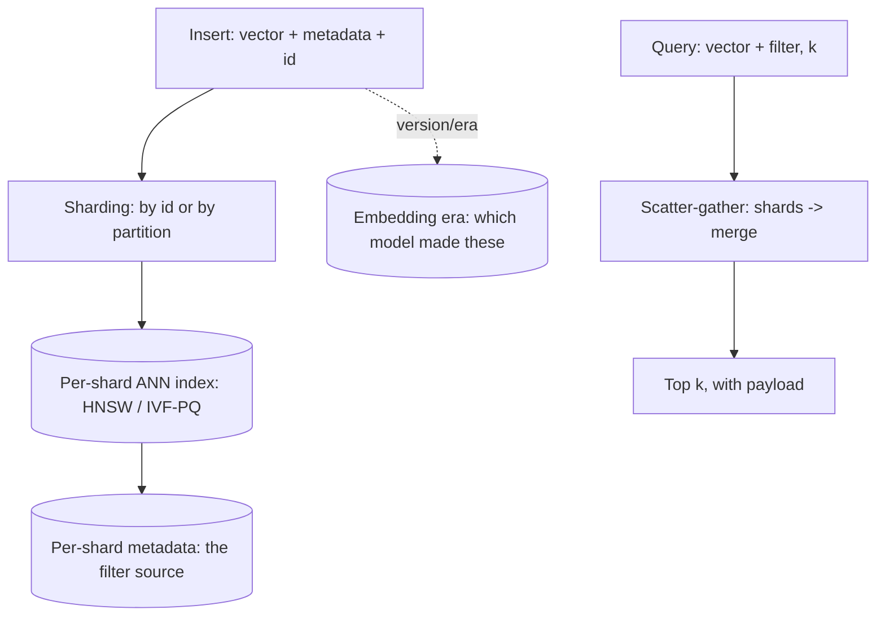

A vector database is a **store whose primary access pattern is
"nearest neighbors by meaning"**: a billion
[embeddings](/ai-ml/systems/embeddings-vector-representations)
indexed by [ANN](/ai-ml/systems/similarity-search-ann),
queried by distance, with *metadata and filters riding along*
(the real query is always "nearest **and** filtered"). The category
exists as a category, Pinecone, Qdrant, Weaviate, Milvus, and the
vector types inside Postgres ([pgvector](https://github.com/pgvector/pgvector))
and the search engines, because the access pattern is
sufficiently different from both SQL (no exact-match primary path)
and [document search](/system-design/fundamentals/search-and-inverted-index)
(no term postings: geometry instead of tokens) that bolting it onto
either is awkward at scale, and the design question is always
"which store, at which scale, for which query mix".

## What the store must do beyond the index

The [ANN index](/ai-ml/systems/similarity-search-ann) is the
engine, but the *database* around it earns its name with the
store-level features, each a systems decision:

- **Vector + payload together** (the item's vector, its id, and its
  *metadata*: category, price, text, availability: the
  [dual-write consistency](/system-design/fundamentals/distributed-transactions)
  question, because the metadata lives in the source system *and*
  here): the store must answer "vector *with* its payload",
  atomically, or the retrieval layer (which fetches the real
  document after the ANN narrows) is doing a fragile join.
- **Filtered search** (the [filtered-query
  problem](/ai-ml/systems/similarity-search-ann): "nearest
  where category = X", the *actual* production query, and the store
  must implement one of the real answers, index-aware filtering,
  per-filter partitions, rather than the naive search-then-filter
  that starves results).
- **Hybrid search** (the merge of the
  [inverted index](/system-design/fundamentals/search-and-inverted-index)
  and the vector index: "matches the terms **and** near the
  meaning", ranked by a blend: the modern default for text
  retrieval, and the reason the vector store and the search
  engine are converging into one product with two index types).
- **Updates and eras** (the [embedding
  versioning](/ai-ml/systems/data-versioning-lineage)
  problem: a new embedding model means re-embedding everything,
  and the store must support *era migration*, the dual-index
  during the re-embed, the cutover, the old era's retirement,
which is the [strangler](/system-design/hld/large-scale-migration)
  discipline, applied to a vector space).
- **Persistence and rebuilds** (the index is
  [memory-heavy](/ai-ml/systems/similarity-search-ann): HNSW's
  graph, IVF's clusters: and the store's durability answer is
  either log-and-rebuild (the vector data is the source of truth,
  the index is [derived](/system-design/fundamentals/event-sourcing-and-cqrs)
  and rebuildable) or snapshot-plus-incremental, the
  [standard trade](/system-design/hld/object-storage-system)).

## The sharding and scale shape

The [sharding](/system-design/fundamentals/consistent-hashing) of
a vector store: **by entity id** (the metadata and vectors colocated,
each shard a complete ANN index over its slice: the query fans out
to all shards, merges top-k, the
[scatter-gather](/system-design/hld/proximity-service) shape, at
~10x the fan-out of a geo query), with the honest costs: the
*fan-out latency* (every query touches every shard: N shards = N
round trips, merged: the
[load balancer](/system-design/fundamentals/load-balancing)'s
least-connections is wrong here, it's always "all"), and the
*skew* (a shard of hot entities vs cold: the
[partition-by-key](/system-design/hld/distributed-message-queue)
skew, which the entity-hash avoids at the price of
hot-shard inability to split without re-embedding).

The memory economics: the [PQ](/ai-ml/systems/similarity-search-ann)
compression tier (10-25% of the raw vectors), the raw tier held
for [re-ranking](/ai-ml/systems/similarity-search-ann) (the
full vectors, fetched for the top ~100: the
[filter-then-refine](/system-design/fundamentals/geospatial-indexing)
discipline), and the ratio (1 TB of raw vectors = ~150-250 GB
index + ~100-250 GB raw-for-rerank, per
[the arithmetic](/system-design/fundamentals/capacity-planning-and-estimation)):
the vector store's *bill* is the memory tier, which is why the
compression family exists.

## Choosing: the real decision tree

The honest guidance, per scale and query mix:

- **Under ~a million vectors, with a database already in the
  stack**: the vector *type* in the existing store
  ([pgvector](https://github.com/pgvector/pgvector)-class: the
  ANN index inside Postgres, one system, one transaction, one
  backup: the
  [monolith](/system-design/fundamentals/microservices-vs-monolith)'s
  quiet win), and the answer for most products for a long time.
- **Millions-to-billions, or heavy filtered/hybrid search, or
  multi-tenant isolation**: the dedicated store (its
  [sharding](/system-design/fundamentals/consistent-hashing), its
  filtered-search implementations, its era-migration tooling),
  as infrastructure bought rather than built.
- **The lakehouse answer** (the emerging third option): vectors as
  columns in the [warehouse](/system-design/fundamentals/olap-vs-oltp)
  / [lake](/system-design/fundamentals/object-storage), with ANN
  indexes over them and the *same* store serving both the SQL and
  the vector query: the convergence story, and the reason the
  category boundary is moving.

The design conversation, always: *what is the query mix?* (pure
ANN: any store; filtered/hybrid: the store's filter quality; SQL +
vectors together: the convergence answer), *what is the write
rate?* (the [HNSW incremental](/ai-ml/systems/similarity-search-ann)
vs IVF-rebuild trade), and *what era is the embedding?*
(the [versioning](/ai-ml/systems/data-versioning-lineage)
discipline, which the store must support or the migration becomes
a manual project).

## Related concepts

- [Embeddings & Vector Representations](/ai-ml/systems/embeddings-vector-representations):
  the data model.
- [Similarity Search & ANN](/ai-ml/systems/similarity-search-ann):
  the engine (HNSW/IVF/PQ, the dial, the filtered-query problem).
- [Search & Inverted Index](/system-design/fundamentals/search-and-inverted-index):
  the term-based sibling, and the hybrid merge.
- [Design a Distributed Cache](/system-design/hld/distributed-cache):
  the memory-bound tier's sharding economics.
- [Geospatial Indexing](/system-design/fundamentals/geospatial-indexing):
  the same nearest-neighbor store in physical space.
