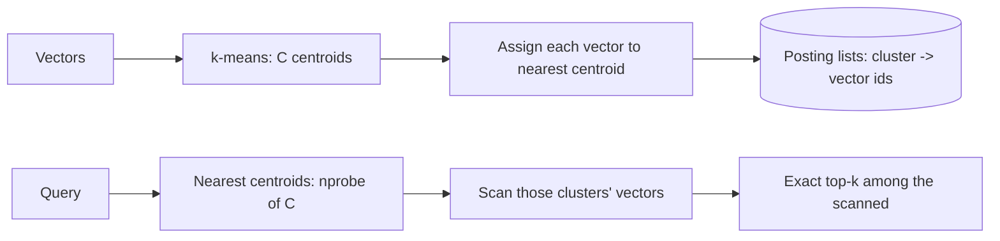

The [similarity-search concept](/ai-ml/systems/similarity-search-ann)
covers HNSW, IVF, and PQ; this is the *code-level* design of a
*minimal* ANN index — the smallest structure that answers "the
nearest k of N vectors" without comparing all N. The honest teaching
choice: implement the **IVF (inverted-file) index**, because it is
the *simplest* real ANN (clustering + a cluster scan) and its
recall/speed dial (`nprobe`) is the whole lesson — the LLD is about
the *structure* and the *approximation*, not the HNSW graph's
constant factors.

## The requirements (as code)

- `build(vectors) -> index` (offline: cluster + assign).
- `search(query, k, nprobe) -> ids` (online: the approximate
  nearest-k).
- The *dial*: `nprobe` (how many clusters to scan: the
  recall/speed trade, exposed as a *parameter*).
- Bounded build (the clustering is the cost).

## The structure



- **The centroids** (k-means over the vectors: C cluster centers —
  the [clustering](/ai-ml/systems/similarity-search-ann), and
  the *build* cost).
- **The posting lists** (per cluster, the ids of its assigned
  vectors: the [inverted-index](/system-design/fundamentals/search-and-inverted-index)
  *shape*, over *meaning* instead of terms — the reason it is called
  an "inverted file").
- **The search** (find the `nprobe` nearest centroids to the query,
  then *exactly* scan the vectors in those clusters: the
  [filter-then-refine](/system-design/fundamentals/geospatial-indexing)
  — approximate cluster selection, exact within).

## The C++ sketch

```cpp
class IvfIndex {
public:
    IvfIndex(int numClusters) : numClusters_(numClusters) {}

    // Build: cluster the vectors and assign them (offline, the cost).
    void build(const std::vector<Vector>& vectors) {
        vectors_ = vectors;
        centroids_ = kMeans(vectors, numClusters_);   // the clustering
        postings_.resize(centroids_.size());
        for (size_t id = 0; id < vectors.size(); ++id) {
            int c = nearestCentroid(vectors[id]);      // assign
            postings_[c].push_back(static_cast<int>(id));
        }
    }

    // Search: scan nprobe clusters, exact top-k within (online, the dial).
    std::vector<int> search(const Vector& query, int k, int nprobe) const {
        // The nprobe nearest centroids (approximate region selection).
        std::vector<int> nearest = nearestCentroids(query, nprobe);

        // Exact scan of those clusters' vectors (the refine).
        std::priority_queue<std::pair<float, int>> topK;   // max-heap of k
        for (int c : nearest) {
            for (int id : postings_[c]) {
                float d = distance(query, vectors_[id]);
                if (static_cast<int>(topK.size()) < k) {
                    topK.push({d, id});
                } else if (d < topK.top().first) {
                    topK.pop();                     // keep the k smallest
                    topK.push({d, id});
                }
            }
        }

        std::vector<int> result;
        while (!topK.empty()) {
            result.push_back(topK.top().second);
            topK.pop();
        }
        std::reverse(result.begin(), result.end());   // nearest first
        return result;
    }

private:
    int nearestCentroid(const Vector& v) const {
        int best = 0;
        float bestDist = distance(v, centroids_[0]);
        for (size_t c = 1; c < centroids_.size(); ++c) {
            float d = distance(v, centroids_[c]);
            if (d < bestDist) { bestDist = d; best = static_cast<int>(c); }
        }
        return best;
    }

    std::vector<int> nearestCentroids(const Vector& v, int nprobe) const {
        std::vector<std::pair<float, int>> dists;
        for (size_t c = 0; c < centroids_.size(); ++c) {
            dists.push_back({distance(v, centroids_[c]), static_cast<int>(c)});
        }
        std::partial_sort(dists.begin(),
                          dists.begin() + std::min<int>(nprobe, dists.size()),
                          dists.end());            // the nprobe nearest
        std::vector<int> out;
        for (int i = 0; i < std::min<int>(nprobe, dists.size()); ++i) {
            out.push_back(dists[i].second);
        }
        return out;
    }

    int numClusters_;
    std::vector<Vector> vectors_;
    std::vector<Vector> centroids_;
    std::vector<std::vector<int>> postings_;
};
```

The design decisions:

- **The `nprobe` parameter is the dial** (scan 1 cluster: fast, low
  recall; scan all clusters: exact, slow — the *same* structure,
  *tuned* per query: the [recall/speed/memory
  dial](/ai-ml/systems/similarity-search-ann), and the reason
  a real vector database exposes `nprobe` as per-query config).
- **Approximate selection, exact refinement** (the cluster choice is
  *approximate* (the nearest vector might be in a cluster the
  centroids did not flag), the scan within is *exact* — the
  [filter-then-refine](/system-design/fundamentals/geospatial-indexing)
  pattern, and the reason the *recall* is `P(true neighbor's cluster
  is in the nprobe)`).
- **The k-nearest via a bounded heap** (the
  [top-k](/dsa/patterns/heaps-and-priority-queues) machinery: keep
  a size-k max-heap, replace the worst — the
  [kth-largest](/dsa/patterns/heaps-and-priority-queues/problems/kth-largest-element-in-an-array)
  pattern, over distances).
- **The clustering is the build cost** (k-means over N vectors: the
  [batch](/ai-ml/systems/batch-vs-real-time-prediction) job,
  and the reason IVF *rebuilds* on data change (the
  [HNSW-vs-IVF](/ai-ml/systems/similarity-search-ann)
  freshness trade: IVF is a batch structure, HNSW is incremental)).

## The honest limits (what the minimal version omits)

The real IVF adds: **product quantization** (store *compressed*
vectors in the postings: the [PQ](/ai-ml/systems/similarity-search-ann)
memory reduction, and the approximate distance), a **rerank** with
full vectors (the two-stage), and the **tuning** (the cluster count,
the nprobe, the PQ codebook: the [dial](/ai-ml/systems/similarity-search-ann),
properly). The minimal version above is the *teaching* structure —
the cluster-and-scan idea, clear and complete — and the LLD's point
is that **the ANN's complexity is in the tuning and the compression,
not the concept**, which is one inverted index over meaning.

## Related concepts

- [Similarity Search & ANN](/ai-ml/systems/similarity-search-ann):
  the concept (HNSW, IVF, PQ, the dial).
- [Embeddings & Vector Representations](/ai-ml/systems/embeddings-vector-representations):
  the data.
- [Search & Inverted Index](/system-design/fundamentals/search-and-inverted-index):
  the inverted-file shape.
- [Heaps / Priority Queues](/dsa/patterns/heaps-and-priority-queues):
  the top-k machinery.
- [Design a Vector Database](/ai-ml/systems/vector-databases):
  the store around it.
