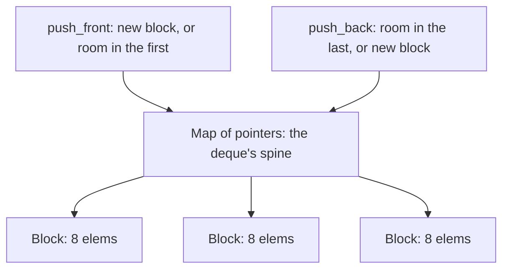

`std::deque` (double-ended queue, "deck") is the container that
gives **O(1) push and pop at *both* ends**, which
[vector](/cpp/vector) cannot (front operations are O(n) shifts)
and [list](/dsa/patterns/linear-structures) cannot do with cache
behavior. Its secret is a structure worth understanding because
it explains its whole personality: **a fixed array of pointers to
fixed-size blocks** ("chunked storage").



- `push_back` fills the last block, allocating a new block when
  full and a new pointer slot in the map when *that* is full:
  amortized O(1), like vector's growth but at both ends.
- `push_front` fills the first block *backward*: the same trick in
  the other direction, which is the whole point.
- Indexing is **two arithmetic steps** (map lookup + block
  offset): O(1), like vector, but *two cache-unfriendly steps*
  (the map, then the block), which is why
  [contiguous](/cpp/vector) still beats it for iteration speed.

## The API surface

```cpp
std::deque<int> d;
d.push_back(x); d.push_front(x);     // O(1) both ends
d.pop_back(); d.pop_front();         // O(1) both ends
d[i]; d.at(i);                       // O(1): map lookup + offset
d.front(); d.back();
d.insert(d.begin() + i, x);         // O(n): shifting (faster at ends)
d.erase(...);
d.resize(n);
// NO d.data(), NO d.reserve(): the block structure has no
// single contiguous buffer to point at or preallocate.
```

## The invalidation rules (the deque's real difference)

- **Insert/erase in the MIDDLE**: iterators invalidated (blocks may
  shift), references *not* invalidated at the ends (elements
  don't move between blocks: only the map's ends shift).
- **push/pop at the ends**: iterators invalidated (formally, the
  standard is conservative), *references to existing elements
  stay valid* (the blocks don't move), which is *better* than
  vector (growth moves everything) and the reason
  deque-backed designs hold element pointers safely.
- The formal rules are fiddly; the practical summary:
  **deque invalidates iterators more readily than vector, but
  invalidates references less readily**, and it is the container
  of choice when you need *both-end* growth with *stable-element*
  guarantees, [the sliding-window
  structures](/dsa/patterns/monotonic-structures) that hold
  indices-into-a-deque rely on exactly this.

## Where this site uses it

The [monotonic deque](/dsa/patterns/monotonic-structures/sliding-window-maximum)
is the canonical consumer: a window's maximum maintained by
pushing/popping at both ends with O(1), which
[the circular-deque design](/dsa/patterns/linear-structures/design-circular-deque)
implements from scratch (a fixed-capacity ring, the same idea with
a single block instead of a block map). The
[priority queue](/cpp/priority-queue) is the *other* end-focused
container, trading order-of-pops (extreme only) for what deque
gives (strict FIFO/LIFO at the ends).
